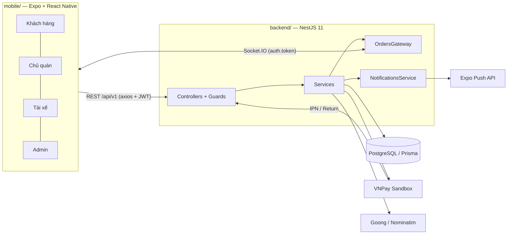
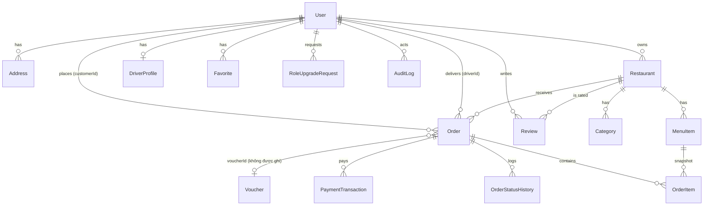
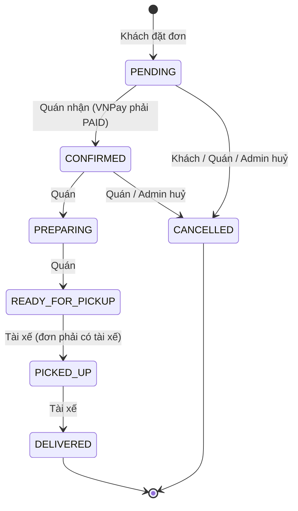
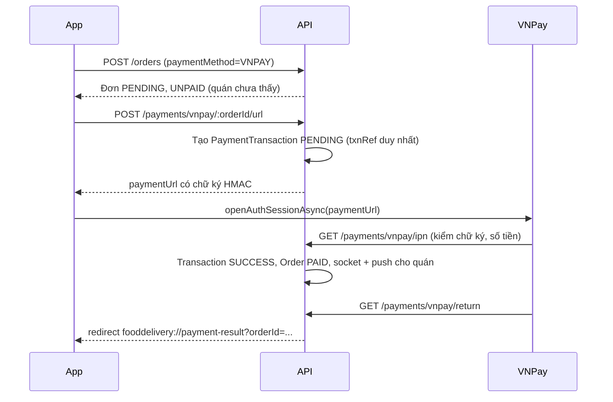

# Sơ đồ & Luồng nghiệp vụ hiện tại của ZomZom

> Báo cáo khảo sát mã nguồn (chỉ đọc), lập ngày 31/10/2026 trên nhánh `redesign/nativewind-ui`.
> Mọi nhận định đều kèm đường dẫn file và số dòng để kiểm chứng. Không có file nào trong `backend/` hoặc `mobile/` bị sửa.

**Quy ước mức độ hoàn thiện**

| Nhãn | Ý nghĩa |
|---|---|
| ✅ `ĐÃ CHẠY THẬT` | Gọi API/DB thật, có kiểm tra phía server |
| ⚠️ `MOCK / VIẾT CỨNG` | Có chạy nhưng dữ liệu/logic viết cứng, giả lập, hoặc chỉ chạy một nửa |
| ❌ `CHỈ CÓ GIAO DIỆN` | Màn hình tĩnh, không có backend tương ứng |

**Lưu ý về phạm vi:** Prompt khảo sát nhắc tới `src/modules/reviews/`, nhưng **thư mục này không tồn tại**. Logic đánh giá nằm trong `orders.service.ts`. Backend cũng **không có** module chat, voucher hay hàng đợi/cron.

---

## Tóm tắt nhanh

| # | Luồng | Mức độ |
|---|---|---|
| 1 | Tìm kiếm, chọn món & tính giá | ✅ Chạy thật (phần voucher ❌) |
| 2 | Vòng đời đơn & máy trạng thái | ✅ Chạy thật (không có timeout) |
| 3 | Tài xế nhận cuốc & vận hành | ✅ Nhận đơn thật / ⚠️ GPS tài xế không bao giờ được gửi lên |
| 4 | Thanh toán & dòng tiền | ✅ COD + VNPay Sandbox / ⚠️ hoàn tiền chỉ là cờ, không có công nợ tài xế |
| 5 | Đánh giá & phản hồi | ✅ Gửi sao thật / ❌ chủ quán không xem/trả lời được |
| 6 | Chat & liên lạc | ❌ Chat giả lập / ⚠️ gọi `tel:` thật ở một số màn, màn "cuộc gọi" là giả |
| 7 | Quản trị & điều hành | ✅ Quản lý user/quán thật / ⚠️ Audit log thiếu nhiều thao tác, không có màn quản lý đơn |

Phát hiện quan trọng nhất (chi tiết ở Phần III):
1. **Ai cũng tự đăng ký được làm Chủ quán hoặc Tài xế qua API**, bỏ qua luồng xin duyệt; chủ quán tự tạo quán không cần duyệt.
2. **4/6 thư mục migration và khoảng 40 file mã nguồn (cả module Drivers) chưa được commit vào git.**
3. **Không có cơ chế hết hạn đơn**: đơn chờ quán hoặc đơn VNPay chưa trả tiền nằm `PENDING` mãi mãi.
4. **Bản đồ theo dõi tài xế không bao giờ có dữ liệu** vì app tài xế không gửi vị trí.

---

## Phần I. Bức tranh tổng thể

### I.1. Kiến trúc

- Xác thực: JWT toàn cục qua `APP_GUARD` (`backend/src/app.module.ts:511-512`). Mọi route cần token trừ khi có `@Public()` (`backend/src/common/guards/jwt-auth.guard.ts`).
- Phân quyền: `@Roles(...)` + `RolesGuard` chỉ so `user.role` trong JWT (`backend/src/common/guards/roles.guard.ts`). Quyền theo đối tượng (đơn của ai, quán của ai) kiểm tra trong service: `canViewOrder` (`backend/src/modules/orders/order-access.ts:10`), `assertCanManage` (`backend/src/modules/restaurants/restaurants.service.ts:310`).
- Access token 15 phút, refresh token 30 ngày, có xoay vòng và thu hồi (`backend/src/config/configuration.ts:67-71`, `backend/src/modules/auth/auth.service.ts:64-94`).
- `JwtStrategy.validate` **không đọc DB** (`backend/src/modules/auth/strategies/jwt.strategy.ts:28-31`). Tài khoản bị khoá vẫn dùng được access token còn hạn (tối đa 15 phút).

### I.2. Actor và ma trận quyền thực tế

Có 4 vai trò trong enum `Role` (`backend/prisma/schema.prisma:12-17`) cộng với khách vãng lai (chưa đăng nhập).

| Chức năng (endpoint) | Vãng lai | CUSTOMER | RESTAURANT_OWNER | DRIVER | ADMIN | Nguồn |
|---|:-:|:-:|:-:|:-:|:-:|---|
| Đăng ký / đăng nhập / refresh | ✔ | | | | | `auth.controller.ts:43-61` |
| **Tự chọn vai trò khi đăng ký** (CUSTOMER/OWNER/DRIVER) | ✔ | | | | | `auth/dto/auth.dto.ts:6,28`; `auth.service.ts:39` |
| Xem quán gần, món gần, chi tiết quán, banner | ✔ | ✔ | ✔ | ✔ | ✔ | `restaurants.controller.ts:30-44,67-71`; `banners.controller.ts` |
| Tra cứu bản đồ (geocode, autocomplete, distance) | | ✔ | ✔ | ✔ | ✔ | `maps.controller.ts` (chỉ cần đăng nhập) |
| Hồ sơ, địa chỉ, yêu thích, push token | | ✔ | ✔ | ✔ | ✔ | `users.controller.ts` |
| Xin nâng cấp vai trò | | ✔ | ✔ | ✔ | ✔ | `role-requests.controller.ts` |
| Đặt đơn, xem đơn của mình, đánh giá | | ✔ | | | | `orders.controller.ts:12-22,68-76` |
| Huỷ đơn (chỉ khi `PENDING`) | | ✔ | | | | `order-state-machine.ts:20,31` |
| Tạo/sửa/xoá quán của mình | | | ✔ | | ✔ | `restaurants.controller.ts:73-94` |
| Quản lý danh mục, món, bật/tắt còn món | | | ✔ | | ✔ | `menus.controller.ts:19-55` |
| Xem đơn của quán, thống kê doanh thu | | | ✔ | | ✔ | `orders.controller.ts:36-44`; `restaurants.controller.ts:53-65` |
| Nhận đơn → Chuẩn bị → Sẵn sàng; huỷ đơn | | | ✔ | | ✔ | `order-state-machine.ts:18` |
| Bật/tắt trực tuyến, cập nhật xe, vị trí | | | | ✔ | | `drivers.controller.ts:12-44` |
| Xem đơn chờ, nhận đơn, thống kê thu nhập | | | | ✔ | | `orders.controller.ts:24-34,46-51,78-81` |
| Lấy món → Giao thành công | | | | ✔ | ✔ | `order-state-machine.ts:19` |
| Chuyển đơn sang bất kỳ trạng thái hợp lệ | | | | | ✔ | `order-state-machine.ts:28` |
| Quản lý user, quán, duyệt vai trò, duyệt tài xế | | | | | ✔ | `admin.controller.ts:29`; `admin-drivers.controller.ts:62` |

Điều hướng mobile chọn bộ tab theo `user.role` (`mobile/src/navigation/AppNavigator.tsx:32-38`):

| Vai trò | Tab | File |
|---|---|---|
| Khách (và vãng lai) | Trang chủ, Đơn hàng, Yêu thích, Tài khoản + stack Giỏ, Checkout, Tracking, Chat, Gọi, Đánh giá, Voucher | `BottomTabNavigator.tsx`, `RootStack.tsx` |
| Chủ quán | Đơn hàng, Thực đơn, Quán + Thống kê | `OwnerTabNavigator.tsx` |
| Tài xế | Đơn chờ, Chuyến của tôi, Hồ sơ + Chi tiết chuyến, Xe, Chat | `DriverTabNavigator.tsx` |
| Admin | Tổng quan, Người dùng, Quán, Hồ sơ | `AdminTabNavigator.tsx` |

### I.3. Danh mục module

| Module | Vai trò | File chính |
|---|---|---|
| Auth | Đăng ký, đăng nhập, refresh/thu hồi token | `backend/src/modules/auth/auth.service.ts`, `strategies/jwt.strategy.ts` |
| Users | Hồ sơ, địa chỉ, yêu thích, push token, xin nâng cấp vai trò | `backend/src/modules/users/*.ts` |
| Restaurants | Tìm quán gần/theo từ khoá, chi tiết + menu, thống kê | `backend/src/modules/restaurants/restaurants.service.ts` |
| Menus | CRUD danh mục và món (xoá mềm) | `backend/src/modules/menus/menus.service.ts` |
| Orders | Đặt đơn, máy trạng thái, nhận đơn, đánh giá, thống kê tài xế | `backend/src/modules/orders/orders.service.ts`, `order-state-machine.ts`, `order-pricing.ts`, `order-access.ts`, `driver-stats.ts` |
| Payments | VNPay Sandbox: tạo URL, IPN, Return | `backend/src/modules/payments/payments.service.ts`, `vnpay.util.ts` |
| Drivers | Hồ sơ xe, trực tuyến, vị trí; admin duyệt | `backend/src/modules/drivers/drivers.service.ts` |
| Maps | Adapter Goong / Nominatim / Fallback | `backend/src/modules/maps/maps.service.ts`, `providers/*.ts` |
| Realtime | Socket.IO: phòng user/order/drivers | `backend/src/modules/realtime/orders.gateway.ts` |
| Notifications | Expo Push | `backend/src/modules/notifications/notifications.service.ts` |
| Admin | Dashboard, user, quán, duyệt vai trò, audit log | `backend/src/modules/admin/admin.service.ts` |
| Banners | Banner trang chủ (chỉ đọc) | `backend/src/modules/banners/banners.controller.ts` |
| Tiện ích | Haversine, phí ship, giờ mở cửa, bỏ dấu tiếng Việt | `backend/src/common/utils/geo.util.ts`, `opening-hours.ts`, `vietnamese.ts` |
| Mobile – API | Gọi REST | `mobile/src/api/*.ts` |
| Mobile – trạng thái | Giỏ hàng, auth, địa chỉ (Zustand) | `mobile/src/store/*.ts` |
| Mobile – realtime | Socket dùng chung | `mobile/src/hooks/useSocket.ts` |

### I.4. Mô hình dữ liệu (rút gọn)

Seed (`backend/prisma/seed.ts`): 8 tài khoản demo dùng chung mật khẩu `Password123!` (dòng 27), banner, 6 voucher, các quán mẫu + menu, đơn mẫu ở nhiều trạng thái (dòng 930-990), 30 đánh giá không gắn với đơn (dòng 998-1010).

---

## Phần II. Bảy luồng nghiệp vụ cốt lõi

### 1. Tìm kiếm, chọn món & tính giá

**[Hiện trạng thực tế]**

*Vị trí dùng để tìm quán và tính giá:*
- Trang chủ, Tìm kiếm, Chi tiết quán dùng **GPS hiện tại** qua `useLocation()` (`mobile/src/screens/home/HomeScreen.tsx:123,165,169`; `screens/search/SearchScreen.tsx:95`; `screens/restaurant/RestaurantDetailScreen.tsx:68`). Bị từ chối quyền vị trí thì dùng toạ độ mặc định Q.1 TP.HCM (`mobile/src/hooks/useLocation.ts`; `mobile/src/constants/config.ts:41-44`).
- Checkout dùng **địa chỉ đã lưu** (mặc định, nếu không có thì địa chỉ đầu tiên) (`mobile/src/screens/checkout/CheckoutScreen.tsx:123-130`). Không có địa chỉ thì không cho đặt (`:139-143`).
- Backend tra lại toạ độ từ `addressId` của chính khách, không tin toạ độ client khi có `addressId` (`backend/src/modules/orders/orders.service.ts:426-436`).
- Store `useDeliveryAddressStore` có quy tắc chọn địa chỉ đầy đủ (chọn tay → mặc định → đầu tiên → GPS), nhưng **chỉ dùng ở màn quản lý địa chỉ**, không dùng ở Trang chủ hay Checkout.

*Tìm quán:*
- SQL thô: lọc thô bằng bounding box rồi tính Haversine trong SQL (`backend/src/modules/restaurants/restaurants.service.ts:35-48,68-106`).
- Không có từ khoá: chỉ trả quán **trong bán kính tìm VÀ trong bán kính giao của quán** (`:93-95`). Không có quán nào thì trả 6 quán gần nhất kèm cảnh báo "ngoài vùng giao" (`:132-151`).
- Có từ khoá: tìm không dấu theo tên quán, mô tả, tên món, trong phạm vi 50 km; quán ngoài vùng giao vẫn hiện với `canDeliver=false` (`:33,79-90,158-166`).
- Món gần bạn: tối đa 30 quán đang nhận đơn, 3 món mới nhất mỗi quán, xếp xen kẽ (`:174-245`).

*Khoảng cách và phí ship:*
- **Đường chim bay (Haversine)** ở cả backend (`backend/src/common/utils/geo.util.ts:10`) và mobile (`mobile/src/utils/fee.ts:22-33`).
- Công thức: `phí = (15.000 + max(0, km − 2) × 5.000) × 1,2 nếu cao điểm`, làm tròn lên 1.000đ (`geo.util.ts:68-81`).
- Cao điểm: 11:00–13:00 và 17:30–19:30 giờ VN, hệ số ×1,2 (`geo.util.ts:49-59,78`). **Viết cứng trong code**, không cấu hình được.
- Phí cơ bản, phí/km, km miễn phí đọc từ `.env` (`backend/src/config/configuration.ts:73-77`), nhưng mobile **viết cứng** cùng giá trị (`mobile/src/utils/fee.ts:42`).
- Maps API có tính "đường bộ" (Goong DistanceMatrix, hoặc Haversine × 1,35) (`backend/src/modules/maps/providers/nominatim-map.provider.ts:127-138`), nhưng **chỉ dùng để hiển thị** ở màn chi tiết chuyến của tài xế (`mobile/src/screens/driver/DriverDeliveryDetailScreen.tsx:140`). Phí tính tiền luôn theo chim bay.
- `estimateDelivery()` (`geo.util.ts:97`) là **code chết**, không có chỗ nào gọi.

*Giờ mở cửa và còn/hết món:*
- Quán nhận đơn khi `isOpen = true` **và** đang trong khung giờ, tính theo giờ VN, hỗ trợ mở qua đêm (`backend/src/common/utils/opening-hours.ts:15-38`).
- Kiểm tra lại khi đặt đơn: quán mở, đúng giờ, trong bán kính giao (`orders.service.ts:91-106`).
- Món: chỉ có cờ `isAvailable` (bật/tắt tay) và `isArchived` (xoá mềm) (`backend/prisma/schema.prisma:182-184`). Đặt đơn từ chối món đã hết/xoá và trả về danh sách id lỗi (`orders.service.ts:108-123`). Chủ quán bật/tắt món trên app (`mobile/src/screens/owner/OwnerMenuScreen.tsx:108-116`).

*Giá món:*
- Server tính lại toàn bộ đơn giá từ DB: giá giảm (nếu hợp lệ) + size + topping; client chỉ gửi id (`backend/src/modules/orders/order-pricing.ts:63-103`; `orders.service.ts:125-147`). Tối đa 50 phần mỗi món (`orders.service.ts:391-424`).
- `total = subtotal + deliveryFee`, **không trừ giảm giá** (`orders.service.ts:156`).

*Voucher:*
- Bảng `Voucher` và cột `Order.voucherId`, `discountAmount` có trong schema và seed (`schema.prisma:206-208,250-270`), nhưng **backend không có API voucher nào**, `CreateOrderDto` không có trường voucher (`orders/dto/orders.dto.ts:57-95`).
- `VoucherSelectScreen` dùng danh sách viết cứng `AVAILABLE_VOUCHERS` (`mobile/src/screens/voucher/VoucherSelectScreen.tsx:27`) và **không có màn nào điều hướng tới**. Checkout hiện ô "Mã giảm giá" mờ, ghi chú "tạm ẩn" (`CheckoutScreen.tsx:340`).

**[Mức độ hoàn thiện]**
- Tìm quán, lọc bán kính, giờ mở cửa, còn/hết món, tính giá món, phí ship: ✅ `ĐÃ CHẠY THẬT`.
- Hệ số cao điểm, cấu hình phí phía mobile: ⚠️ `VIẾT CỨNG`.
- Voucher: ❌ `CHỈ CÓ GIAO DIỆN` (và màn hình không truy cập được).

**[Khoảng trống nghiệp vụ]**
- Trang chủ dùng GPS nhưng Checkout dùng địa chỉ đã lưu. Khách thấy quán "giao được" ở trang chủ nhưng có thể bị từ chối "ngoài bán kính" khi đặt nếu địa chỉ lưu ở xa. Checkout cũng **không cho chọn địa chỉ khác** ngoài địa chỉ mặc định.
- Phí ship theo chim bay, không theo quãng đường thực tế; có thể lệch nhiều ở khu vực có sông, cầu.
- Hai nơi giữ cấu hình phí (env backend và hằng số mobile). Đổi env mà quên đổi mobile thì số tiền hiển thị khác số tiền thu. Mobile làm tròn khoảng cách tới 0,1 km trước khi tính (`fee.ts:32`), backend thì không, nên có thể lệch 1.000đ ở ranh giới.
- Không có phí dịch vụ, phí đơn nhỏ, giá trị đơn tối thiểu, phụ phí thời tiết, hệ số cao điểm theo cung–cầu.
- Không quản lý tồn kho theo số lượng; không có giờ mở cửa theo từng ngày trong tuần, ngày nghỉ lễ.
- Không có voucher thật (kiểm tra điều kiện, giới hạn lượt, trừ tiền, tăng `usedCount`).

---

### 2. Vòng đời đơn hàng & máy trạng thái

**[Hiện trạng thực tế]**

Đồ thị chuyển trạng thái (`backend/src/modules/orders/order-state-machine.ts:6-14`):

Gán tài xế **không phải** một trạng thái. Tài xế "nhận đơn" bằng cách ghi `driverId` khi đơn đang ở `CONFIRMED`, `PREPARING` hoặc `READY_FOR_PICKUP` (`order-state-machine.ts:36`; `orders.service.ts:220-244`).

| Bên | Được chuyển sang | Điều kiện thêm | Nguồn |
|---|---|---|---|
| Khách | `CANCELLED` | Chỉ khi đang `PENDING` | `order-state-machine.ts:20,31` |
| Chủ quán | `CONFIRMED`, `PREPARING`, `READY_FOR_PICKUP`, `CANCELLED` | Phải là chủ quán của đơn; VNPay chưa `PAID` thì không được `CONFIRMED` | `order-state-machine.ts:18`; `orders.service.ts:192-194,381` |
| Tài xế | `PICKED_UP`, `DELIVERED` | Phải là tài xế đã nhận đơn | `order-state-machine.ts:19`; `orders.service.ts:189-191,382` |
| Admin | Mọi bước hợp lệ | Không | `order-state-machine.ts:28` |

Các cơ chế đã có:
- Tạo đơn trong một transaction, phát sự kiện socket **sau khi commit** (`orders.service.ts:88-173`).
- Khoá lạc quan: `updateMany WHERE status = trạng thái vừa đọc`; nếu ai đó đổi trước thì trả 409 (`orders.service.ts:196-207`).
- Mỗi lần đổi trạng thái ghi `OrderStatusHistory` kèm `changedBy` (`orders.service.ts:209`).
- COD giao xong thì tự chuyển `paymentStatus = PAID`; huỷ đơn đã trả online thì đặt `REFUNDED` (`orders.service.ts:202-204`).
- Socket: `order:created`, `order:status`, `order:driver_assigned`, `order:payment` gửi tới phòng đơn, khách, chủ quán, tài xế (`backend/src/modules/realtime/orders.gateway.ts:119-124`). Đơn chuyển `CONFIRMED` mà chưa có tài xế thì phát `order:available` cho phòng `drivers` (`orders.service.ts:214`).
- Push: chủ quán nhận khi có đơn mới (COD) hoặc khi VNPay thanh toán xong; khách nhận khi đổi trạng thái và khi có tài xế (`backend/src/modules/notifications/notifications.service.ts:38-77`).
- Mobile: khách theo dõi đơn bằng socket + polling 10 giây (`mobile/src/services/useOrders.ts:17-22`); chủ quán chuyển trạng thái bằng nút (`mobile/src/screens/owner/OwnerOrdersScreen.tsx:49-78`).

*Timeout:* **Không có.** Backend không cài `@nestjs/schedule`, không có cron, không có hàng đợi (`backend/package.json`; tìm `Cron|setInterval` trong `backend/src` không ra kết quả nào ngoài bộ giới hạn tốc độ của Maps).

**[Mức độ hoàn thiện]** ✅ `ĐÃ CHẠY THẬT` cho máy trạng thái, phân quyền, chống tranh chấp, lịch sử, realtime, push. Timeout: ❌ chưa có.

**[Khoảng trống nghiệp vụ]**
- Không tự huỷ đơn khi quán không nhận sau N phút, khi không có tài xế nhận, hoặc khi đơn VNPay không thanh toán. Các đơn này kẹt ở `PENDING`/`CONFIRMED` vô thời hạn.
- Huỷ đơn **không có lý do**, không phân biệt ai huỷ (chỉ có `changedBy`), không có phí huỷ.
- Quán có thể huỷ đơn `CONFIRMED` dù tài xế đã nhận và đang đến quán. Tài xế chỉ được báo qua socket, **không có push** cho tài xế.
- Sau `PREPARING` thì không ai (trừ admin) huỷ được, kể cả khi quán hết nguyên liệu hoặc tài xế bỏ đơn.
- Không có trạng thái "tài xế đã đến quán", "giao thất bại", "khách không nhận", không có ảnh xác nhận giao (proof of delivery), không có OTP nhận hàng.
- Tài xế không thể trả đơn đã nhận (không có API huỷ nhận).
- Không có thời gian dự kiến (ETA) lưu theo đơn; mobile tự ước tính từ khoảng cách.

---

### 3. Tài xế nhận cuốc & vận hành

**[Hiện trạng thực tế]**

*Cơ chế tìm đơn:* **Tài xế tự chọn trong danh sách chung**, không bắn đơn (dispatch), không lọc bán kính.
- `GET /orders/available` trả **mọi đơn chưa có tài xế** ở `CONFIRMED`/`PREPARING`/`READY_FOR_PICKUP` (bỏ đơn VNPay chưa trả tiền) trên toàn hệ thống, xếp cũ nhất trước, **không có điều kiện vị trí** (`backend/src/modules/orders/orders.service.ts:297-300`).
- Socket `order:available` gửi cho **mọi tài xế đang kết nối** trong phòng `drivers`, kể cả tài xế đang ngoại tuyến hoặc chưa được duyệt (`orders.gateway.ts:65,126-128`).
- Mobile: polling 8 giây khi trực tuyến + nghe socket (`mobile/src/screens/driver/DriverAvailableOrdersScreen.tsx:134-182`).
- Nhận đơn atomic: `updateMany WHERE driverId IS NULL`, chỉ một tài xế thắng (`orders.service.ts:231-239`). Tối đa 2 đơn cùng lúc (`orders.service.ts:58,223-230`).
- Điều kiện nhận: tài khoản hoạt động, hồ sơ `APPROVED`, đang trực tuyến (`orders.service.ts:247-272`).

*Trực tuyến/Ngoại tuyến:*
- `PATCH /drivers/me/status` lưu `isOnline` (và vị trí nếu gửi kèm) vào `DriverProfile`; chỉ hồ sơ `APPROVED` mới bật được (`backend/src/modules/drivers/drivers.service.ts:151-190`). Admin từ chối/tạm khoá thì tự tắt trực tuyến (`:288`).
- Mobile gửi vị trí **một lần** lúc bật công tắc (`DriverAvailableOrdersScreen.tsx:109-114`).

*Vị trí GPS:*
- Backend có 2 đường: REST `PATCH /drivers/me/location` (giới hạn 1 lần/15 giây, lưu DB) (`drivers.service.ts:23,192-216`) và socket `driver:location` (kiểm tra tài xế có đơn đang chạy rồi phát cho phòng đơn, không lưu DB) (`orders.gateway.ts:91-115`).
- Khách nghe `driver:location` để vẽ tài xế lên bản đồ (`mobile/src/screens/order/OrderTrackingScreen.tsx:51-66`).
- **Nhưng app tài xế không gửi vị trí ở đâu cả.** `driversApi.updateLocation` có khai báo (`mobile/src/api/drivers.ts:48`) nhưng không màn nào gọi; không có `emit('driver:location')` hay `watchPositionAsync` nào trong `mobile/src`. Vì vậy marker tài xế trên bản đồ của khách **không bao giờ xuất hiện**.

*Vận hành chuyến:*
- Chi tiết chuyến: mở Google Maps/Apple Maps chỉ đường, gọi `tel:` cho khách, xác nhận lấy món / giao xong (`mobile/src/screens/driver/DriverDeliveryDetailScreen.tsx:229-256`).
- Thống kê thu nhập 1/7/30 ngày: thu nhập = tổng phí ship đơn đã giao; tiền mặt thu hộ = tổng `total` đơn COD đã giao (`backend/src/modules/orders/driver-stats.ts:16-23,50-57`).

**[Mức độ hoàn thiện]**
- Danh sách đơn, nhận đơn, giới hạn 2 đơn, trực tuyến, duyệt hồ sơ: ✅ `ĐÃ CHẠY THẬT`.
- Theo dõi GPS tài xế: ⚠️ backend sẵn sàng nhưng **mobile không gửi**, thực tế không hoạt động.

**[Khoảng trống nghiệp vụ]**
- Không có điều phối: không lọc theo khoảng cách tài xế–quán, không ưu tiên tài xế gần nhất, không có đếm ngược chấp nhận/từ chối.
- Socket báo đơn mới cho cả tài xế ngoại tuyến/chưa duyệt (chỉ server mới chặn lúc nhận).
- Payload socket chỉ có `{id, status, paymentStatus, driverId, updatedAt}` (`orders.gateway.ts:130-132`), nhưng màn tài xế coi nó là đơn đầy đủ: thông báo hiện "Đơn hàng mới từ Nhà hàng (Phí ship …)" với tên quán và phí rỗng, và chèn bản ghi thiếu dữ liệu vào danh sách cho tới lần polling sau (`DriverAvailableOrdersScreen.tsx:167-178`).
- Thống kê tài xế lọc theo **ngày tạo đơn**, không phải ngày giao (`orders.service.ts:308-312`).
- Không có heartbeat: tài xế tắt app vẫn `isOnline = true` mãi.
- Không có phí/hoa hồng nền tảng: thu nhập tài xế = 100% phí ship.

---

### 4. Thanh toán & dòng tiền

**[Hiện trạng thực tế]**

Phương thức: `COD` và `VNPAY` (`backend/prisma/schema.prisma:29-32`).

*COD:*
- Đơn hiện ngay cho quán, push cho chủ quán (`orders.service.ts:172`).
- Giao thành công thì `paymentStatus` tự thành `PAID` (`orders.service.ts:202`). Tài xế được coi là đã thu đủ `total`.

*VNPay Sandbox:*

- Tạo URL: `backend/src/modules/payments/payments.service.ts:36-100`. IPN idempotent theo trạng thái giao dịch, kiểm chữ ký và số tiền (`:106-180`). Return: `:186-196`.
- Quán và tài xế không thấy đơn VNPay chưa trả tiền (`orders.service.ts:65-67`).
- Mobile: tạo đơn → lấy URL → mở trình duyệt → luôn chuyển sang màn theo dõi đơn, bất kể kết quả thanh toán (`mobile/src/screens/checkout/CheckoutScreen.tsx:165-173`).

*Hoàn tiền:* Huỷ đơn đã `PAID` chỉ **đặt cờ** `REFUNDED` (`orders.service.ts:204`). Không gọi API hoàn tiền VNPay, không có giao dịch hoàn tiền.

*Công nợ tài xế:* **Chưa có bảng nào.** Chỉ có con số `cashCollected` tính tại chỗ trong thống kê (`driver-stats.ts:22-23,51-52`). Không có ví, sổ cái, đối soát hay rút tiền. `DriverProfile` có lưu số tài khoản ngân hàng (`schema.prisma:355-357`) nhưng chưa dùng vào đâu.

**[Mức độ hoàn thiện]**
- COD, VNPay Sandbox (tạo URL, IPN, chữ ký, idempotent): ✅ `ĐÃ CHẠY THẬT`.
- Hoàn tiền: ⚠️ chỉ là cờ trạng thái.
- Công nợ / đối soát tài xế và quán: ❌ chưa có.

**[Khoảng trống nghiệp vụ]**
- Deep link `payment-result` mở **màn Checkout** chứ không phải màn đơn hàng (`mobile/App.tsx:31-32`), và `orderId` trong link chỉ là **8 ký tự đầu** của UUID (`payments.service.ts:190`, do `txnRef = id.slice(0,8)_timestamp`), nên không dùng được để mở đúng đơn.
- Khách huỷ đơn khi đang ở trang VNPay, rồi IPN thành công tới sau: đơn `CANCELLED` bị đặt `PAID` mà không gắn cờ hoàn tiền (`payments.service.ts:150-156` không kiểm trạng thái đơn).
- Không hết hạn đơn VNPay chưa trả; không cho khách thanh toán lại hay đổi sang COD từ app.
- Socket và push trong IPN phát **bên trong** transaction, trước khi commit (`payments.service.ts:137-176`).
- Không có hoa hồng quán, phí nền tảng, đối soát cuối ngày, hoá đơn.
- Tài xế thu COD nhưng hệ thống không theo dõi tài xế đã nộp tiền về hay chưa.

---

### 5. Đánh giá & phản hồi

**[Hiện trạng thực tế]**
- Bảng `Review` chỉ liên kết **Quán + Khách**: `restaurantId`, `customerId`, `rating`, `comment` (`backend/prisma/schema.prisma:285-298`). **Không có** `orderId`, không đánh giá tài xế, không đánh giá món.
- `POST /orders/:id/review` (chỉ khách): đơn phải `DELIVERED` (`orders.service.ts:328-331`). Chống đánh giá trùng bằng cách đếm: số đánh giá của khách cho quán không vượt số đơn đã giao (`:333-340`, chính code ghi chú "Bảng reviews chưa có cột orderId").
- Cập nhật `Restaurant.rating` = trung bình, làm tròn 1 chữ số, trong cùng transaction (`:342-352`).
- Mobile: chọn 1–5 sao, chọn thẻ ("Món ăn ngon", "Tài xế thân thiện"…), nhập bình luận. **Gửi lên chỉ `rating` và `comment`**, thẻ được nối vào chuỗi bình luận (`mobile/src/screens/rating/RatingScreen.tsx:20-27,38-43`). `driverName` được truyền vào màn nhưng không gửi đi.
- Lối vào màn đánh giá: nút trên màn theo dõi đơn (`mobile/src/screens/order/OrderTrackingScreen.tsx:95-101`).
- **Không có API đọc danh sách đánh giá** (công khai hay cho chủ quán). Chủ quán **không có màn xem hay trả lời đánh giá**.

**[Mức độ hoàn thiện]** Gửi sao và cập nhật điểm quán: ✅ `ĐÃ CHẠY THẬT`. Thẻ phản hồi: ⚠️ chỉ thành chữ trong bình luận. Xem/trả lời đánh giá: ❌ chưa có.

**[Khoảng trống nghiệp vụ]**
- Thiếu khoá duy nhất `orderId`: không biết đánh giá thuộc đơn nào, chống trùng chỉ dựa vào phép đếm (dễ lệch khi có dữ liệu cũ).
- Không đánh giá tài xế, không đánh giá món, không ảnh, không thời hạn đánh giá (ví dụ 7 ngày sau giao).
- Không có trả lời của chủ quán, báo cáo đánh giá xấu, ẩn/kiểm duyệt bởi admin.
- `Restaurant.rating` là số trung bình lưu sẵn; không có số lượt đánh giá đi kèm.

---

### 6. Chat & liên lạc

**[Hiện trạng thực tế]**

*Chat:* **Hoàn toàn giả lập trên máy.**
- 4 tin nhắn mẫu viết cứng (`mobile/src/screens/chat/ChatScreen.tsx:28-53`).
- Tin gửi đi chỉ thêm vào state cục bộ; sau 2 giây tự sinh câu trả lời giả "Dạ vâng, em nhận được thông tin rồi ạ…" (`:72-101`).
- Gửi ảnh chỉ hiện ảnh cục bộ, không tải lên (`:103-130`).
- Backend không có module chat, không có bảng tin nhắn, gateway không có sự kiện chat. **Không lưu DB, không broadcast.**
- Lối vào: chỉ từ màn chi tiết chuyến của tài xế (`DriverDeliveryDetailScreen.tsx:258-265`). Khách **không có nút chat** trên màn theo dõi đơn.

*Gọi điện:*
- Khách gọi tài xế (`OrderTrackingScreen.tsx:86-93`) và tài xế gọi khách (`DriverDeliveryDetailScreen.tsx:250-256`) dùng **`tel:` qua SIM**, lộ số điện thoại thật của hai bên.
- Màn `DriverCallScreen` là **giao diện cuộc gọi giả**: đồng hồ đếm giờ tự chạy, nút loa/tắt tiếng chỉ đổi state, không có cuộc gọi nào (`mobile/src/screens/call/DriverCallScreen.tsx:14-38`). Số mặc định viết cứng `0908 123 456` (`:16`). Mở từ nút gọi trong màn chat, cũng truyền số viết cứng (`ChatScreen.tsx:132-138`).

**[Mức độ hoàn thiện]**
- Chat: ❌ `CHỈ CÓ GIAO DIỆN` (kèm phản hồi giả lập, dễ làm người dùng tưởng là thật).
- Gọi `tel:`: ✅ chạy thật (qua SIM).
- Màn cuộc gọi trong app: ❌ `CHỈ CÓ GIAO DIỆN`.

**[Khoảng trống nghiệp vụ]**
- Cần chat thật theo đơn: bảng tin nhắn, sự kiện socket theo phòng `order_<id>`, phân quyền bằng `canViewOrder`, đóng chat khi đơn kết thúc, push khi có tin mới.
- Không che số điện thoại (masked call/tổng đài); không có liên hệ quán hay hỗ trợ khách hàng.
- Phản hồi giả lập và số viết cứng nên được gỡ ngay vì có thể gây hiểu nhầm cho người dùng thật.

---

### 7. Quản trị & điều hành

**[Hiện trạng thực tế]**

*Tài khoản người dùng* (`backend/src/modules/admin/admin.service.ts`):
- Danh sách, tìm kiếm, lọc theo vai trò (`:67`).
- Khoá/mở khoá kèm lý do; khoá thì thu hồi refresh token (`:125-149`). Không cho tự khoá hay khoá admin khác.
- Đổi vai trò; chặn nếu chủ quán còn sở hữu quán; thu hồi token; tạo hồ sơ tài xế nếu đổi sang DRIVER; gửi push (`:151-185`).
- Xem hoạt động: audit log, đơn gần đây, yêu cầu nâng cấp, quán sở hữu (`:194-236`).
- Duyệt/từ chối yêu cầu nâng cấp vai trò (`:498-597`). Duyệt/từ chối/tạm khoá tài xế, bắt buộc lý do khi từ chối (`backend/src/modules/drivers/drivers.service.ts:266-300`).

*Quán ăn:* tạo quán kèm tài khoản chủ quán (trả mật khẩu tạm một lần), sửa, gán chủ, tạm ngưng/mở lại, xoá (chặn nếu quán đã có đơn), xoá mềm món (`admin.service.ts:308-388,599-697`).

*Đơn hàng:*
- `GET /admin/orders` liệt kê đơn theo trạng thái (`admin.service.ts:390-418`), **nhưng app mobile không gọi** (không có màn quản lý đơn).
- Admin có thể đổi trạng thái đơn qua `PATCH /orders/:id/status` (`order-state-machine.ts:28`), nhưng app cũng **không có giao diện** cho việc này.
- Không có API cho admin gán/đổi tài xế, hoàn tiền, hay sửa đơn.

*Audit log:* bảng `AuditLog` (`schema.prisma:389-404`), ghi trong cùng transaction với thao tác (`admin.service.ts:55-64`).

| Thao tác nhạy cảm | Có ghi audit? | Nguồn |
|---|:-:|---|
| Khoá / mở khoá user | ✔ | `admin.service.ts:145` |
| Đổi vai trò user | ✔ | `:175` |
| Gán chủ quán | ✔ | `:332,345` |
| Tạm ngưng / mở lại quán | ✔ | `:377-380` |
| Duyệt / từ chối yêu cầu vai trò | ✔ | `:568-571` |
| Tạo quán (kèm tạo user, đổi vai trò người có sẵn) | ✘ | `:599-649` |
| Sửa quán (tên, địa chỉ, toạ độ, isOpen) | ✘ | `:652-670` |
| Xoá quán / xoá món | ✘ | `:673-697` |
| Duyệt / từ chối / tạm khoá tài xế | ✘ (chỉ lưu `verifiedById` trên hồ sơ) | `drivers.service.ts:280-290` |
| Admin đổi trạng thái / huỷ đơn | ✘ (chỉ có `OrderStatusHistory.changedBy`) | `orders.service.ts:209` |
| Chủ quán đổi giá món, sửa quán | ✘ | `menus.service.ts`, `restaurants.service.ts:278-281` |

**[Mức độ hoàn thiện]** Quản lý user, quán, duyệt vai trò, duyệt tài xế: ✅ `ĐÃ CHẠY THẬT`. Audit log: ⚠️ có nhưng thiếu nhiều thao tác. Quản lý đơn trên app admin: ❌ chưa có giao diện.

**[Khoảng trống nghiệp vụ]**
- Không có màn hỗ trợ đơn đang chạy: xem đơn kẹt, huỷ hộ, gán lại tài xế, hoàn tiền, ghi chú khiếu nại.
- Không có quản lý voucher, banner, cấu hình phí trong trang admin.
- Không có phân cấp quyền admin (ví dụ admin vận hành và admin tài chính).
- Mật khẩu tạm chủ quán dạng `Owner@` + 6 chữ số (`admin.service.ts:613`), không bắt đổi khi đăng nhập lần đầu.

---

## Phần III. Rủi ro & đề xuất trước khi nâng cấp

### III.1. Rủi ro dữ liệu (khi chạy `prisma migrate`)

1. **Migration chưa được commit.** `git status` cho thấy 4/6 thư mục migration đang ở trạng thái chưa theo dõi (`??`): `20261030130000_driver_profile`, `20261030200000_admin_role_requests_audit`, `20261030220000_user_username`, `20261030230000_user_favorites`. Máy khác clone về chạy `migrate deploy` sẽ thiếu bảng `driver_profiles`, `vouchers`, `reviews`, `audit_logs`, `favorites`… trong khi code đã dùng chúng. Không chỉ migration: cả module `backend/src/modules/drivers/`, `opening-hours.ts`, `vietnamese.ts`, `driver-stats.ts`, `role-requests.*`, `favorites.service.ts`, `DriverDeliveryDetailScreen.tsx`, `mobile/src/api/drivers.ts`… cũng chưa được theo dõi (khoảng 40 file). Các file đã sửa (ví dụ `app.module.ts` import `DriversModule`) phụ thuộc vào những file mới này, nên commit thiếu sẽ **không build được**. **Cần commit trước mọi thay đổi schema tiếp theo.**
2. **Hai migration "init".** `20261029000000_init` tạo bảng; `20261029041931_init` chỉ `DROP DEFAULT` cột id. Không lỗi, nhưng tên gây nhầm; DB nào từng chạy `db push` có thể lệch lịch sử migration và bị Prisma đòi reset.
3. **Bảng `reviews` không có `orderId`.** Khi thêm `orderId @unique` (quan hệ 1-1 với đơn):
   - Các đánh giá đang có (30 bản ghi seed và mọi đánh giá thật) không gắn với đơn nào → cột phải **nullable** hoặc backfill trước, nếu không migration sẽ lỗi `NOT NULL`.
   - Có thể có nhiều đánh giá cùng cặp khách–quán, nên backfill theo cặp này sẽ vấp ràng buộc `UNIQUE`.
   - Khoá ngoại hiện có: `restaurantId` và `customerId` đều `ON DELETE CASCADE` (`migrations/20261030200000_admin_role_requests_audit/migration.sql:130-133`). Xoá user sẽ xoá luôn đánh giá, làm điểm quán thay đổi mà không tính lại.
4. **`Restaurant.rating` là số tổng hợp lưu sẵn**, không lưu số lượt. Thêm đánh giá tài xế/món hoặc ẩn đánh giá xấu sẽ cần tính lại toàn bộ.
5. **Voucher đang "nửa có nửa không".** `Order.voucherId` và `discountAmount` chỉ có giá trị ở dữ liệu seed (`seed.ts:954-955`); `Voucher.usedCount` không bao giờ tăng. Bật voucher thật cần thêm ràng buộc giới hạn lượt dùng mỗi người, nên có bảng `VoucherRedemption` riêng.
6. **Chưa có bảng cho tính năng mới**: tin nhắn chat, sổ cái/ví tài xế, giao dịch hoàn tiền, lý do huỷ, lịch sử vị trí tài xế.
7. **`AuditLog.targetId` kiểu `@db.Uuid`** (`schema.prisma:395`). Không ghi được đối tượng có khoá không phải UUID (ví dụ `txnRef` của VNPay hay khoá cấu hình).
8. **Giá tuỳ chọn món nằm trong cột JSON `MenuItem.options`** (`schema.prisma:181`). Không có ràng buộc ở mức DB; mọi kiểm tra dựa vào `parseMenuOptions` (`order-pricing.ts:52-61`).

### III.2. Rủi ro hiệu năng & chi phí

**API bản đồ**
- Bộ giới hạn 30 yêu cầu/phút/người và cache đều **nằm trong bộ nhớ một tiến trình** (`backend/src/modules/maps/maps.controller.ts:10-30`; `maps/utils/rate-limiter.util.ts`). Khởi động lại hay chạy nhiều instance là mất. Không có giới hạn tổng theo ngày, trong khi Goong miễn phí 1.000 yêu cầu/ngày (`maps.controller.ts:46`).
- Goong `DistanceMatrix` **không có cache** (`providers/goong-map.provider.ts:126-131`). Màn chi tiết chuyến của tài xế gọi nó mỗi lần dữ liệu đơn thay đổi (`DriverDeliveryDetailScreen.tsx:133-171`).
- `FallbackMapProvider` gọi thẳng Nominatim **không qua bộ giới hạn tốc độ** (`providers/fallback-map.provider.ts:17,46,69`), dễ vi phạm chính sách 1 yêu cầu/giây của Nominatim và bị chặn IP.
- Màn chọn địa chỉ đã debounce khi kéo bản đồ (`mobile/src/screens/profile/AddressPickerScreen.tsx:131-134`). Đây là điểm tốt cần giữ.

**Socket & polling**
- Mọi trạng thái socket nằm trong bộ nhớ, **không có Redis adapter**. Không chạy được nhiều instance backend mà không mất sự kiện.
- Socket mobile tạo một lần với token lúc đó (`mobile/src/hooks/useSocket.ts:41-46`). Access token hết hạn sau 15 phút, mất kết nối thì reconnect bằng token cũ → bị từ chối → sau 5 lần thử thì bỏ hẳn. App chỉ còn chạy nhờ polling.
- Polling chồng lên socket: tài xế 8 s + 10 s + 30 s (`DriverAvailableOrdersScreen.tsx:68-80,140`), chủ quán 2 × 10 s (`OwnerOrdersScreen.tsx:116,127`), chi tiết đơn 10 s (`useOrders.ts:21`). Với 1.000 người dùng đang mở app, ước tính khoảng 100–300 yêu cầu/giây chỉ cho polling.
- `order:available` phát cho mọi tài xế đang kết nối, không lọc vùng; mỗi tài xế sau đó tự gọi lại API.
- Khi bật GPS tài xế, handler `driver:location` **truy vấn DB mỗi lần nhận vị trí** (`orders.gateway.ts:107-110`). Gửi vị trí mỗi 3–5 giây × nhiều tài xế sẽ tạo tải DB đáng kể; nên cache quyền theo phiên socket.

### III.3. Rủi ro bảo mật phát hiện thêm

- **Tự nâng vai trò khi đăng ký:** `POST /auth/register` nhận `role` là `RESTAURANT_OWNER` hoặc `DRIVER` (`backend/src/modules/auth/dto/auth.dto.ts:6,26-29`; `auth.service.ts:39`). App mobile không gửi trường này, nhưng gọi API trực tiếp thì được. Chủ quán tự đăng ký có thể **tạo quán ngay** qua `POST /restaurants` mà không cần admin duyệt (`restaurants.controller.ts:73-78`). Điều này vô hiệu hoá luồng `RoleUpgradeRequest`. (Tài xế vẫn bị chặn ở bước duyệt hồ sơ.)
- Tài khoản bị khoá vẫn dùng được access token còn hạn tối đa 15 phút, kể cả socket đang mở (`jwt.strategy.ts:28-31`; `orders.gateway.ts:51-70`).
- Gọi điện qua `tel:` làm lộ số thật của khách và tài xế cho nhau.
- `@WebSocketGateway({ cors: { origin: '*' } })` (`orders.gateway.ts:40`) và `enableCors({ origin: true })` (`backend/src/main.ts:25`) chấp nhận mọi origin.

### III.4. Top 5 việc cấp bách cần làm ngay

| # | Việc | Lý do | Phạm vi chính |
|---|---|---|---|
| 1 | **Commit toàn bộ migration và chốt lại schema** (thêm `Review.orderId` nullable + unique, `Order.cancelReason`/`cancelledBy`) | Mọi nâng cấp sau đều đổi schema; lịch sử migration đang không nằm trong git | `backend/prisma/migrations/`, `schema.prisma` |
| 2 | **Đóng lỗ hổng vai trò**: bỏ `role` khỏi `RegisterDto`; chỉ cho tạo quán qua luồng duyệt; ghi audit cho tạo/sửa/xoá quán, duyệt tài xế, admin đổi trạng thái đơn | Hiện ai cũng tự làm chủ quán và mở quán được; audit thiếu đúng các thao tác rủi ro nhất | `auth/dto/auth.dto.ts`, `restaurants.controller.ts`, `admin.service.ts`, `drivers.service.ts` |
| 3 | **Thêm job hết hạn đơn** (`@nestjs/schedule` hoặc hàng đợi): huỷ đơn VNPay chưa trả sau `VNPAY_EXPIRE_MINUTES`, đơn quán không nhận sau N phút, cảnh báo đơn không có tài xế; kiểm trạng thái đơn trong IPN | Đơn kẹt vô thời hạn, sai lệch tiền khi IPN tới sau khi huỷ | `orders.service.ts`, `payments.service.ts` |
| 4 | **Hoàn thiện đường đi realtime và GPS tài xế**: app tài xế gửi vị trí (socket khi có đơn, REST định kỳ khi trực tuyến); làm mới token của socket khi refresh; gửi đơn đầy đủ (hoặc chỉ invalidate) trong `order:available`; lọc tài xế theo bán kính | Bản đồ theo dõi đang trống, socket chết sau 15 phút, điều phối chưa có | `mobile/src/hooks/useSocket.ts`, màn tài xế, `orders.gateway.ts`, `orders.service.ts:297` |
| 5 | **Gỡ các phần giả lập đang hiện cho người dùng**, rồi làm thật theo thứ tự: Chat (bỏ trả lời tự động, số điện thoại viết cứng, màn gọi giả) → Voucher (API áp mã phía server) → sửa deep link VNPay về đúng màn đơn hàng | Người dùng thật sẽ tưởng chat/gọi hoạt động; deep link sau thanh toán đang mở sai màn | `ChatScreen.tsx`, `DriverCallScreen.tsx`, `VoucherSelectScreen.tsx`, `mobile/App.tsx:31-32`, `payments.service.ts:190` |

Sau 5 việc trên, thứ tự đề xuất tiếp theo: sổ cái công nợ COD của tài xế và đối soát quán; đánh giá tài xế + chủ quán trả lời đánh giá; màn hỗ trợ đơn cho admin; Redis adapter cho Socket.IO và cache Maps dùng chung; thống nhất một nguồn cấu hình phí ship (backend trả phí ước tính cho mobile thay vì mobile tự tính).
