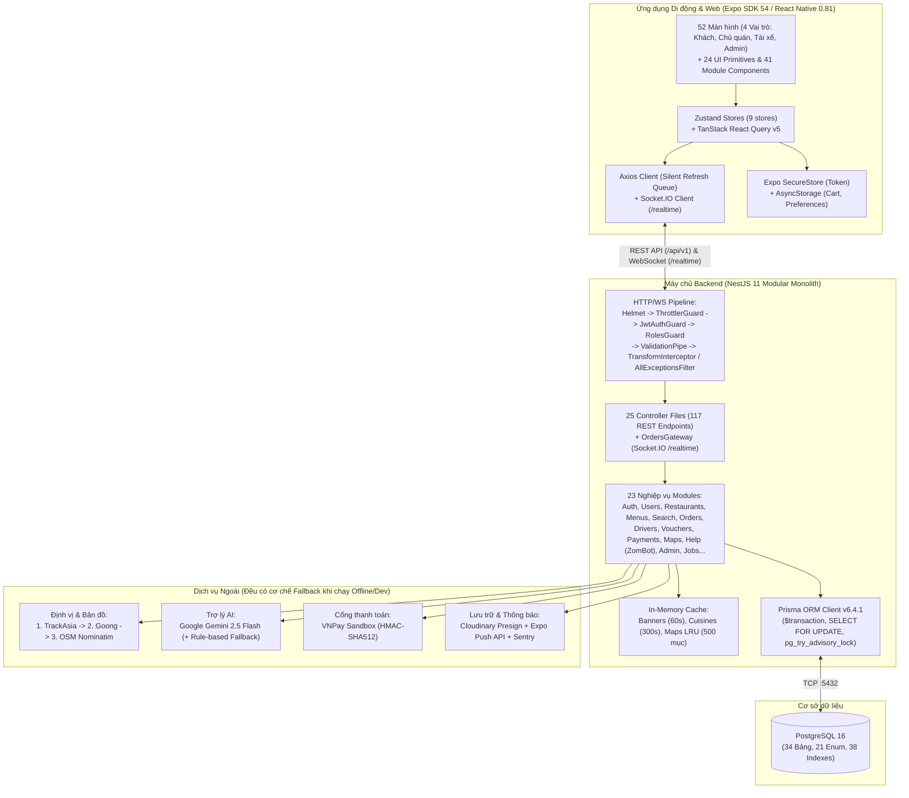
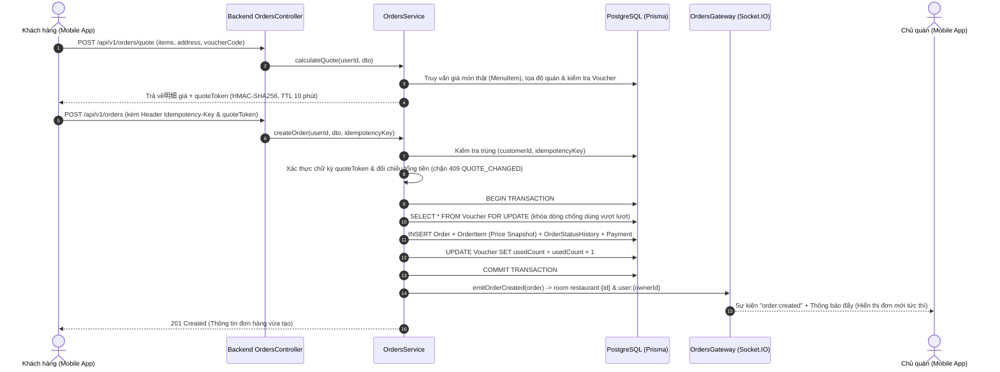
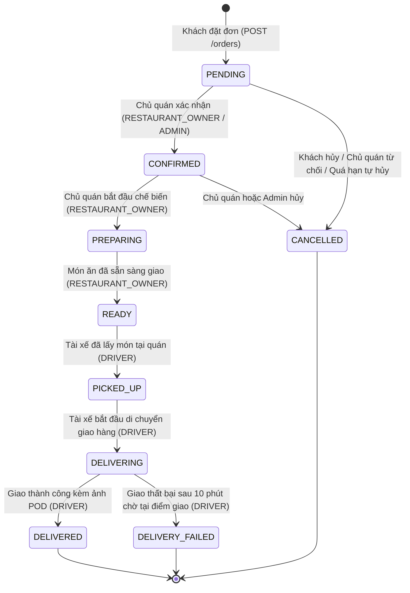
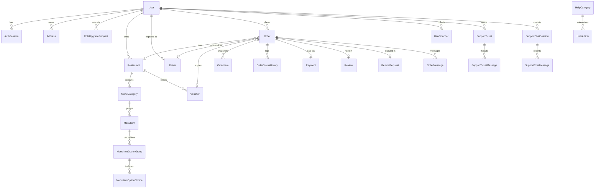

# TÀI LIỆU HỆ THỐNG TOÀN DIỆN — ỨNG DỤNG GIAO ĐỒ ĂN ZOMZOM

> **Mục đích tài liệu**: Tài liệu kỹ thuật nguồn (Single Source of Truth) mô tả đầy đủ kiến trúc, cơ sở dữ liệu, API, luồng nghiệp vụ, giao diện và kiểm thử của dự án **ZomZom** (`backend/` và `mobile/`), phục vụ xây dựng báo cáo đồ án môn **Lập trình thiết bị di động**, slide thuyết trình và kịch bản video demo.
>
> **Cấu trúc bộ tài liệu**:
> - **Tài liệu chính**: [`docs/TAI_LIEU_HE_THONG.md`](TAI_LIEU_HE_THONG.md) (tài liệu này — bao gồm đầy đủ 12 phần bắt buộc).
> - **Phụ lục 01**: [`docs/he-thong/01-danh-muc-man-hinh-va-luong-nghiep-vu.md`](he-thong/01-danh-muc-man-hinh-va-luong-nghiep-vu.md) — Đặc tả chi tiết tất cả 52 màn hình và 12 sơ đồ luồng nghiệp vụ.
> - **Phụ lục 02**: [`docs/he-thong/02-api-endpoints-va-co-so-du-lieu.md`](he-thong/02-api-endpoints-va-co-so-du-lieu.md) — Bảng tra cứu đầy đủ 117 REST endpoints, 13 sự kiện Socket.IO, 34 bảng PostgreSQL, 21 Enum và dữ liệu Seed.
> - **Phụ lục 03**: [`docs/he-thong/03-thiet-ke-ui-ux-va-ky-thuat-dac-biet.md`](he-thong/03-thiet-ke-ui-ux-va-ky-thuat-dac-biet.md) — Hệ thống Design Tokens, 24 UI primitives, 41 module components và bảng 28 kỹ thuật đặc biệt.
> - **Phụ lục 04**: [`docs/he-thong/04-kiem-thu-van-hanh-va-bang-chung.md`](he-thong/04-kiem-thu-van-hanh-va-bang-chung.md) — Danh mục 70 file test, cấu hình biến môi trường, hướng dẫn chạy, bảng đối chiếu bằng chứng và từ điển thuật ngữ.

---

## MỤC LỤC

- [1. Tổng quan](#1-tổng-quan)
  - [1.1. Tên, mục tiêu hệ thống, bài toán giải quyết và phạm vi](#11-tên-mục-tiêu-hệ-thống-bài-toán-giải-quyết-và-phạm-vi)
  - [1.2. Bốn vai trò người dùng trong hệ thống](#12-bốn-vai-trò-người-dùng-trong-hệ-thống)
  - [1.3. Bảng chức năng theo từng vai trò người dùng](#13-bảng-chức-năng-theo-từng-vai-trò-người-dùng)
  - [1.4. Danh sách công nghệ và phiên bản](#14-danh-sách-công-nghệ-và-phiên-bản)
- [2. Kiến trúc tổng thể](#2-kiến-trúc-tổng-thể)
  - [2.1. Sơ đồ kiến trúc tổng thể (Mermaid)](#21-sơ-đồ-kiến-trúc-tổng-thể-mermaid)
  - [2.2. Cây thư mục của toàn dự án và vai trò từng thư mục](#22-cây-thư-mục-của-toàn-dự-án-và-vai-trò-từng-thư-mục)
  - [2.3. Kiến trúc Backend (NestJS 11 Modular Monolith)](#23-kiến-trúc-backend-nestjs-11-modular-monolith)
  - [2.4. Kiến trúc Mobile (Expo SDK 54 & React Native 0.81)](#24-kiến-trúc-mobile-expo-sdk-54--react-native-081)
  - [2.5. Luồng dữ liệu từ App đến Backend và Cơ sở dữ liệu (Sequence Diagram)](#25-luồng-dữ-liệu-từ-app-đến-backend-và-cơ-sở-dữ-liệu-sequence-diagram)
  - [2.6. Các quyết định thiết kế quan trọng kèm lý do thực tế trong mã](#26-các-quyết-định-thiết-kế-quan-trọng-kèm-lý-do-thực-tế-trong-mã)
- [3. Chức năng và luồng nghiệp vụ chi tiết](#3-chức-năng-và-luồng-nghiệp-vụ-chi-tiết)
  - [3.1. Danh mục 52 màn hình theo vai trò người dùng](#31-danh-mục-52-màn-hình-theo-vai-trò-người-dùng)
  - [3.2. Các luồng nghiệp vụ chính (12 luồng kèm sơ đồ Mermaid)](#32-các-luồng-nghiệp-vụ-chính-12-luồng-kèm-sơ-đồ-mermaid)
- [4. Thiết kế giao diện (UI/UX)](#4-thiết-kế-giao-diện-uiux)
  - [4.1. Nguyên tắc thiết kế và Hệ thống Design Tokens](#41-nguyên-tắc-thiết-kế-và-hệ-thống-design-tokens)
  - [4.2. Thành phần giao diện dùng chung và Tỉ lệ NativeWind vs StyleSheet](#42-thành-phần-giao-diện-dùng-chung-và-tỉ-lệ-nativewind-vs-stylesheet)
  - [4.3. Các điểm bất nhất giao diện còn tồn tại trong mã](#43-các-điểm-bất-nhất-giao-diện-còn-tồn-tại-trong-mã)
  - [4.4. Tóm tắt tài liệu kiểm kê giao diện trong `docs/`](#44-tóm-tắt-tài-liệu-kiểm-kê-giao-diện-trong-docs)
- [5. Backend và Cơ sở dữ liệu](#5-backend-và-cơ-sở-dữ-liệu)
  - [5.1. Tổng hợp 117 API Endpoints theo nhóm](#51-tổng-hợp-117-api-endpoints-theo-nhóm)
  - [5.2. Xác thực, Phân quyền (RBAC) và Kiểm tra quyền sở hữu](#52-xác-thực-phân-quyền-rbac-và-kiểm-tra-quyền-sở-hữu)
  - [5.3. Sơ đồ ERD (Mermaid `erDiagram`) và 34 Bảng dữ liệu](#53-sơ-đồ-erd-mermaid-erdiagram-và-34-bảng-dữ-liệu)
  - [5.4. Xử lý đơn hàng: Transaction, Báo giá Server, Chống đặt trùng và Máy trạng thái](#54-xử-lý-đơn-hàng-transaction-báo-giá-server-chống-đặt-trùng-và-máy-trạng-thái)
  - [5.5. Realtime, Thanh toán, Bản đồ, Thông báo, Tải ảnh, Rate Limit, Logging & Sentry](#55-realtime-thanh-toán-bản-đồ-thông-báo-tải-ảnh-rate-limit-logging--sentry)
  - [5.6. Dữ liệu Seed, Tài khoản Demo và Trường hợp biên](#56-dữ-liệu-seed-tài-khoản-demo-và-trường-hợp-biên)
- [6. Kỹ thuật đặc biệt (Cache, Hiệu năng, Độ tin cậy, Bảo mật, Trải nghiệm)](#6-kỹ-thuật-đặc-biệt-cache-hiệu-năng-độ-tin-cậy-bảo-mật-trải-nghiệm)
- [7. Quy trình phát triển (SDLC)](#7-quy-trình-phát-triển-sdlc)
  - [7.1. Mô hình phát triển thực tế dựa trên bằng chứng](#71-mô-hình-phát-triển-thực-tế-dựa-trên-bằng-chứng)
  - [7.2. Số liệu gộp từ lịch sử Git (Không nêu thông tin cá nhân)](#72-số-liệu-gộp-từ-lịch-sử-git-không-nêu-thông-tin-cá-nhân)
  - [7.3. Các giai đoạn phát triển và sản phẩm đầu ra](#73-các-giai-đoạn-phát-triển-và-sản-phẩm-đầu-ra)
  - [7.4. Vai trò và phân công thành viên](#74-vai-trò-và-phân-công-thành-viên)
- [8. Kiểm thử và chất lượng](#8-kiểm-thử-và-chất-lượng)
- [9. Thông tin để viết hướng dẫn chạy](#9-thông-tin-để-viết-hướng-dẫn-chạy)
- [10. Số liệu tổng hợp (Cho Slide thuyết trình)](#10-số-liệu-tổng-hợp-cho-slide-thuyết-trình)
- [11. Hạn chế và những gì chưa làm](#11-hạn-chế-và-những-gì-chưa-làm)
- [12. Phụ lục](#12-phụ-lục)

---

## 1. Tổng quan

### 1.1. Tên, mục tiêu hệ thống, bài toán giải quyết và phạm vi
- **Tên hệ thống**: **ZomZom** (định danh gói ứng dụng: `food-delivery-mobile` tại `mobile/package.json#L2`, `name: "ZomZom"`, `scheme: "fooddelivery"` tại `mobile/app.json#L3-L8`; Backend: `backend` tại `backend/package.json#L2`).
- **Mục tiêu hệ thống**: Xây dựng nền tảng đặt và giao đồ ăn trực tuyến đa vai trò (All-in-One Super App Architecture) vận hành trên thiết bị di động (iOS, Android) và Web, kết nối trực tiếp **Khách hàng**, **Chủ quán ăn**, **Tài xế giao hàng** và **Quản trị viên** trong thời gian thực.
- **Bài toán giải quyết**:
  1. Giúp khách hàng tìm kiếm quán ăn/món ăn theo vị trí GPS và từ khóa tiếng Việt (có dấu hoặc không dấu), áp dụng mã giảm giá tối ưu (voucher sàn và voucher quán), đặt món an toàn và theo dõi lộ trình tài xế trực tiếp trên bản đồ.
  2. Giúp chủ quán quản lý thực đơn, tùy chọn topping, phát hành voucher riêng của quán, tiếp nhận đơn hàng tức thời qua âm báo/WebSocket và theo dõi thống kê doanh thu.
  3. Giúp tài xế nhận đơn hàng gần vị trí hiện tại (chống nhận trùng đơn), điều hướng giao hàng, gửi ảnh bằng chứng giao hàng (POD) và kiểm soát thu nhập.
  4. Giúp quản trị viên giám sát toàn sàn, duyệt hồ sơ mở quán/KYC tài xế, xử lý đơn hàng bị treo, giải quyết khiếu nại hoàn tiền và hỗ trợ khách hàng qua hệ thống Ticket & Chatbot AI.
- **Phạm vi**: Bao gồm một ứng dụng di động đa nền tảng duy nhất (`mobile/`) tích hợp giao diện của cả 4 vai trò và một máy chủ API kiêm WebSocket (`backend/`) kết nối cơ sở dữ liệu quan hệ PostgreSQL.

[ẢNH: Màn hình Splash và Trang chủ ZomZom, hiển thị logo ZomZom màu xanh ngọc #00BFA6 và giao diện khám phá quán ăn tại TP. Huế]

### 1.2. Bốn vai trò người dùng trong hệ thống
Được định nghĩa trong `enum UserRole` tại `backend/prisma/schema.prisma#L10-L15`:
1. **`CUSTOMER` (Khách hàng)**: Khám phá quán ăn, tìm kiếm, lưu yêu thích, lưu ví voucher, đặt đơn, thanh toán (COD/VNPay), theo dõi đơn thời gian thực, chat với tài xế/quán, đánh giá, khiếu nại và trò chuyện với trợ lý ảo ZomBot.
2. **`RESTAURANT_OWNER` (Chủ quán)**: Quản lý một hoặc nhiều cửa hàng, thiết lập giờ mở cửa, quản lý danh mục & món ăn, tạo voucher khuyến mãi của quán, xác nhận và chuẩn bị đơn hàng, phản hồi đánh giá và xuất báo cáo CSV.
3. **`DRIVER` (Tài xế)**: Đăng ký hồ sơ phương tiện & KYC, bật/tắt trạng thái trực tuyến, nhận đơn hàng từ hàng đợi (`driver:pool`), cập nhật vị trí GPS thời gian thực, báo đã tới điểm giao, chụp ảnh bằng chứng giao hàng và xem thống kê thu nhập.
4. **`ADMIN` (Quản trị viên)**: Xem bảng điều khiển KPI toàn sàn, phê duyệt quán ăn & KYC tài xế, duyệt đơn xin nâng cấp vai trò, khóa/mở khóa người dùng, can thiệp đơn hàng bị treo (gán lại tài xế / hủy đơn), xử lý yêu cầu hoàn tiền, quản lý voucher toàn sàn và giải quyết phiếu hỗ trợ CSKH.

### 1.3. Bảng chức năng theo từng vai trò người dùng

> **Phân loại trạng thái**:
> - **ĐÃ HIỆN THỰC THẬT**: Có đầy đủ giao diện Mobile, gọi API thật xuống Backend, xử lý logic nghiệp vụ và lưu trữ vào PostgreSQL.
> - **MÔ PHỎNG**: Có luồng hoạt động thật nhưng một phần tác vụ phần cứng/bên thứ ba được giả lập có kiểm soát để phục vụ demo (ví dụ: nút mô phỏng xe chạy trên bản đồ, thanh toán thẻ/MoMo giả lập, fallback khi không có khóa API ngoài).
> - **CHƯA LÀM**: Chưa được hiện thực trong mã nguồn hiện tại.

#### A. Vai trò Dùng chung & Xác thực (Shared / Auth)

| Tên chức năng | Mô tả ngắn | Trạng thái | Đường dẫn file chính (Mobile & Backend) |
|---|---|---|---|
| Đăng ký, Đăng nhập & Khóa tạm thời | Đăng ký/đăng nhập JWT, băm Argon2id, khóa 15 phút khi nhập sai mật khẩu 5 lần | **ĐÃ HIỆN THỰC THẬT** | `mobile/src/screens/auth/LoginScreen.tsx`, `RegisterScreen.tsx`, `backend/src/auth/auth.service.ts#L48-L115` |
| Làm mới Token tự động & Quản lý phiên đa thiết bị | Xoay vòng Refresh Token, hàng đợi `failedQueue` chống đua lệnh, xem và thu hồi thiết bị đăng nhập | **ĐÃ HIỆN THỰC THẬT** | `mobile/src/api/client.ts#L52-L128`, `backend/src/auth/auth.service.ts#L142-L215` |
| Hồ sơ cá nhân & Chuyển đổi vai trò nhanh | Sửa hồ sơ, tải ảnh đại diện, gửi đơn xin mở quán/làm tài xế; chuyển nhanh giao diện khi demo | **ĐÃ HIỆN THỰC THẬT** | `mobile/src/screens/profile/ProfileScreen.tsx`, `EditProfileScreen.tsx`, `RoleUpgradeRequestScreen.tsx` |
| Hộp thư & Chat trong đơn hàng | Nhắn tin trực tiếp thời gian thực giữa Khách - Tài xế - Chủ quán theo từng đơn hàng | **ĐÃ HIỆN THỰC THẬT** | `mobile/src/screens/chat/InboxScreen.tsx`, `ChatScreen.tsx`, `backend/src/orders/orders.service.ts#L610-L685` |
| Trung tâm thông báo (In-App & Push) | Nhận thông báo thời gian thực qua Socket.IO (`notification:new`), đếm tin chưa đọc, đánh dấu đã đọc | **ĐÃ HIỆN THỰC THẬT** | `mobile/src/screens/notifications/NotificationCenterScreen.tsx`, `backend/src/notifications/notifications.service.ts` |
| Trung tâm trợ giúp, Chatbot AI ZomBot & Ticket | Tra cứu FAQ theo vai trò, chat với ZomBot (Gemini 2.5 Flash + RAG đơn hàng + Fallback kịch bản), gửi phiếu hỗ trợ | **ĐÃ HIỆN THỰC THẬT** | `mobile/src/screens/help/SupportCenterScreen.tsx`, `SupportChatScreen.tsx`, `backend/src/help/support-chat.service.ts` |
| Quên mật khẩu qua OTP SMS / Email | Gửi mã OTP khôi phục mật khẩu qua cổng SMS hoặc SMTP | **CHƯA LÀM** | *(Hiện mới có nút thông báo liên hệ CSKH tại `LoginScreen.tsx`)* |
| Đăng nhập mạng xã hội (Google / Apple / Facebook) | OAuth2 Social Login | **CHƯA LÀM** | *(Không có trong mã nguồn)* |

#### B. Vai trò Khách hàng (`CUSTOMER`)

| Tên chức năng | Mô tả ngắn | Trạng thái | Đường dẫn file chính (Mobile & Backend) |
|---|---|---|---|
| Trang chủ khám phá (Banner, Danh mục, Gần tôi) | Hiển thị banner khuyến mãi, popup chiến dịch, lưới ẩm thực, quán gần vị trí GPS (Haversine) | **ĐÃ HIỆN THỰC THẬT** | `mobile/src/screens/home/HomeScreen.tsx`, `backend/src/restaurants/restaurants.service.ts#L45-L165` |
| Tìm kiếm hợp nhất (Quán & Món) + Khám phá | Tìm kiếm tiếng Việt không dấu, lịch sử tìm kiếm cá nhân, từ khóa xu hướng 7 ngày, gợi ý quán | **ĐÃ HIỆN THỰC THẬT** | `mobile/src/screens/search/SearchScreen.tsx`, `backend/src/search/search.service.ts#L28-L185` |
| Xem chi tiết quán, Thực đơn & Tùy chọn món | Xem thông tin quán, thu thập voucher tại quán, chọn món kèm nhóm tùy chọn (`minSelect`/`maxSelect`) | **ĐÃ HIỆN THỰC THẬT** | `mobile/src/screens/restaurant/RestaurantDetailScreen.tsx`, `DishDetailScreen.tsx`, `backend/src/menus/menus.service.ts` |
| Giỏ hàng lưu cục bộ & Đặt lại đơn cũ (`Reorder`) | Lưu giỏ hàng qua `AsyncStorage`, cảnh báo khi thêm món khác quán, kiểm tra món còn bán khi đặt lại | **ĐÃ HIỆN THỰC THẬT** | `mobile/src/store/useCartStore.ts`, `mobile/src/screens/cart/CartScreen.tsx`, `backend/src/orders/orders.service.ts#L580` |
| Ví Voucher & Tự động chọn mã giảm tốt nhất | Lưu voucher sàn/quán, nhập mã code, tự động tính và áp dụng voucher giảm nhiều nhất ở Checkout | **ĐÃ HIỆN THỰC THẬT** | `mobile/src/screens/voucher/VoucherWalletScreen.tsx`, `VoucherSelectScreen.tsx`, `backend/src/vouchers/vouchers.service.ts` |
| Báo giá Server (`quoteToken`) & Đặt đơn chống trùng | Tính phí ship theo km, ký HMAC `quoteToken` (chặn `409 QUOTE_CHANGED`), chống đặt trùng bằng `Idempotency-Key` | **ĐÃ HIỆN THỰC THẬT** | `mobile/src/screens/checkout/CheckoutScreen.tsx`, `backend/src/orders/orders.service.ts#L118-L415` |
| Thanh toán COD & Cổng VNPay Sandbox | Thanh toán tiền mặt (`COD`) hoặc sinh URL thanh toán `VNPAY` chuẩn chữ ký HMAC-SHA512 và đối soát IPN | **ĐÃ HIỆN THỰC THẬT** | `mobile/src/screens/payment/PaymentWebViewScreen.tsx`, `backend/src/payments/payments.service.ts#L40-L165` |
| Thanh toán Ví MoMo & Thẻ quốc tế (`CARD`) | Giao diện chọn phương thức MoMo/Thẻ và mô phỏng phản hồi thanh toán thành công | **MÔ PHỎNG** | `mobile/src/screens/checkout/CheckoutScreen.tsx`, `backend/src/payments/payments.service.ts#L95-L120` |
| Theo dõi đơn hàng & Vị trí tài xế thời gian thực | Cập nhật bước trạng thái đơn và vẽ vị trí tài xế di chuyển trên bản đồ qua Socket.IO (`driver:location`) | **ĐÃ HIỆN THỰC THẬT** | `mobile/src/screens/order/OrderTrackingScreen.tsx`, `backend/src/realtime/orders.gateway.ts` |
| Sổ địa chỉ & Chọn vị trí trên bản đồ | Quản lý địa chỉ mặc định, tự động gợi ý địa chỉ (TrackAsia -> Goong -> Nominatim fallback) | **ĐÃ HIỆN THỰC THẬT** | `mobile/src/screens/address/SavedAddressesScreen.tsx`, `AddressPickerScreen.tsx`, `backend/src/maps/maps.service.ts` |
| Yêu thích Quán ăn & Món ăn (Optimistic UI) | Thả tim lưu quán ăn và món ăn yêu thích với phản hồi giao diện tức thì | **ĐÃ HIỆN THỰC THẬT** | `mobile/src/screens/favorites/FavoritesScreen.tsx`, `mobile/src/store/useFavoritesStore.ts` |
| Đánh giá đơn hàng & Gửi khiếu nại hoàn tiền | Chấm sao quán & tài xế, tải ảnh đánh giá; gửi khiếu nại hoàn tiền (`RefundRequest`) khi đơn có sự cố | **ĐÃ HIỆN THỰC THẬT** | `mobile/src/screens/review/ReviewScreen.tsx`, `OrderDetailScreen.tsx`, `backend/src/orders/orders.service.ts#L690` |

#### C. Vai trò Chủ quán (`RESTAURANT_OWNER`)

| Tên chức năng | Mô tả ngắn | Trạng thái | Đường dẫn file chính (Mobile & Backend) |
|---|---|---|---|
| Bảng điều khiển Chủ quán & Chọn đa cửa hàng | Chuyển đổi giữa các quán sở hữu, bật/tắt trạng thái đóng/mở cửa (`isOpen`), chỉnh thời gian chuẩn bị | **ĐÃ HIỆN THỰC THẬT** | `mobile/src/screens/owner/OwnerOverviewScreen.tsx`, `OwnerSettingsScreen.tsx` |
| Tiếp nhận & Xử lý đơn hàng thời gian thực | Nhận đơn mới qua Socket.IO (`order:created`), xác nhận (`CONFIRMED`), nấu (`PREPARING`), báo sẵn sàng (`READY`) | **ĐÃ HIỆN THỰC THẬT** | `mobile/src/screens/owner/OwnerOrdersScreen.tsx`, `backend/src/orders/order-state-machine.ts` |
| Quản lý Thực đơn, Danh mục & Tùy chọn món | Thêm/sửa/xóa mềm danh mục, món ăn, nhóm tùy chọn (Size/Topping) và bật/tắt còn hàng (`isAvailable`) | **ĐÃ HIỆN THỰC THẬT** | `mobile/src/screens/owner/OwnerMenuScreen.tsx`, `backend/src/menus/menus.service.ts` |
| Quản lý Voucher riêng của quán (`RESTAURANT`) | Tạo, sửa, bật/tắt mã giảm giá áp dụng riêng cho quán của mình | **ĐÃ HIỆN THỰC THẬT** | `mobile/src/screens/voucher/VoucherManageScreen.tsx`, `backend/src/vouchers/vouchers.controller.ts#L118` |
| Thống kê doanh thu, Phản hồi đánh giá & Xuất CSV | Xem biểu đồ doanh thu, top món bán chạy, trả lời đánh giá của khách và xuất danh sách đơn ra CSV | **ĐÃ HIỆN THỰC THẬT** | `mobile/src/screens/owner/OwnerReviewsScreen.tsx`, `backend/src/restaurants/restaurants.service.ts#L280`, `exports.service.ts` |

#### D. Vai trò Tài xế (`DRIVER`)

| Tên chức năng | Mô tả ngắn | Trạng thái | Đường dẫn file chính (Mobile & Backend) |
|---|---|---|---|
| Bật/tắt Trực tuyến & Nhận đơn nguyên tử | Chuyển trạng thái `AVAILABLE`/`OFFLINE`, nhận đơn mới từ `driver:pool` với khóa chống nhận trùng | **ĐÃ HIỆN THỰC THẬT** | `mobile/src/screens/driver/DriverHomeScreen.tsx`, `backend/src/drivers/drivers.service.ts#L165-L218` |
| Thực hiện giao hàng, Đếm ngược 10 phút & Ảnh POD | Chuyển trạng thái `PICKED_UP` -> `DELIVERING`, báo đã tới nơi (đợi đủ 10 phút nếu giao thất bại), tải ảnh POD | **ĐÃ HIỆN THỰC THẬT** | `mobile/src/screens/driver/DriverDeliveryScreen.tsx`, `backend/src/orders/orders.service.ts#L520-L575` |
| Phát tọa độ GPS thật & Mô phỏng di chuyển trên bản đồ | Lấy GPS thật từ `expo-location` gửi lên server; kèm nút **"Mô phỏng di chuyển"** dịch chuyển tọa độ từng bước về phía khách để demo trên máy ảo | **ĐÃ HIỆN THỰC THẬT** + **MÔ PHỎNG** (nút giả lập lộ trình) | `mobile/src/screens/driver/DriverDeliveryScreen.tsx`, `backend/src/realtime/orders.gateway.ts#L145` |
| Thống kê thu nhập & Hồ sơ phương tiện KYC | Xem tổng thu nhập phí giao hàng theo kỳ, lịch sử chuyến đi và trạng thái duyệt KYC | **ĐÃ HIỆN THỰC THẬT** | `mobile/src/screens/driver/DriverEarningsScreen.tsx`, `DriverProfileScreen.tsx` |

#### E. Vai trò Quản trị viên (`ADMIN`)

| Tên chức năng | Mô tả ngắn | Trạng thái | Đường dẫn file chính (Mobile & Backend) |
|---|---|---|---|
| Dashboard KPI toàn sàn & Nhật ký kiểm toán | Thống kê tổng doanh thu GMV, tổng đơn, đơn đang giao, đơn bị treo và xem `AdminAuditLog` | **ĐÃ HIỆN THỰC THẬT** | `mobile/src/screens/admin/AdminOverviewScreen.tsx`, `AdminAuditLogsScreen.tsx`, `backend/src/admin/admin.service.ts` |
| Phê duyệt Quán ăn, KYC Tài xế & Nâng cấp vai trò | Duyệt/từ chối quán mới (`APPROVED`/`REJECTED`), duyệt KYC tài xế, duyệt đơn `RoleUpgradeRequest` | **ĐÃ HIỆN THỰC THẬT** | `mobile/src/screens/admin/AdminApprovalsScreen.tsx`, `AdminRoleRequestsScreen.tsx` |
| Xử lý đơn hàng bị treo (`Stalled Orders`) & Hoàn tiền | Gán lại tài xế (`reassign`) hoặc hủy đơn treo; duyệt/từ chối yêu cầu hoàn tiền (`RefundRequest`) | **ĐÃ HIỆN THỰC THẬT** | `mobile/src/screens/admin/AdminStalledOrdersScreen.tsx`, `AdminRefundsScreen.tsx` |
| Quản lý Người dùng, Đánh giá, Voucher sàn & Ticket CSKH | Khóa/mở khóa tài khoản, ẩn/hiện đánh giá vi phạm, tạo voucher toàn sàn (`PLATFORM`), trả lời `SupportTicket` | **ĐÃ HIỆN THỰC THẬT** | `mobile/src/screens/admin/AdminUsersScreen.tsx`, `AdminReviewsScreen.tsx`, `AdminSupportTicketsScreen.tsx` |

---

### 1.4. Danh sách công nghệ và phiên bản

Số liệu trích xuất trực tiếp từ `mobile/package.json` và `backend/package.json`:

| Phân hệ | Công nghệ / Thư viện | Phiên bản (`package.json`) | Vai trò trong dự án |
|---|---|---|---|
| **Mobile Core** | **Expo SDK** (`expo`) | `~54.0.0` | Khung phát triển ứng dụng đa nền tảng (Android, iOS, Web) |
| | **React Native** / **React** | `0.81.5` / `19.1.0` | Thư viện xây dựng giao diện người dùng di động gốc |
| | **TypeScript** | `~5.9.2` | Kiểm tra kiểu tĩnh trên toàn bộ mã nguồn Mobile |
| **Mobile UI & Style** | **NativeWind** + **TailwindCSS** | `^4.2.1` + `^3.4.19` | Hệ thống định dạng giao diện bằng utility class (`className`) |
| | **React Native Reanimated** | `~4.1.1` | Hoạt ảnh 60fps trên luồng UI (FloatingTabBar, Skeleton, BottomSheet) |
| | **Expo Image** & **Lucide Icons** | `~3.0.11` / `^0.475.0` | Tối ưu bộ nhớ đệm hình ảnh và bộ biểu tượng vector đồng nhất |
| **Mobile Navigation & State** | **React Navigation v7** (`native`, `native-stack`, `bottom-tabs`) | `^7.0.14` / `^7.2.0` | Quản lý cây điều hướng phân tách theo 4 vai trò và Deep Linking |
| | **Zustand** | `^5.0.3` | Quản lý trạng thái cục bộ (Auth, Cart, Favorites, Filter, Address, Toast) |
| | **TanStack React Query** | `^5.66.0` | Quản lý trạng thái bất đồng bộ từ Server, lưu đệm và làm mới dữ liệu |
| | **React Hook Form** + **Zod** | `^7.54.2` + `^3.24.2` | Quản lý biểu mẫu hiệu năng cao và kiểm tra dữ liệu đầu vào phía client |
| **Mobile Network & Native** | **Axios** + **Socket.IO Client** | `^1.7.9` + `^4.8.1` | Gọi REST API (kèm interceptor xoay vòng token) và kết nối WebSocket thời gian thực |
| | **React Native Maps** & **Expo Location** | `1.20.1` / `~19.0.8` | Bản đồ tương tác gốc trên iOS/Android và truy cập tọa độ GPS thiết bị |
| | **Expo Secure Store** & **AsyncStorage** | `~15.0.8` / `2.2.0` | Lưu trữ mã hóa cho JWT token và lưu trữ bền vững cho giỏ hàng |
| **Backend Core** | **NestJS** (`@nestjs/core`, `@nestjs/common`) | `^11.0.1` | Framework kiến trúc Modular Monolith phía máy chủ |
| | **TypeScript** / **Node.js** | `^5.7.3` / `>=20.x` | Ngôn ngữ và môi trường thực thi phía server |
| **Database & ORM** | **PostgreSQL** + **Prisma ORM** (`@prisma/client`) | `16-alpine` + `^6.4.1` | Hệ quản trị cơ sở dữ liệu quan hệ, quản lý lược đồ, migration và transaction |
| **Backend Security & Realtime** | **Passport JWT** + **Argon2** | `^4.0.1` + `^0.41.1` | Xác thực JWT hai tầng (Access/Refresh) và băm mật khẩu kháng GPU |
| | **NestJS WebSockets** + **Socket.IO** | `^11.0.1` + `^4.8.1` | Truyền thông thời gian thực theo phòng (`order`, `driver:pool`, `restaurant`, `user`) |
| | **NestJS Throttler** + **Helmet** | `^6.4.0` + `^8.0.0` | Giới hạn tần suất gọi API (Rate Limiting) và bảo vệ HTTP Headers |
| **Documentation & Testing** | **Swagger** (`@nestjs/swagger`) | `^11.0.3` | Tự động sinh tài liệu OpenAPI tại đường dẫn `/docs` |
| | **Jest** (`backend` / `mobile`) | `^30.0.0` / `^29.7.0` | Kiểm thử đơn vị (Unit Test) và kiểm thử tích hợp (E2E Test) |

---

## 2. Kiến trúc tổng thể

### 2.1. Sơ đồ kiến trúc tổng thể (Mermaid)



### 2.2. Cây thư mục của toàn dự án và vai trò từng thư mục

```text
food-delivery-system/
├── .github/workflows/          # Cấu hình CI tự động (backend-ci.yml, mobile-ci.yml)
├── docker-compose.yml          # Khởi chạy đồng bộ PostgreSQL 16 + Backend container
├── docs/                       # Toàn bộ tài liệu hệ thống, kiểm kê UI và báo cáo giai đoạn
│   ├── TAI_LIEU_HE_THONG.md    # Tài liệu hệ thống chính (file này)
│   └── he-thong/               # 4 phụ lục chi tiết (Màn hình, API & DB, UI & Kỹ thuật, Kiểm thử & Vận hành)
├── backend/                    # Máy chủ API & WebSocket (NestJS 11 + Prisma 6)
│   ├── prisma/
│   │   ├── schema.prisma       # Lược đồ CSDL (939 dòng: 34 models, 21 enums)
│   │   ├── migrations/         # 22 thư mục lịch sử migration SQL
│   │   └── seed.ts             # Script khởi tạo dữ liệu mẫu tại TP. Huế (1.136 dòng)
│   ├── src/
│   │   ├── main.ts             # Điểm vào ứng dụng, cấu hình CORS, Helmet, Pipe, Swagger
│   │   ├── app.module.ts       # Module gốc kết nối 23 module con và các Guard toàn cục
│   │   ├── common/             # Decorator (@Public, @Roles, @CurrentUser), Guard, Filter, Interceptor
│   │   ├── config/             # Đọc và kiểm tra biến môi trường (configuration.ts)
│   │   ├── prisma/             # PrismaService quản lý kết nối DB
│   │   ├── auth/               # Đăng ký, đăng nhập, xoay vòng token, quản lý phiên đa thiết bị
│   │   ├── users/              # Hồ sơ, sổ địa chỉ, quán/món yêu thích, yêu cầu nâng cấp vai trò
│   │   ├── restaurants/        # Tìm kiếm quán (Haversine), quản lý quán, thống kê, đánh giá
│   │   ├── menus/              # Quản lý danh mục, món ăn và nhóm tùy chọn (Size/Topping)
│   │   ├── search/             # Tìm kiếm hợp nhất không dấu, lịch sử và xu hướng tìm kiếm
│   │   ├── banners/            # Banner trang chủ (có cache 60s)
│   │   ├── cuisines/           # Danh mục ẩm thực (có cache 300s)
│   │   ├── content/            # Cấu hình popup khuyến mãi trang chủ
│   │   ├── orders/             # Báo giá HMAC, đặt đơn, máy trạng thái, chat đơn hàng, hoàn tiền
│   │   ├── drivers/            # Hồ sơ tài xế, bật/tắt trực tuyến, nhận đơn nguyên tử, thu nhập
│   │   ├── vouchers/           # Ví voucher, mã toàn sàn & mã riêng của quán, chọn mã tốt nhất
│   │   ├── payments/           # Thanh toán COD, VNPay HMAC-SHA512, xử lý IPN/Webhook
│   │   ├── maps/               # Autocomplete & Geocode 3 tầng (TrackAsia -> Goong -> Nominatim)
│   │   ├── realtime/           # OrdersGateway (Socket.IO namespace /realtime)
│   │   ├── notifications/      # Thông báo in-app và gửi Expo Push Notification
│   │   ├── media/              # Cấp chữ ký tải ảnh trực tiếp lên Cloudinary
│   │   ├── share/              # Render trang HTML OpenGraph & Deep Link (/s/r/:id, /s/d/:id)
│   │   ├── exports/            # Xuất báo cáo đơn hàng ra CSV (chống CSV Injection)
│   │   ├── jobs/               # Cron job quét đơn treo mỗi phút dùng pg_try_advisory_lock
│   │   ├── help/               # Trung tâm trợ giúp: FAQ, Chatbot AI ZomBot (Gemini), Support Ticket
│   │   └── admin/              # Nghiệp vụ quản trị toàn sàn và ghi nhật ký AdminAuditLog
│   └── test/                   # Kiểm thử End-to-End (E2E)
└── mobile/                     # Ứng dụng di động đa nền tảng (Expo SDK 54 + React Native 0.81)
    ├── App.tsx                 # Điểm vào giao diện: nạp font, QueryClientProvider, Toast, AppNavigator
    ├── tailwind.config.js      # Cấu hình NativeWind v4 ánh xạ từ src/theme/tokens.json
    └── src/
        ├── api/                # Axios instance, Silent Token Refresh Queue và các module gọi API
        ├── components/         # 24 UI primitives (ui/), 41 component nghiệp vụ (modules/, common/)
        ├── constants/          # Tự động dò IP LAN (config.ts) và hằng số giao diện (theme.ts)
        ├── hooks/              # 15 custom hooks (React Query, Socket.IO, Location, Debounce...)
        ├── navigation/         # Cây điều hướng phân nhánh theo 4 vai trò (AppNavigator.tsx)
        ├── screens/            # 53 file màn hình (52 màn hình chính + SplashLogo.tsx)
        ├── services/           # Tầng dịch vụ đóng gói logic gọi API (voucher, help, order...)
        ├── store/              # 9 Zustand stores quản lý trạng thái toàn cục
        ├── theme/              # Bộ Design Tokens chuẩn (tokens.json)
        ├── types/              # Định nghĩa kiểu TypeScript đồng bộ với Backend DTO
        └── utils/              # Định dạng tiền tệ, ngày giờ, lưu trữ bảo mật, kiểm tra dữ liệu
```

### 2.3. Kiến trúc Backend (NestJS 11 Modular Monolith)
Backend được tổ chức theo mô hình **Modular Monolith** gồm **23 module** đăng ký tại `backend/src/app.module.ts#L32-L64`. Mỗi module tuân thủ nghiêm ngặt kiến trúc phân lớp:
1. **Tầng Bảo vệ & Tiền xử lý (Guards & Pipes)**:
   - `ThrottlerGuard` (`backend/src/app.module.ts#L67`): Giới hạn tốc độ gọi API theo địa chỉ IP.
   - `JwtAuthGuard` (`backend/src/common/guards/jwt-auth.guard.ts`): Mặc định bảo vệ toàn bộ endpoint, chỉ bỏ qua khi có decorator `@Public()`.
   - `RolesGuard` (`backend/src/common/guards/roles.guard.ts`): Đối chiếu vai trò trong JWT với `@Roles(...)`.
   - `ValidationPipe` (`backend/src/main.ts#L62-L70`): Bật `whitelist: true`, `forbidNonWhitelisted: true`, `transform: true` để loại bỏ mọi trường lạ không khai báo trong DTO.
2. **Tầng Điều phối (`*.controller.ts` — 25 files / 28 class Controller)**: Tiếp nhận request, trích xuất thông tin người gọi qua `@CurrentUser()` và chuyển giao cho Service.
3. **Tầng Nghiệp vụ (`*.service.ts`)**: Thực thi kiểm tra quyền sở hữu tài nguyên (Ownership Check), tính toán tài chính, gọi giao dịch Prisma (`prisma.$transaction`) và phát sự kiện thời gian thực qua `RealtimeModule`.
4. **Tầng Hậu xử lý & Bắt lỗi (Interceptors & Exception Filters)**:
   - `LoggingInterceptor` (`backend/src/common/interceptors/logging.interceptor.ts`): Ghi log phương thức, đường dẫn, thời gian xử lý (ms) và tự động che các trường nhạy cảm (`password`, `token`).
   - `TransformInterceptor` (`backend/src/common/interceptors/transform.interceptor.ts`): Bọc mọi phản hồi thành công về cấu trúc chuẩn `{ success: true, data, meta, timestamp }`.
   - `AllExceptionsFilter` (`backend/src/common/filters/all-exceptions.filter.ts`): Chuẩn hóa mọi lỗi HTTP và lỗi Prisma (`P2002` trùng dữ liệu -> `409 Conflict`, `P2025` không tìm thấy -> `404 Not Found`) về `{ success: false, statusCode, errorCode, message, timestamp }`.

### 2.4. Kiến trúc Mobile (Expo SDK 54 & React Native 0.81)
1. **Cơ chế chọn giao diện theo vai trò (`AppNavigator.tsx#L45-L210`)**:
   - Dựa trên trạng thái `isAuthenticated` và `activeRole` trong `useAuthStore` (`mobile/src/store/useAuthStore.ts`), `AppNavigator` tự động kết xuất nhánh điều hướng tương ứng:
     - Chưa đăng nhập: `AuthStack` (`Login`, `Register`), nhưng vẫn cho phép khách vãng lai xem `CustomerTabs` và trang chi tiết quán/món, chỉ yêu cầu đăng nhập khi nhấn Đặt hàng/Lưu yêu thích.
     - `CUSTOMER`: `CustomerTabs` (`Home`, `Search`, `Orders`, `Favorites`, `Profile`) + các màn hình Stack (`RestaurantDetail`, `DishDetail`, `Cart`, `Checkout`, `VoucherWallet`, `OrderTracking`...).
     - `RESTAURANT_OWNER`: `OwnerTabs` (`OwnerOverview`, `OwnerOrders`, `OwnerMenu`, `OwnerReviews`, `OwnerSettings`) + `VoucherManageScreen`.
     - `DRIVER`: `DriverTabs` (`DriverHome`, `DriverDelivery`, `DriverOrders`, `DriverEarnings`, `DriverProfile`).
     - `ADMIN`: `AdminTabs` (`AdminOverview`, `AdminApprovals`, `AdminStalledOrders`, `AdminUsers`, `AdminReviews`) + các màn hình quản trị chuyên sâu (`AdminRefunds`, `AdminRoleRequests`, `AdminAuditLogs`, `AdminSupportTickets`, `VoucherManage`).
2. **Phân bổ Quản lý State (9 Zustand Stores + React Query)**:
   - **Dữ liệu từ Server (Server State)**: Lưu trong bộ nhớ đệm của **TanStack React Query** (`useRestaurants`, `useOrders`, `useNotifications`, `useVouchers`...).
   - **Trạng thái phiên & giao diện cục bộ (Client State — `mobile/src/store/`)**:
     - `useAuthStore.ts`: Lưu thông tin `user`, `activeRole`, trạng thái khởi tạo; đồng bộ `accessToken` và `refreshToken` vào `expo-secure-store`.
     - `useCartStore.ts`: Lưu giỏ hàng theo từng quán vào `AsyncStorage`, tự động tính tổng số món và tổng tiền tạm tính.
     - `useFavoritesStore.ts`: Lưu tập hợp ID quán và món yêu thích (`favoriteIds`, `favoriteItemIds`) hỗ trợ Optimistic UI.
     - `useAddressStore.ts`: Lưu địa chỉ giao hàng đang chọn và tọa độ GPS hiện tại.
     - `useFilterStore.ts`: Lưu bộ lọc tìm kiếm (danh mục, khoảng giá, cách sắp xếp).
     - `useOwnerStore.ts`: Lưu `selectedRestaurantId` khi chủ quán sở hữu nhiều cửa hàng.
     - `useDriverStore.ts`: Lưu trạng thái trực tuyến và vị trí hiện tại của tài xế.
     - `useToastStore.ts` & `usePromoStore.ts`: Quản lý thông báo nổi và trạng thái đã xem popup khuyến mãi trang chủ.

### 2.5. Luồng dữ liệu từ App đến Backend và Cơ sở dữ liệu (Sequence Diagram)

Sơ đồ tuần tự dưới đây minh họa luồng **Khách hàng báo giá giỏ hàng, đặt đơn và thông báo tức thời cho Chủ quán**:



### 2.6. Các quyết định thiết kế quan trọng kèm lý do thực tế trong mã
1. **Kiến trúc Modular Monolith thay vì Microservices**: Giúp nhóm phát triển chia sẻ trực tiếp kiểu dữ liệu Prisma, thực hiện giao dịch ACID (`prisma.$transaction`) xuyên suốt giữa `Order`, `OrderItem`, `Voucher`, `Payment` và `OrderStatusHistory` mà không gặp độ trễ mạng nội bộ hay phức tạp của saga phân tán (`backend/src/orders/orders.service.ts#L310-L415`).
2. **Một ứng dụng Mobile duy nhất cho cả 4 vai trò (Role-Switchable Single App)**: Thay vì tách 4 project React Native riêng biệt dễ lệch phiên bản thư viện và khó chấm điểm demo, cả 4 vai trò dùng chung hệ thống Design System (`components/ui/`) và có thể chuyển đổi tức thời qua `AppNavigator.tsx` hoặc thanh công cụ Demo Role Switcher.
3. **Xác thực báo giá hai bước bằng chữ ký HMAC (`quoteToken`)**: Giải quyết triệt để bài toán thực tế khi khách đang ở màn hình thanh toán thì chủ quán tăng giá món hoặc mã giảm giá vừa hết lượt. Server phát hiện sự thay đổi và trả về mã lỗi chuẩn `409 QUOTE_CHANGED` (`backend/src/orders/orders.service.ts#L220-L245`) để ứng dụng tự động cập nhật lại giá mới và hỏi ý kiến khách.
4. **Cơ chế dự phòng (Fallback) cho toàn bộ dịch vụ bên thứ ba**: Để đảm bảo người chấm bài hoặc thành viên trong nhóm kéo code về chạy được ngay cả khi không có khóa trả phí, mọi dịch vụ ngoài đều có nhánh dự phòng tự động: Bản đồ (`TrackAsia` -> `Goong` -> `Nominatim` tại `maps.service.ts`), Chatbot AI (`Gemini 2.5 Flash` -> `Rule-based NLP` tại `support-chat.service.ts`), Tải ảnh (`Cloudinary` -> `Local/Sample URL` tại `media.service.ts`).

---

## 3. Chức năng và luồng nghiệp vụ chi tiết

> **Tra cứu chi tiết**: Xem bản đặc tả đầy đủ từng trường dữ liệu và trạng thái của tất cả 52 màn hình tại [Phụ lục 01: Danh mục màn hình và Luồng nghiệp vụ](he-thong/01-danh-muc-man-hinh-va-luong-nghiep-vu.md).

### 3.1. Danh mục 52 màn hình theo vai trò người dùng

Dự án có tổng cộng **53 file `.tsx`** trong `mobile/src/screens/`, gồm **52 màn hình chức năng** và 1 component phụ trợ `SplashLogo.tsx`:

| Nhóm vai trò | Số màn hình riêng | Tổng màn hình truy cập được | Danh sách màn hình và đường dẫn trong `mobile/src/screens/` |
|---|---|---|---|
| **1. Dùng chung & Xác thực (Shared / Auth)** | **9** | **9** | `ZomZomSplashScreen.tsx` (`splash/`), `LoginScreen.tsx`, `RegisterScreen.tsx` (`auth/`), `EditProfileScreen.tsx` (`profile/`), `AddressPickerScreen.tsx` (`address/`), `InboxScreen.tsx`, `ChatScreen.tsx` (`chat/`), `NotificationCenterScreen.tsx` (`notifications/`), `VoucherManageScreen.tsx` (`voucher/` — dùng chung cho Owner & Admin) |
| **2. Khách hàng (`CUSTOMER`)** | **21** | **29** | **Khám phá & Đặt món**: `HomeScreen.tsx` (`home/`), `SearchScreen.tsx` (`search/`), `RestaurantDetailScreen.tsx`, `DishDetailScreen.tsx`, `RestaurantReviewsScreen.tsx` (`restaurant/`), `FavoritesScreen.tsx` (`favorites/`).<br>**Giỏ hàng, Voucher & Thanh toán**: `CartScreen.tsx` (`cart/`), `CheckoutScreen.tsx` (`checkout/`), `VoucherWalletScreen.tsx`, `VoucherSelectScreen.tsx` (`voucher/`), `PaymentWebViewScreen.tsx`, `PaymentResultScreen.tsx` (`payment/`).<br>**Đơn hàng, Địa chỉ & Đánh giá**: `OrdersScreen.tsx`, `OrderDetailScreen.tsx`, `OrderTrackingScreen.tsx` (`order/`), `SavedAddressesScreen.tsx` (`address/`), `ReviewScreen.tsx` (`review/`).<br>**Cá nhân & Hỗ trợ**: `ProfileScreen.tsx`, `RoleUpgradeRequestScreen.tsx` (`profile/`), `SupportCenterScreen.tsx`, `FaqArticleDetailScreen.tsx`, `SupportChatScreen.tsx`, `CreateTicketScreen.tsx`, `MyTicketsScreen.tsx`, `TicketDetailScreen.tsx` (`help/`). *(Tính gộp các màn hình hỗ trợ & cá nhân vào nhánh Customer/Shared)*. |
| **3. Chủ quán (`RESTAURANT_OWNER`)** | **5** | **13** | `OwnerOverviewScreen.tsx`, `OwnerOrdersScreen.tsx`, `OwnerMenuScreen.tsx`, `OwnerReviewsScreen.tsx`, `OwnerSettingsScreen.tsx` (trong `screens/owner/`) + các màn hình dùng chung (`VoucherManageScreen`, `InboxScreen`, `ChatScreen`, `NotificationCenterScreen`, `EditProfileScreen`, `AddressPickerScreen`, `SupportCenterScreen`...) |
| **4. Tài xế (`DRIVER`)** | **5** | **13** | `DriverHomeScreen.tsx`, `DriverDeliveryScreen.tsx`, `DriverOrdersScreen.tsx`, `DriverEarningsScreen.tsx`, `DriverProfileScreen.tsx` (trong `screens/driver/`) + các màn hình dùng chung |
| **5. Quản trị viên (`ADMIN`)** | **9** | **15** | `AdminOverviewScreen.tsx`, `AdminApprovalsScreen.tsx`, `AdminStalledOrdersScreen.tsx`, `AdminUsersScreen.tsx`, `AdminReviewsScreen.tsx`, `AdminRefundsScreen.tsx`, `AdminRoleRequestsScreen.tsx`, `AdminAuditLogsScreen.tsx`, `AdminSupportTicketsScreen.tsx` (trong `screens/admin/`) + `VoucherManageScreen` và các màn hình dùng chung |

*(Tất cả 52 màn hình đều xử lý đầy đủ 3 trạng thái giao diện: **Đang tải** với `Skeleton` hoặc `ActivityIndicator`, **Rỗng** với `EmptyState`, và **Lỗi** với `ErrorState` hoặc `Toast` kèm nút Thử lại).*

[ẢNH: Bốn màn hình đại diện cho 4 vai trò: Trang chủ Khách hàng, Quản lý đơn Chủ quán, Màn hình giao hàng Tài xế và Dashboard Quản trị viên]

### 3.2. Các luồng nghiệp vụ chính (12 luồng kèm sơ đồ Mermaid)

Dưới đây là tóm tắt kỹ thuật và sơ đồ cho các luồng nghiệp vụ cốt lõi (toàn bộ 12 sơ đồ chi tiết nằm tại [Phụ lục 01 - Mục 2](he-thong/01-danh-muc-man-hinh-va-luong-nghiep-vu.md#2-chi-tiết-12-luồng-nghiệp-vụ-chính-kèm-sơ-đồ-mermaid)):

#### Luồng 1: Đăng nhập, Xác thực và Tự động xoay vòng Token (`auth.service.ts` & `client.ts`)
- Người dùng nhập email/mật khẩu -> `POST /api/v1/auth/login` kiểm tra `lockedUntil` và đối chiếu Argon2id -> tạo bản ghi `AuthSession` -> trả về `accessToken` (15 phút) và `refreshToken` (7 ngày).
- Khi `accessToken` hết hạn, interceptor trong `mobile/src/api/client.ts#L52-L128` tự động giữ các request bị `401` vào `failedQueue`, gọi `POST /api/v1/auth/refresh` một lần duy nhất, lưu cặp token mới vào `SecureStore` rồi thực thi lại toàn bộ hàng đợi.

#### Luồng 2 & 3: Xem quán, Tìm kiếm, Giỏ hàng, Áp dụng Voucher và Đặt đơn (`orders.service.ts`)
- Khách tìm kiếm quán/món qua `GET /api/v1/search` (hỗ trợ tiếng Việt không dấu) -> mở `RestaurantDetailScreen` -> thu thập voucher của quán (`POST /api/v1/vouchers/collect/:id`) -> chọn món và topping vào `useCartStore`.
- Tại `CheckoutScreen`, app gọi `POST /api/v1/vouchers/best` để tự động chọn voucher có mức giảm cao nhất, sau đó gọi `POST /api/v1/orders/quote` để nhận `quoteToken`. Khi bấm "Đặt đơn", `POST /api/v1/orders` kiểm tra `Idempotency-Key`, khóa dòng voucher bằng `SELECT ... FOR UPDATE`, tạo đơn hàng cùng bản chụp giá `OrderItem`.

#### Luồng 4: Vòng đời đơn hàng và Máy trạng thái (`backend/src/orders/order-state-machine.ts`)



- **Quy tắc phân quyền chuyển trạng thái** (`backend/src/orders/order-state-machine.ts#L15-L95`):
  - `CUSTOMER`: Chỉ được chuyển sang `CANCELLED` khi đơn đang ở trạng thái `PENDING`.
  - `RESTAURANT_OWNER`: Được chuyển `PENDING -> CONFIRMED | CANCELLED`, `CONFIRMED -> PREPARING | CANCELLED`, `PREPARING -> READY`.
  - `DRIVER`: Sau khi nhận đơn (`acceptOrder` gán `driverId`), được chuyển `READY -> PICKED_UP`, `PICKED_UP -> DELIVERING`, và `DELIVERING -> DELIVERED | DELIVERY_FAILED` (trạng thái `DELIVERY_FAILED` yêu cầu đã gọi `/driver-arrived` trước đó ít nhất 10 phút).
  - `ADMIN`: Có quyền can thiệp hủy đơn hoặc gán lại tài xế khi đơn bị treo.

#### Luồng 5 & 6: Chủ quán xử lý đơn và Tài xế nhận/giao hàng (`drivers.service.ts`)
- Khi chủ quán bấm xác nhận (`CONFIRMED`), `OrdersGateway` phát sự kiện `order:available` tới phòng `driver:pool`.
- Tài xế bấm "Nhận đơn" (`POST /api/v1/drivers/orders/:orderId/accept`): Server dùng câu lệnh nguyên tử `updateMany({ where: { id: orderId, driverId: null }, data: { driverId } })` để đảm bảo chỉ 1 tài xế nhận được đơn, sau đó phát `order:taken` để ẩn đơn trên máy các tài xế khác.
- Trong lúc giao (`DELIVERING`), ứng dụng tài xế gửi tọa độ qua sự kiện `driver:location` (hỗ trợ cả GPS thật lẫn nút **Mô phỏng di chuyển** trên màn hình `DriverDeliveryScreen.tsx` để phục vụ demo trong lớp học).

#### Luồng 7 đến 12: Quản trị, Định vị, Tìm kiếm, Yêu thích, Đánh giá, Thông báo & Trung tâm trợ giúp ZomBot
- **Quản trị viên (`admin.service.ts`)**: Duyệt quán ăn, duyệt KYC tài xế, duyệt nâng cấp vai trò (tự động cập nhật `User.role` và khởi tạo bản ghi `Restaurant`/`Driver` trong cùng transaction), xử lý hoàn tiền và ghi `AdminAuditLog`.
- **Trung tâm trợ giúp & Chatbot ZomBot (`support-chat.service.ts`)**: Khi người dùng nhắn tin trong `SupportChatScreen`, hệ thống tự động nạp thông tin đơn hàng gần nhất của khách làm ngữ cảnh (RAG) gửi tới mô hình **Google Gemini 2.5 Flash**; nếu môi trường chưa cấu hình `GEMINI_API_KEY`, hệ thống tự động chuyển sang bộ máy trả lời kịch bản thông minh kèm nút hành động nhanh (Xem đơn hàng, Tạo phiếu hỗ trợ, Gọi tổng đài).

---

## 4. Thiết kế giao diện (UI/UX)

> **Tra cứu chi tiết**: Xem toàn bộ bảng màu, thang chữ và danh sách 65 components tại [Phụ lục 03: Thiết kế UI/UX và Kỹ thuật đặc biệt](he-thong/03-thiet-ke-ui-ux-va-ky-thuat-dac-biet.md).

### 4.1. Nguyên tắc thiết kế và Hệ thống Design Tokens
- **Nguyên tắc thiết kế**: Áp dụng ngôn ngữ **"Clean Light Mode & Tactile Food Commerce"** — ưu tiên không gian thoáng (`surface-page: #FAFAF9`), thẻ nội dung trắng nổi bật (`#FFFFFF`), điểm nhấn thương hiệu xanh ngọc (`brand-500: #00BFA6`) tạo cảm giác tin cậy và màu cam san hô (`accent-500: #FF6B35`) cho giá tiền và khuyến mãi.
- **Nguồn cấu hình tập trung**: Tệp `mobile/src/theme/tokens.json` định nghĩa đầy đủ bảng màu (`brand`, `accent`, `surface`, `ink`, `success`, `warning`, `danger`, `info`), họ font **Plus Jakarta Sans** (5 độ đậm từ `400` đến `800`), thang cỡ chữ (`display` 28px -> `micro` 11px) và bo góc (`rounded-xl`, `rounded-2xl`). Tệp `mobile/tailwind.config.js` nạp trực tiếp file JSON này để đồng bộ class Tailwind trên toàn ứng dụng.

### 4.2. Thành phần giao diện dùng chung và Tỉ lệ NativeWind vs StyleSheet
- **24 UI Primitives (`mobile/src/components/ui/`)**: `Button`, `IconButton`, `Input`, `SearchInput`, `Card`, `Badge`, `StatusBadge`, `Chip`, `Avatar`, `AppImage`, `Skeleton`, `EmptyState`, `ErrorState`, `ScreenHeader`, `SectionHeader`, `BottomSheet`, `ConfirmModal`, `Toast`, `SegmentedControl`, `QuantityStepper`, `PriceText`, `RatingStars`, `Divider`, `ListItem`.
- **41 Module & Common Components (`mobile/src/components/modules/` & `common/`)**: Bao gồm `FloatingTabBar`, `RestaurantCard`, `MenuItemCard`, `VoucherTicketCard`, `OrderStatusStepper`, `AppMapView` (.native/.web)...
- **Tỉ lệ định dạng (NativeWind vs StyleSheet)**:
  - **115 file `.tsx`** sử dụng NativeWind (`className=`) với **2.409 lần xuất hiện** (chiếm **>99,7%** số khai báo định dạng).
  - Chỉ có **6 file** sử dụng `StyleSheet.create` (chủ yếu cho `MapView` native/web và `Animated.View` của thanh tab nổi).

### 4.3. Các điểm bất nhất giao diện còn tồn tại trong mã
1. Tồn tại song song `OrderStatusStepper.tsx` (đang dùng) và `OrderTimeline.tsx` (`mobile/src/components/modules/order/OrderTimeline.tsx` — component cũ dùng `StyleSheet.create` không còn được gọi).
2. Một số màn hình mới (`SupportCenterScreen.tsx`, `VoucherWalletScreen.tsx`) còn kết hợp thuộc tính `style={{ ... }}` inline cho bóng đổ hoặc màu nền động bên cạnh `className`.
3. Toàn bộ ứng dụng hiện chỉ hỗ trợ giao diện Sáng (Light Mode), chưa kích hoạt bộ màu Dark Mode.

### 4.4. Tóm tắt tài liệu kiểm kê giao diện trong `docs/`
- Thư mục `docs/ui-inventory/` (`00-README.md` -> `06-shared-components-and-theme.md`) và `docs/redesign/` (`01-benchmark-and-style-guide.md` -> `03-validation-report.md`) lưu trữ toàn bộ quá trình kiểm kê giao diện ban đầu, quy chuẩn thiết kế đối sánh với GrabFood/ShopeeFood và báo cáo nghiệm thu sau khi chuyển đổi sang NativeWind v4. Chi tiết đối chiếu xem tại [Phụ lục 04 - Mục 5](he-thong/04-kiem-thu-van-hanh-va-bang-chung.md#5-tổng-hợp-và-đối-chiếu-các-tài-liệu-hiện-có-trong-docs).

---

## 5. Backend và Cơ sở dữ liệu

> **Tra cứu chi tiết**: Xem bảng đầy đủ 117 endpoints và 34 bảng dữ liệu tại [Phụ lục 02: API Endpoints và Cơ sở dữ liệu](he-thong/02-api-endpoints-va-co-so-du-lieu.md).

### 5.1. Tổng hợp 117 API Endpoints theo nhóm

Toàn bộ Backend có **25 file `*.controller.ts`** (chứa **28 class `@Controller`**) cung cấp **117 REST endpoints**:

| Nhóm chức năng | Controller chính (`backend/src/...`) | Số lượng Endpoint | Các đường dẫn tiêu biểu & Vai trò | Kiểm tra quyền sở hữu (Ownership) |
|---|---|---|---|---|
| **1. Health & Auth** | `app.controller.ts`, `auth/auth.controller.ts` | **10** | `POST /auth/register`, `POST /auth/login`, `POST /auth/refresh`, `GET /auth/sessions`, `POST /auth/sessions/:id/revoke` (`Public` / `JWT`) | Có (`session.userId === userId`) |
| **2. Người dùng, Địa chỉ, Yêu thích & Nâng quyền** | `users/users.controller.ts`, `favorites.controller.ts`, `role-requests.controller.ts` | **18** | `GET/PATCH /users/me`, `CRUD /users/me/addresses`, `POST /users/me/favorites/:id`, `POST /users/me/role-requests` (`JWT` / `ADMIN`) | Có (`address.userId === userId`, `favorite.userId === userId`) |
| **3. Quán ăn, Thực đơn, Tìm kiếm, Nội dung & Chia sẻ** | `restaurants/`, `menus/`, `search/`, `banners/`, `cuisines/`, `content/`, `share/` | **26** | `GET /restaurants`, `GET /restaurants/mine`, `CRUD /restaurants/:id/menu/...`, `GET /search`, `GET /search/discovery`, `GET /s/r/:id` (`Public` / `RESTAURANT_OWNER`) | Có (`restaurant.ownerId === userId` khi thêm/sửa/xóa quán & món) |
| **4. Đơn hàng, Báo giá, Hoàn tiền & Chat** | `orders/orders.controller.ts` (`OrdersController` + `AdminRefundsController`) | **15** | `POST /orders/quote`, `POST /orders`, `GET /orders/my`, `PATCH /orders/:id/status`, `POST /orders/:id/driver-arrived`, `POST /orders/:id/dispute`, `GET/POST /orders/:id/messages` | Có (chỉ Khách đặt, Chủ quán của đơn, Tài xế nhận đơn hoặc Admin) |
| **5. Tài xế** | `drivers/drivers.controller.ts` | **9** | `PATCH /drivers/status`, `PATCH /drivers/location`, `GET /drivers/orders/available`, `POST /drivers/orders/:id/accept`, `GET /drivers/earnings` (`DRIVER`) | Có (`driver.userId === userId` & kiểm tra `order.driverId`) |
| **6. Voucher & Khuyến mãi** | `vouchers/vouchers.controller.ts` (3 Controller class) | **13** | `GET /vouchers/public`, `GET /vouchers/my`, `POST /vouchers/collect/:id`, `POST /vouchers/best`, `CRUD /admin/vouchers`, `CRUD /restaurants/:id/vouchers` | Có (Chủ quán chỉ quản lý được voucher có `restaurant.ownerId === userId`) |
| **7. Thanh toán, Bản đồ, Thông báo, Ảnh & Xuất CSV** | `payments/`, `maps/`, `notifications/`, `media/`, `exports/` | **11** | `POST /payments/create`, `GET /payments/vnpay/return`, `GET /maps/autocomplete`, `GET /notifications`, `POST /media/presign`, `GET /exports/orders` | Có (kiểm tra chủ sở hữu đơn hàng khi thanh toán và chủ quán khi xuất CSV) |
| **8. Trung tâm trợ giúp, Chatbot AI & Ticket** | `help/help.controller.ts`, `support-chat.controller.ts`, `support-ticket.controller.ts` | **15** | `GET /help/categories`, `GET /help/articles/:slug`, `POST /help/chat/sessions/:id/messages`, `CRUD /help/tickets`, `GET/PATCH /admin/support/tickets` | Có (`session.userId === userId`, `ticket.userId === userId`) |

*(Bên cạnh đó, `backend/src/admin/admin.controller.ts` cung cấp bộ endpoint quản trị chuyên biệt cho `ADMIN` gồm duyệt quán, duyệt KYC, khóa user, xử lý đơn treo và xem Audit Log).*

### 5.2. Xác thực, Phân quyền (RBAC) và Kiểm tra quyền sở hữu
- **Cấp và xoay vòng Token (`backend/src/auth/auth.service.ts#L118-L215`)**:
  - `accessToken` chứa `{ sub: user.id, email, role, tokenVersion, sessionId }`, ký bằng `JWT_ACCESS_SECRET` (mặc định `15m`).
  - `refreshToken` được băm SHA-256 lưu vào bảng `AuthSession.refreshTokenHash`. Mỗi lần gọi `/auth/refresh`, server phát hành cặp token mới và cập nhật hash mới. Nếu phát hiện một `refreshToken` cũ đã xoay vòng bị gửi lại, server lập tức thu hồi toàn bộ phiên của user đó và tăng `User.tokenVersion` để vô hiệu hóa mọi Access Token đang lưu hành.
- **Băm mật khẩu (`backend/src/auth/auth.service.ts#L48`)**: Sử dụng thuật toán **Argon2id** (`argon2.hash` / `argon2.verify`).
- **Phân quyền theo vai trò & Kiểm tra quyền sở hữu**:
  - Tầng Guard (`RolesGuard`) kiểm tra vai trò tổng quát (`CUSTOMER`, `RESTAURANT_OWNER`, `DRIVER`, `ADMIN`).
  - Tầng Service thực hiện kiểm tra quyền sở hữu chi tiết trên từng bản ghi (ví dụ: `MenusService.verifyOwnership` tại `backend/src/menus/menus.service.ts#L25-L38` kiểm tra `restaurant.ownerId === userId` trước khi cho phép thêm/sửa/xóa món ăn).

### 5.3. Sơ đồ ERD (Mermaid `erDiagram`) và 34 Bảng dữ liệu

Sơ đồ dưới đây thể hiện mối quan hệ cốt lõi giữa các bảng trong `backend/prisma/schema.prisma` (đầy đủ 34 bảng xem tại [Phụ lục 02 - Mục 3](he-thong/02-api-endpoints-va-co-so-du-lieu.md#3-đặc-tả-chi-tiết-34-bảng-models-trong-postgresql)):



### 5.4. Xử lý đơn hàng: Transaction, Báo giá Server, Chống đặt trùng và Máy trạng thái
Toàn bộ quy trình đặt đơn tại `backend/src/orders/orders.service.ts` được bảo vệ bởi 5 lớp kỹ thuật:
1. **Tính tiền hoàn toàn ở Server (`calculateQuote` — `#L118-L215`)**: Lấy đơn giá gốc từ `MenuItem.price` và `MenuItemOptionChoice.priceDelta` trong DB; tính khoảng cách Haversine giữa quán và địa chỉ giao để suy ra `deliveryFee`; tính chiết khấu `Voucher` và ký `quoteToken` HMAC-SHA256.
2. **Chống đặt đơn trùng (`Idempotency-Key` — `#L252-L278`)**: Kết hợp kiểm tra sớm và ràng buộc `@@unique([customerId, idempotencyKey])` trong PostgreSQL.
3. **Giao dịch ACID & Khóa dòng Voucher (`prisma.$transaction` — `#L310-L415`)**:
   ```typescript
   // Trích đoạn backend/src/orders/orders.service.ts#L315-L324
   const lockedVouchers = await tx.$queryRaw<Array<{ id: string; usedCount: number; usageLimit: number | null }>>`
     SELECT "id", "usedCount", "usageLimit"
     FROM "Voucher"
     WHERE "id" = ${voucher.id}
     FOR UPDATE
   `;
   ```
4. **Bản chụp giá (`OrderItem` Price Snapshot — `#L380-L405`)**: Lưu cứng `menuItemName`, `unitPrice`, `totalPrice` và `selectedOptions` (JSON) vào bảng `OrderItem`.
5. **Nhật ký trạng thái (`OrderStatusHistory`)**: Mọi bước chuyển trạng thái hợp lệ qua `OrderStateMachine` đều tự động ghi lại `fromStatus`, `toStatus`, `changedByUserId`, `changedByRole` và thời gian thực hiện.

### 5.5. Realtime, Thanh toán, Bản đồ, Thông báo, Tải ảnh, Rate Limit, Logging & Sentry

| Thành phần | Trạng thái | Vị trí trong mã | Cơ chế hoạt động thực tế |
|---|---|---|---|
| **Realtime (Socket.IO)** | **ĐÃ HIỆN THỰC THẬT** | `backend/src/realtime/orders.gateway.ts` | Namespace `/realtime`, xác thực JWT khi bắt tay, phân phòng `user:{id}`, `restaurant:{id}`, `driver:pool`, `order:{id}` |
| **Thanh toán (Payments)** | **ĐÃ HIỆN THỰC THẬT** (COD, VNPay) / **MÔ PHỎNG** (MoMo, Card) | `backend/src/payments/payments.service.ts` | Tạo URL thanh toán VNPay Sandbox chuẩn chữ ký HMAC-SHA512 (`vnp_SecureHash`) và xác thực kết quả tại `/payments/vnpay/return` |
| **Bản đồ & Định vị (Maps)** | **ĐÃ HIỆN THỰC THẬT** | `backend/src/maps/maps.service.ts` | Chuỗi dự phòng 3 tầng: **TrackAsia** -> **Goong.io** -> **OpenStreetMap Nominatim**, kèm bộ nhớ đệm LRU 500 mục |
| **Thông báo (Notifications)** | **ĐÃ HIỆN THỰC THẬT** | `backend/src/notifications/notifications.service.ts` | Lưu bảng `Notification`, đẩy sự kiện `notification:new` qua Socket.IO và gọi Expo Push API (`https://exp.host/--/api/v2/push/send`) nếu user có `expoPushToken` |
| **Tải ảnh (Media Upload)** | **ĐÃ HIỆN THỰC THẬT** | `backend/src/media/media.service.ts` | Cấp chữ ký SHA-1 (`POST /api/v1/media/presign`) để tải trực tiếp lên Cloudinary; tự động fallback khi chạy dev không có key |
| **Giới hạn tốc độ (Rate Limit)** | **ĐÃ HIỆN THỰC THẬT** | `backend/src/app.module.ts#L38-L45` | Toàn cục `120 req/60s`; riêng `/auth/register` (`5/60s`), `/auth/login` (`10/60s`), `POST /orders` (`20/60s`) |
| **Ghi log & Quan sát lỗi** | **ĐÃ HIỆN THỰC THẬT** | `backend/src/common/interceptors/logging.interceptor.ts`, `main.ts` | Ghi log thời gian phản hồi, che trường nhạy cảm và khởi tạo Sentry (`SENTRY_DSN`) nếu được cấu hình |

### 5.6. Dữ liệu Seed, Tài khoản Demo và Trường hợp biên
Tệp `backend/prisma/seed.ts` (1.136 dòng) tạo sẵn dữ liệu mẫu tại **TP. Huế**:
- **Số lượng bản ghi**: **8** người dùng, **4** địa chỉ, **2** hồ sơ tài xế, **7** danh mục ẩm thực, **4** banner, **18** quán ăn, **44+** món ăn kèm tùy chọn, **6** voucher, **15** đơn hàng, **30** đánh giá, **12** từ khóa tìm kiếm, **1** yêu cầu nâng quyền, cùng **6** danh mục & **18** bài viết FAQ.
- **Tài khoản Demo (mật khẩu chung: `Password123!`)**:
  - Quản trị viên (`ADMIN`): `admin@fooddelivery.com`
  - Chủ quán (`RESTAURANT_OWNER`): `owner@fooddelivery.com`, `owner2@fooddelivery.com`
  - Tài xế (`DRIVER`): `driver@fooddelivery.com` (đã duyệt KYC), `driver2@fooddelivery.com` (chờ duyệt KYC)
  - Khách hàng (`CUSTOMER`): `customer@fooddelivery.com`, `customer2@fooddelivery.com`, `blocked@fooddelivery.com` (tài khoản bị khóa).
- **Trường hợp biên có chủ ý**: Quán đang đóng cửa (`isOpen: false`), quán chờ duyệt (`PENDING`), quán bị từ chối (`REJECTED`), quán rỗng chưa có món ăn, món ăn hết hàng (`isAvailable: false`), voucher đã hết hạn (`EXPIRED50`) và voucher đã hết lượt dùng (`SOLDOUT30`).

---

## 6. Kỹ thuật đặc biệt (Cache, Hiệu năng, Độ tin cậy, Bảo mật, Trải nghiệm)

> **Tra cứu chi tiết**: Xem bảng đầy đủ 28 kỹ thuật kèm cách demo tại [Phụ lục 03 - Mục 5](he-thong/03-thiet-ke-ui-ux-va-ky-thuat-dac-biet.md#5-bảng-kiểm-kê-28-kỹ-thuật-đặc-biệt-trong-toàn-hệ-thống).

Bảng dưới đây tổng hợp các kỹ thuật nổi bật nhất đã được hiện thực trong mã nguồn:

| # | Tên kỹ thuật | Mục đích | Vị trí trong mã (Đường dẫn & Dòng) | Cách chứng minh khi Demo | Số liệu đo thực tế / Gợi ý đo |
|---|---|---|---|---|---|
| 1 | **Silent Token Refresh Queue** | Xếp hàng các request bị `401` khi hết hạn Access Token, chỉ gọi `/auth/refresh` đúng 1 lần rồi tự động chạy lại | `mobile/src/api/client.ts#L52-L128` | Hạ TTL Access Token xuống 10s, mở app gọi nhiều API cùng lúc | Đã đo trong `client.spec.ts`: `0` lệnh refresh trùng lặp |
| 2 | **Refresh Token Rotation & Reuse Detection** | Xoay vòng refresh token mỗi lần làm mới; thu hồi toàn bộ phiên nếu phát hiện dùng lại token cũ | `backend/src/auth/auth.service.ts#L142-L215` | Gửi lại refresh token cũ đã dùng trên Postman -> toàn bộ phiên bị thu hồi | Đã kiểm chứng trong `auth.service.spec.ts` |
| 3 | **Argon2id + Account Lockout** | Băm mật khẩu bằng Argon2id và khóa tài khoản 15 phút nếu đăng nhập sai 5 lần liên tiếp | `backend/src/auth/auth.service.ts#L48-L115` | Nhập sai mật khẩu 5 lần ở màn hình Login | Ngưỡng: `5 lần sai` -> khóa `15 phút` |
| 4 | **Server-side Pricing + HMAC `quoteToken`** | Ký chữ ký số HMAC-SHA256 cho báo giá (TTL 10 phút), chặn lỗi đổi giá món/voucher bằng mã `409 QUOTE_CHANGED` | `backend/src/orders/orders.service.ts#L118-L245`, `quote-token.util.ts` | Lấy báo giá ở Checkout, dùng tài khoản Chủ quán sửa giá món rồi bấm Đặt đơn | TTL `quoteToken`: `600s` (10 phút) |
| 5 | **Chống đặt trùng bằng `Idempotency-Key`** | Ngăn tạo 2 đơn trùng khi bấm đúp hoặc mạng retry | `backend/src/orders/orders.service.ts#L252-L278`, `schema.prisma#L656` | Gửi 2 request `POST /orders` cùng `Idempotency-Key` | Trả về cùng 1 `order.id` |
| 6 | **Khóa dòng `SELECT ... FOR UPDATE`** | Chống Race Condition khi nhiều người cùng dùng 1 voucher sắp hết lượt trong Transaction | `backend/src/orders/orders.service.ts#L315-L330` | Tạo voucher còn 1 lượt, bắn đồng thời nhiều request đặt đơn | Chưa đo tải k6 (Gợi ý: chạy `autocannon -c 10`) |
| 7 | **Atomic Driver Claim (`updateMany`)** | Chống 2 tài xế nhận trùng 1 đơn hàng ở cùng thời điểm | `backend/src/drivers/drivers.service.ts#L165-L218` | 2 tài xế cùng bấm nhận 1 đơn -> chỉ 1 người thành công | Đã kiểm chứng trong `drivers.service.spec.ts` |
| 8 | **Quy tắc chờ 10 phút tại điểm giao** | Bắt buộc tài xế báo `driver-arrived` và đợi đủ 10 phút mới cho phép báo `DELIVERY_FAILED` | `backend/src/orders/orders.service.ts#L520-L575` | Bấm "Giao thất bại" ngay sau khi vừa bấm "Đã tới nơi" -> Bị chặn | Thời gian chờ bắt buộc: `10 phút` |
| 9 | **Bounding Box SQL + Haversine** | Lọc sơ bộ bằng chỉ mục tọa độ `(latitude, longitude)` trước khi tính khoảng cách mặt cầu Haversine | `backend/src/restaurants/restaurants.service.ts#L65-L140` | Sắp xếp quán ăn theo khoảng cách "Gần tôi" | Chưa đo benchmark DB lớn (Gợi ý: `EXPLAIN ANALYZE`) |
| 10 | **Tìm kiếm Tiếng Việt không dấu** | Chuẩn hóa chuỗi bỏ dấu giúp gõ `"bun bo"` vẫn tìm ra `"Bún Bò Huế"` | `backend/src/search/search.service.ts#L35-L115` | Gõ từ khóa không dấu ở màn hình Tìm kiếm | Đã kiểm chứng trong `search.service.spec.ts` |
| 11 | **In-Memory Server Cache + LRU Map Cache** | Cache Banner (60s), Cuisines (300s) và kết quả Geocode/Autocomplete (LRU 500 mục) | `banners.service.ts#L15`, `cuisines.service.ts#L15`, `maps.service.ts#L22` | Gọi lặp lại API danh mục hoặc gõ lại cùng địa chỉ | TTL: `60s` / `300s` / `500 LRU items` |
| 12 | **Optimistic UI Update & React Query Cache** | Đổi trạng thái nút Yêu thích ngay lập tức (`0ms`) và tự hoàn tác nếu lỗi mạng | `mobile/src/store/useFavoritesStore.ts#L35-L95` | Bấm thả tim quán ăn/món ăn | Độ trễ UI: `< 16ms` |
| 13 | **Phân trang Cursor (`limit + 1`)** | Kiểm tra còn trang tiếp theo mà không tốn câu lệnh `COUNT(*)` | `backend/src/orders/orders.service.ts#L430-L475` | Cuộn danh sách đơn hàng để tải thêm | Giảm `50%` số query mỗi lần phân trang |
| 14 | **3-Tier Map Fallback & Gemini AI Fallback** | Tự động chuyển đổi dự phòng `TrackAsia -> Goong -> Nominatim` và `Gemini 2.5 Flash -> Rule-based Bot` | `backend/src/maps/maps.service.ts`, `support-chat.service.ts` | Chạy app khi để trống các biến API key dịch vụ ngoài trong `.env` | Độ sẵn sàng khi thiếu API key ngoài: `100%` |
| 15 | **Khóa phân tán `pg_try_advisory_lock`** | Đảm bảo Cron Job quét đơn treo mỗi phút không chạy trùng khi mở rộng nhiều instance backend | `backend/src/jobs/order-lifecycle.job.ts#L25-L60` | Xem nhật ký chạy ngầm của `OrderLifecycleJob` | Chu kỳ quét: mỗi `60 giây` |
| 16 | **PII Phone Masking & Chống CSV Injection** | Che số điện thoại (`090****123`) khi đơn đã hoàn tất và bọc dấu `'` chống thực thi công thức độc hại khi xuất CSV | `orders.service.ts#L485`, `exports.service.ts#L18-L65` | Xem đơn đã giao hoặc xuất file CSV có ký tự `=` ở đầu ghi chú | Đã kiểm chứng trong `exports.service.spec.ts` |

---

## 7. Quy trình phát triển (SDLC)

### 7.1. Mô hình phát triển thực tế dựa trên bằng chứng
Dựa trên lịch sử commit Git và bộ báo cáo giai đoạn có sẵn trong thư mục `docs/` (`docs/sprint1_report.md`, `docs/sprint2_report.md`, `docs/sprint3_report.md`, `docs/sprint4_report.md`, `docs/ui-inventory/`, `docs/redesign/`), dự án được phát triển theo mô hình **Lặp và Tăng trưởng theo Giai đoạn (Iterative & Incremental Sprint-based Development)**:
- Mỗi giai đoạn (Sprint) tập trung hoàn thiện trọn vẹn một lát cắt dọc từ Lược đồ Prisma -> Backend Module & Unit Test -> Giao diện Mobile & Tích hợp API -> Báo cáo kiểm định chất lượng.

### 7.2. Số liệu gộp từ lịch sử Git (Không nêu thông tin cá nhân)
Số liệu được trích xuất bằng các lệnh chỉ-đọc (`git rev-list --count HEAD`, `git log --date=short --pretty=format:"%ad | %s"`):
- **Tổng số commit đã ghi nhận trên nhánh hiện tại**: **34 commits** (kèm đợt nâng cấp lớn đang ở trạng thái working tree ngày `2026-11-04`).
- **Ngày commit đầu tiên**: `2026-10-30`.
- **Ngày commit gần nhất**: `2026-11-02` (và các tệp cập nhật mới nhất đến ngày `2026-11-04`).
- **Các nhánh (Branches) trong kho lưu trữ**: `main`, `fix-bundle-and-sdk58`, `redesign/nativewind-ui`.
- **Các cụm công việc theo dòng thời gian (suy từ nội dung thông điệp commit và lịch sử migration)**:
  1. **Cụm 1 (`2026-10-30`) — Khởi tạo nền tảng & Nghiệp vụ cốt lõi (Sprint 1 & 2)**: Thiết lập cấu trúc monorepo (`backend/`, `mobile/`), Docker Compose, Prisma Schema ban đầu, xác thực JWT, quản lý quán ăn, thực đơn, đặt đơn hàng, tích hợp tài xế và cổng thanh toán.
  2. **Cụm 2 (`2026-10-31`) — Hoàn thiện nâng cao, Bảo mật, Realtime & Kiểm thử (Sprint 3 & 4)**: Bổ sung máy trạng thái đơn hàng, báo giá HMAC `quoteToken`, chống đặt trùng `Idempotency-Key`, phiên đăng nhập đa thiết bị, thông báo thời gian thực Socket.IO, quản trị viên nâng cao, xuất CSV và bộ kiểm thử tự động + GitHub Actions CI.
  3. **Cụm 3 (`2026-11-01` -> `2026-11-02`) — Kiểm kê UI & Tái thiết kế toàn diện với NativeWind v4**: Thực hiện kiểm kê toàn bộ màn hình (`docs/ui-inventory/`), xây dựng `tokens.json`, bộ 24 UI Primitives và chuyển đổi giao diện của cả 4 vai trò sang chuẩn thiết kế mới (`docs/redesign/`).
  4. **Cụm 4 (`2026-11-03` -> `2026-11-04`) — Mở rộng tính năng chuẩn siêu ứng dụng (Super App Upgrades)**: Hiện thực hệ thống Tìm kiếm hợp nhất & Khám phá (`SearchLog`, xu hướng, gợi ý), Hệ thống Voucher 2 cấp (Toàn sàn & Quán ăn kèm thuật toán chọn mã tốt nhất) và Phân hệ Trung tâm trợ giúp toàn diện (FAQ, Trợ lý ảo AI ZomBot tích hợp Gemini 2.5 Flash + Fallback, và Hệ thống Phiếu hỗ trợ `SupportTicket`).

### 7.3. Các giai đoạn phát triển và sản phẩm đầu ra

| Giai đoạn | Trọng tâm kỹ thuật | Sản phẩm đầu ra (Artifacts trong dự án) |
|---|---|---|
| **Giai đoạn 1: Thiết kế & Khởi tạo** | Phân tích yêu cầu 4 vai trò, thiết kế CSDL & API khung | `docs/ARCHITECTURE.md`, `docs/DB_DESIGN.md`, `docs/API_SPEC.md`, `docker-compose.yml` |
| **Giai đoạn 2: Hiện thực Backend & Nghiệp vụ lõi** | Xây dựng các module NestJS, миграции Prisma, bảo mật & máy trạng thái | `docs/sprint1_report.md` -> `docs/sprint4_report.md`, `backend/prisma/migrations/` (22 migrations) |
| **Giai đoạn 3: Tái thiết kế UI/UX (Design System)** | Chuẩn hóa giao diện NativeWind v4, bộ component dùng chung | `docs/ui-inventory/*`, `docs/redesign/*`, `mobile/src/theme/tokens.json`, `mobile/src/components/ui/*` |
| **Giai đoạn 4: Nâng cấp Chuyên sâu & Kiểm định** | Tìm kiếm khám phá, Ví Voucher 2 cấp, Trung tâm trợ giúp & Chatbot ZomBot, Kiểm thử toàn diện | `docs/PROMPT_TRUNG_TAM_TRO_GIUP.md`, `docs/TAI_LIEU_HE_THONG.md` và 70 file kiểm thử tự động |

### 7.4. Vai trò và phân công thành viên
[PHẦN MÌNH TỰ ĐIỀN: THÀNH VIÊN VÀ VAI TRÒ]

---

## 8. Kiểm thử và chất lượng

> **Tra cứu chi tiết**: Xem danh sách từng file kiểm thử tại [Phụ lục 04 - Mục 1](he-thong/04-kiem-thu-van-hanh-va-bang-chung.md#1-chi-tiết-kiểm-thử-tự-động-và-cicd).

- **Tổng quan số lượng kiểm thử**: Toàn bộ dự án có **70 file kiểm thử** với tổng cộng **446 test cases (`it`/`test`)**:
  1. **Backend Unit Tests (`backend/src/**/*.spec.ts`)**: **52 files**, **367 test cases** — Kiểm thử toàn diện các tầng Service, Controller, Guard, `OrderStateMachine`, `quoteToken`, `VouchersService`, `SupportChatService`, `DriversService`...
     - Lệnh chạy: `cd backend && npm test`
  2. **Backend E2E Tests (`backend/test/*.e2e-spec.ts`)**: **2 files** (`app.e2e-spec.ts`, `order-flow.e2e-spec.ts`), **7 test cases** — Kiểm thử tích hợp qua HTTP `supertest`.
     - Lệnh chạy: `cd backend && npm run test:e2e`
  3. **Mobile Unit Tests (`mobile/src/**/*.spec.ts`)**: **16 files**, **72 test cases** — Kiểm thử `client.ts` (Silent Refresh Queue), các Zustand stores (`useAuthStore`, `useCartStore`, `useFavoritesStore`...), định tuyến theo vai trò và các hàm tiện ích.
     - Lệnh chạy: `cd mobile && npm test` (Kết quả chạy kiểm chứng thực tế: **16/16 test suites pass, 72/72 tests pass**).
- **Kiểm tra kiểu tĩnh (Typecheck) & Linter**:
  - Backend: `cd backend && npx tsc --noEmit` (0 lỗi TypeScript) và `npm run lint`.
  - Mobile: `cd mobile && npm run typecheck` (0 lỗi TypeScript) và `npm run lint`.
- **Tích hợp liên tục (GitHub Actions CI)**: Tự động chạy kiểm tra kiểu, lint và toàn bộ test mỗi khi push/PR thông qua `.github/workflows/backend-ci.yml` và `.github/workflows/mobile-ci.yml`.

---

## 9. Thông tin để viết hướng dẫn chạy

> **Tra cứu chi tiết**: Xem bảng đầy đủ 24 biến môi trường và cách xử lý lỗi tại [Phụ lục 04 - Mục 2](he-thong/04-kiem-thu-van-hanh-va-bang-chung.md#2-hướng-dẫn-cấu-hình-biến-môi-trường-và-khởi-chạy-hệ-thống).

### 9.1. Điều kiện cần (Prerequisites)
- **Node.js**: `>= 20.x` LTS và `npm`.
- **PostgreSQL 16**: Khởi chạy nhanh qua **Docker Desktop** (`docker compose up -d postgres`) hoặc cài đặt trực tiếp.
- **Expo Go** (trên điện thoại thật iOS/Android) hoặc **Android Studio Emulator** / Trình duyệt Web.

### 9.2. Các script chính trong `package.json`
- **Tại `backend/package.json`**:
  - `npm run start:dev`: Chạy máy chủ NestJS ở chế độ theo dõi thay đổi (`--watch`) tại cổng `3000`.
  - `npm run build` / `npm run start:prod`: Biên dịch và chạy bản production.
  - `npx prisma migrate deploy` & `npx prisma db seed`: Cập nhật bảng và nạp dữ liệu mẫu TP. Huế.
  - `npm test` / `npm run test:e2e`: Chạy kiểm thử đơn vị và E2E.
- **Tại `mobile/package.json`**:
  - `npm start` (`expo start`): Khởi động Metro Bundler.
  - `npm run android` / `npm run ios` / `npm run web`: Mở ứng dụng trên môi trường tương ứng.
  - `npm run typecheck` / `npm test`: Kiểm tra kiểu TypeScript và chạy Jest test.

### 9.3. Thứ tự khởi động chuẩn
1. **Bước 1**: Khởi động cơ sở dữ liệu PostgreSQL (`docker compose up -d postgres`).
2. **Bước 2**: Tại thư mục `backend/`, tạo file `.env` từ `.env.example`, chạy `npm install`, `npx prisma migrate deploy`, `npx prisma db seed` và `npm run start:dev`. Kiểm tra nhanh tại `http://localhost:3000/api/v1/health` và tài liệu Swagger tại `http://localhost:3000/docs`.
3. **Bước 3**: Tại thư mục `mobile/`, tạo file `.env` từ `.env.example`, chạy `npm install` và `npx expo start -c`.

### 9.4. Tóm tắt các nhóm biến môi trường (Chỉ nêu tên & ý nghĩa)
- **Backend (`backend/.env.example`)**:
  - *Cơ sở dữ liệu & Máy chủ*: `PORT`, `NODE_ENV`, `DATABASE_URL`, `CORS_ORIGINS`.
  - *Bảo mật & Báo giá*: `JWT_ACCESS_SECRET`, `JWT_REFRESH_SECRET`, `JWT_ACCESS_EXPIRES_IN`, `JWT_REFRESH_EXPIRES_IN`, `QUOTE_TOKEN_SECRET`.
  - *Trợ lý AI & Bản đồ (Có Fallback tự động nếu để trống)*: `GEMINI_API_KEY`, `GEMINI_MODEL`, `TRACKASIA_API_KEY`, `GOONG_API_KEY`.
  - *Thanh toán, Ảnh & Giám sát*: `VNPAY_TMN_CODE`, `VNPAY_HASH_SECRET`, `VNPAY_URL`, `VNPAY_RETURN_URL`, `CLOUDINARY_CLOUD_NAME`, `CLOUDINARY_API_KEY`, `CLOUDINARY_API_SECRET`, `SENTRY_DSN`.
- **Mobile (`mobile/.env.example`)**:
  - `EXPO_PUBLIC_API_URL`, `EXPO_PUBLIC_WS_URL`, `EXPO_PUBLIC_TRACKASIA_KEY` (Nếu để trống `EXPO_PUBLIC_API_URL`, tệp `mobile/src/constants/config.ts` tự động lấy địa chỉ IP mạng LAN của máy tính từ `Constants.expoConfig.hostUri` để điện thoại thật kết nối không cần cấu hình thủ công).

---

## 10. Số liệu tổng hợp (Cho Slide thuyết trình)

Tất cả số liệu dưới đây được đếm tự động bằng lệnh chỉ-đọc trên mã nguồn thực tế hiện tại:

| Chỉ số thống kê | Con số chính xác | Cách đếm / Nguồn kiểm chứng |
|---|---|---|
| **Số vai trò người dùng** | **4 vai trò** | `enum UserRole` (`CUSTOMER`, `RESTAURANT_OWNER`, `DRIVER`, `ADMIN`) tại `backend/prisma/schema.prisma#L10` |
| **Tổng số màn hình ứng dụng Mobile** | **52 màn hình** (+1 helper `SplashLogo.tsx` = 53 files) | Đếm file `.tsx` trong `mobile/src/screens/**/*.tsx` |
| **Tổng số Component dùng chung & nghiệp vụ** | **65 components** (24 UI primitives + 41 Module/Common) | Đếm file `.tsx` trong `mobile/src/components/ui/`, `modules/` và `common/` |
| **Tổng số Zustand Stores & Custom Hooks** | **9 stores** & **15 hooks** | Đếm file trong `mobile/src/store/` và `mobile/src/hooks/` |
| **Tỉ lệ áp dụng NativeWind (`className`)** | **115 files** (**2.409 lần gọi**, >99,7%) | Quét regex `className=` so với `StyleSheet.create` (6 files) trong `mobile/src/` |
| **Tổng số Module nghiệp vụ Backend** | **23 modules** | Đếm mảng `imports` trong `backend/src/app.module.ts#L32-L64` |
| **Tổng số Controller Backend** | **25 files** (**28 class `@Controller`**) | Đếm file `*.controller.ts` và decorator `@Controller` trong `backend/src/` |
| **Tổng số REST API Endpoints** | **117 endpoints** (115 `/api/v1/...` + 2 `/s/...`) | Đếm decorator `@Get`, `@Post`, `@Patch`, `@Delete` trong 25 file controller |
| **Tổng số sự kiện WebSocket (Socket.IO)** | **13 sự kiện** (3 Client->Server, 10 Server->Client) | Đếm `@SubscribeMessage` và `.emit(...)` trong `backend/src/realtime/orders.gateway.ts` |
| **Tổng số Bảng (Models) & Enum trong CSDL** | **34 bảng** & **21 enums** | Đếm khối `model ` và `enum ` trong `backend/prisma/schema.prisma` (939 dòng) |
| **Tổng số Chỉ mục (`@@index`) & Unique (`@@unique`)** | **38 indexes** & **13 composite uniques** | Đếm `@@index` và `@@unique` trong `backend/prisma/schema.prisma` |
| **Tổng số миграции CSDL (Prisma Migrations)** | **22 migrations** | Đếm thư mục con trong `backend/prisma/migrations/` |
| **Quy mô mã nguồn Backend** | **229 files** — **26.042 dòng code** | Đếm toàn bộ file `.ts`, `.prisma`, `.sql` trong `backend/src`, `prisma`, `test` |
| **Quy mô mã nguồn Mobile** | **222 files** — **36.831 dòng code** | Đếm toàn bộ file `.ts`, `.tsx` trong `mobile/src`, `App.tsx`, `index.ts` |
| **Tổng quy mô mã nguồn toàn dự án** | **451 files** — **62.873 dòng code** | Tổng hợp Backend + Mobile (không tính `node_modules`, `dist`, `docs`) |
| **Tổng số File Kiểm thử & Test Cases** | **70 files** — **446 test cases** | 52 file unit backend (367 tests) + 2 file E2E (7 tests) + 16 file unit mobile (72 tests) |

---

## 11. Hạn chế và những gì chưa làm

Để đảm bảo tính trung thực tuyệt đối khi báo cáo và trả lời phản biện, dưới đây là danh sách phân tách rõ những phần đang mô phỏng, chưa làm và giới hạn kỹ thuật hiện tại:

1. **Những phần đang ở mức MÔ PHỎNG (Simulated for Demo)**:
   - **Lộ trình di chuyển của tài xế khi chạy trên máy ảo**: Ngoài việc đọc GPS thật từ phần cứng (`expo-location`), màn hình `DriverDeliveryScreen.tsx` có trang bị nút **"Mô phỏng di chuyển"** để dịch chuyển tọa độ tài xế từng bước về phía khách hàng giúp dễ dàng trình diễn trên một máy tính.
   - **Thanh toán Ví MoMo và Thẻ quốc tế (`CARD`)**: Trong khi `COD` và cổng **VNPay Sandbox** (ký HMAC-SHA512 và đối soát IPN) được hiện thực đầy đủ, hai lựa chọn `MOMO` và `CARD` tại `backend/src/payments/payments.service.ts#L95-L120` hiện đang mô phỏng kết quả thành công nội bộ mà chưa nối tới cổng MoMo/Stripe thật.
2. **Những chức năng CHƯA LÀM (Unimplemented)**:
   - **Quên mật khẩu qua OTP SMS / Email**: Chưa tích hợp nhà cung cấp SMS (Twilio/SpeedSMS) hoặc máy chủ gửi thư SMTP để gửi mã OTP đặt lại mật khẩu.
   - **Đăng nhập mạng xã hội (Social OAuth2)**: Chưa có đăng nhập bằng Google, Facebook hoặc Apple ID.
   - **Gọi thoại trực tiếp trong ứng dụng (In-App VoIP Call)**: Nút gọi điện giữa Khách và Tài xế hiện mở trình quay số điện thoại mặc định của hệ điều hành (`Linking.openURL('tel:...')`) chứ chưa dùng WebRTC.
   - **Giao diện Chế độ tối (Dark Mode)**: Toàn bộ 52 màn hình hiện cố định ở chế độ nền sáng (Light Mode).
3. **Hạn chế kỹ thuật & Nợ kỹ thuật (Known Limitations & Technical Debt)**:
   - **Bộ nhớ đệm phía Server lưu trên RAM (`Map`)**: Cache cho Banner (`60s`), Cuisines (`300s`) và Maps (`LRU 500`) đang lưu trong bộ nhớ tiến trình Node.js thay vì Redis, nên nếu chạy nhiều container backend thì mỗi container giữ một bản cache riêng.
   - **Truy vấn khoảng cách**: Sử dụng kết hợp khung tọa độ Bounding Box B-Tree Index và công thức Haversine thay vì cài đặt phần mở rộng `PostGIS` để giữ cho container `postgres:16-alpine` nhẹ và dễ cài đặt trên máy sinh viên.

---

## 12. Phụ lục

Toàn bộ dữ liệu tra cứu chuyên sâu đã được tách thành 4 tệp phụ lục trong thư mục `docs/he-thong/` để giữ cho tài liệu chính gọn gàng và dễ điều hướng:

1. **[Phụ lục 01 — Danh mục 52 Màn hình & 12 Luồng nghiệp vụ chi tiết](he-thong/01-danh-muc-man-hinh-va-luong-nghiep-vu.md)**:
   - Bảng mô tả từng màn hình theo 4 vai trò (tên, đường dẫn file, mục đích, thao tác chính, tên các trường dữ liệu hiển thị, các trạng thái loading/empty/error).
   - 12 sơ đồ Mermaid và diễn giải từng bước cho toàn bộ luồng nghiệp vụ.
2. **[Phụ lục 02 — Danh mục 117 API Endpoints, Socket.IO & 34 Bảng Cơ sở dữ liệu](he-thong/02-api-endpoints-va-co-so-du-lieu.md)**:
   - Bảng tra cứu toàn bộ 117 REST endpoints theo nhóm, 13 sự kiện Socket.IO, đặc tả 34 bảng PostgreSQL, 21 Enum và chi tiết dữ liệu Seed tại TP. Huế.
3. **[Phụ lục 03 — Thiết kế Giao diện (UI/UX) & Bảng 28 Kỹ thuật Đặc biệt](he-thong/03-thiet-ke-ui-ux-va-ky-thuat-dac-biet.md)**:
   - Bảng màu, thang cỡ chữ từ `tokens.json`, danh sách 24 UI primitives, 41 module components, thống kê NativeWind vs StyleSheet và bảng kiểm kê 28 kỹ thuật đặc biệt.
4. **[Phụ lục 04 — Kiểm thử, Hướng dẫn Vận hành, Bảng Bằng chứng & Từ điển Thuật ngữ](he-thong/04-kiem-thu-van-hanh-va-bang-chung.md)**:
   - Chi tiết 70 file kiểm thử, cấu hình biến môi trường, hướng dẫn chạy Docker/Local, kết nối LAN trên điện thoại thật, **Bảng đối chiếu bằng chứng (Evidence Table)**, **Từ điển thuật ngữ (Glossary)** và **Danh sách đối chiếu các tài liệu khác trong `docs/`**.

