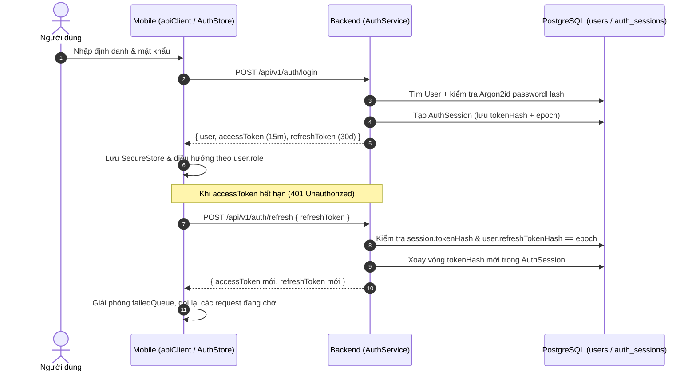
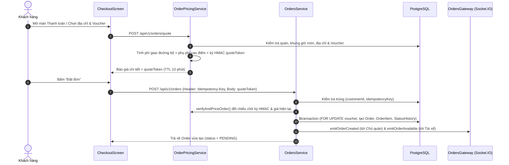
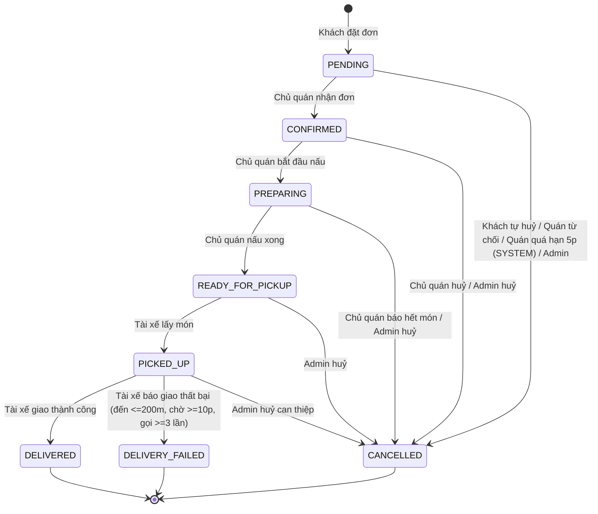
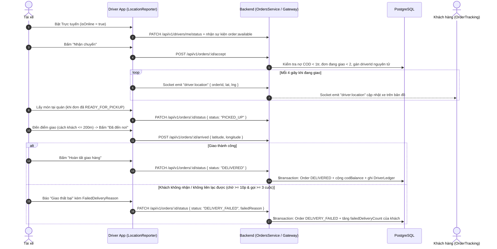

# Phụ lục 01: Danh mục 52 Màn hình & Đặc tả 12 Luồng Nghiệp vụ Chi tiết

> Tài liệu này là Phụ lục của [Tài liệu Hệ thống ZomZom](../TAI_LIEU_HE_THONG.md), cung cấp bảng kiểm kê đầy đủ 52 màn hình giao diện (kèm 1 component intro phụ trợ = 53 file `.tsx` trong `mobile/src/screens/`) và đặc tả từng bước của 12 luồng nghiệp vụ có thật trong mã nguồn.

---

## Mục lục
1. [Thống kê màn hình theo vai trò](#1-thống-kê-màn-hình-theo-vai-trò)
2. [Chi tiết từng màn hình theo nhóm chức năng](#2-chi-tiết-từng-màn-hình-theo-nhóm-chức-năng)
3. [Đặc tả 12 luồng nghiệp vụ cốt lõi](#3-đặc-tả-12-luồng-nghiệp-vu-cốt-lõi)

---

## 1. Thống kê màn hình theo vai trò

Cách đếm bằng lệnh chỉ-đọc:
```powershell
Get-ChildItem -Path mobile/src/screens -Filter *.tsx -Recurse
```
Kết quả: **53 file `.tsx`**, bao gồm **52 màn hình độc lập** và **1 component phụ trợ logo** (`mobile/src/screens/intro/SplashLogo.tsx`, 137 dòng).

| Phân nhóm vai trò | Số màn hình riêng | Số màn hình dùng chung có tham gia | Tổng số màn hình khả dụng cho vai trò |
| :--- | :---: | :---: | :---: |
| **Khách hàng (`CUSTOMER` & Khách vãng lai)** | 21 | 6 (`ZomZomSplash`, `Login`, `EditProfile`, `AddressPicker`, `Chat`, `Inbox`, `NotificationCenter`) | **28** |
| **Chủ quán (`RESTAURANT_OWNER`)** | 5 | 7 (`ZomZomSplash`, `Login`, `VoucherManage`, `EditProfile`, `AddressPicker`, `Chat`, `Inbox`, `NotificationCenter`) | **13** |
| **Tài xế (`DRIVER`)** | 7 | 5 (`ZomZomSplash`, `Login`, `EditProfile`, `Chat`, `Inbox`, `NotificationCenter`) | **13** |
| **Quản trị viên (`ADMIN`)** | 10 | 4 (`ZomZomSplash`, `Login`, `VoucherManage`, `EditProfile`, `NotificationCenter`) | **15** |
| **Dùng chung đa vai trò** | 9 (`ZomZomSplash`, `Login`, `EditProfile`, `AddressPicker`, `Chat`, `Inbox`, `NotificationCenter`, `VoucherManage`, + helper `SplashLogo`) | — | — |
| **Tổng cộng toàn ứng dụng** | **52 màn hình** (+ 1 helper `SplashLogo.tsx` = **53 file `.tsx`**) | — | — |

---

## 2. Chi tiết từng màn hình theo nhóm chức năng

### 2.1. Nhóm Khởi động & Xác thực (`intro/`, `auth/`)

| # | Tên màn hình | Đường dẫn file (số dòng) | Vai trò | Mục đích & Thao tác chính | Dữ liệu hiển thị (tên trường) | Trạng thái xử lý (Đang tải / Lỗi / Rỗng) | Trạng thái hiện thực |
| :-: | :--- | :--- | :--- | :--- | :--- | :--- | :---: |
| 1 | `ZomZomSplashScreen` (+ `SplashLogo`) | `mobile/src/screens/intro/ZomZomSplashScreen.tsx` (160d)<br>`mobile/src/screens/intro/SplashLogo.tsx` (137d) | Dùng chung | Màn hình khởi động thương hiệu ZomZom với hoạt ảnh lò xo `Animated.spring`, xe tay ga giao hàng và thanh tiến độ 2,6 giây trước khi gọi `onFinish()`. | Tĩnh (logo, khẩu hiệu, thanh tiến trình). | Tiến trình tải `Animated.timing`. | **ĐÃ HIỆN THỰC THẬT** |
| 2 | `LoginScreen` | `mobile/src/screens/auth/LoginScreen.tsx` (131d) | Dùng chung | Đăng nhập bằng email/tên đăng nhập/SĐT và mật khẩu (`authApi.login`), kiểm tra Zod (`loginSchema`), chuyển sang `Register`, nút điền nhanh 4 tài khoản demo khi `__DEV__ === true`. | `identifier`, `password`, `error`. | Đang tải: `Button.loading`; Lỗi: `FormErrorBanner` + lỗi dưới từng ô. | **ĐÃ HIỆN THỰC THẬT** |
| 3 | `RegisterScreen` | `mobile/src/screens/auth/RegisterScreen.tsx` (186d) | Khách hàng | Đăng ký tài khoản mới (`authApi.register`), chuẩn hoá SĐT Việt Nam, thanh đo độ mạnh mật khẩu `PasswordStrengthBar`, tự động lưu phiên vào `useAuthStore`. | `fullName`, `phone`, `email`, `password`, `confirmPassword`. | Đang tải: `Button.loading`; Lỗi: `FormErrorBanner` + lỗi Zod từng trường. | **ĐÃ HIỆN THỰC THẬT** |

### 2.2. Nhóm Khám phá, Tìm kiếm & Nhà hàng (`home/`, `search/`, `restaurant/`, `favorites/`)

| # | Tên màn hình | Đường dẫn file (số dòng) | Vai trò | Mục đích & Thao tác chính | Dữ liệu hiển thị (tên trường) | Trạng thái xử lý (Đang tải / Lỗi / Rỗng) | Trạng thái hiện thực |
| :-: | :--- | :--- | :--- | :--- | :--- | :--- | :---: |
| 4 | `HomeScreen` | `mobile/src/screens/home/HomeScreen.tsx` (606d) | Khách hàng | Chọn địa chỉ giao trên đầu trang, mở chuông thông báo (`NotificationBell`), chạm thanh tìm kiếm, lọc nhanh (`FilterChip`), duyệt danh mục ẩm thực (`useCuisines`), banner tự cuộn (`useBanners`), dải mã giảm giá (`FeaturedVoucherStrip`), kệ 2 hàng "Món ngon gần bạn" (`useNearbyDishes`), kệ "Quán được yêu thích" (`FeaturedCarousel`), danh sách "Quán gần tôi" (`useNearbyRestaurants`), mở `DishOptionSheet`, hiện `HomePromoModal`. | `activeAddress`, `cuisines[]` (`id`, `code`, `name`, `imageUrl`), `banners[]`, `dishes[]` (`id`, `name`, `price`, `discountPrice`, `restaurant`), `restaurants[]` (`id`, `name`, `rating`, `distanceKm`, `estimatedDeliveryFee`, `isOpen`). | Đang tải: `RailSkeleton`, `BannerSkeleton`, `RestaurantRowSkeleton`; Lỗi: `ErrorState`; Rỗng: `EmptyState` (khi thiếu vị trí hoặc không có quán khớp); Kéo làm mới: `RefreshControl`. | **ĐÃ HIỆN THỰC THẬT** *(Mọi kệ dữ liệu từ API thật; riêng nút nhận combo trong `HomePromoModal` dòng 182–188 chỉ hiện toast và cuộn xuống kệ món)* |
| 5 | `SearchScreen` | `mobile/src/screens/search/SearchScreen.tsx` (452d) | Khách hàng | Tìm kiếm nhà hàng & món ăn theo từ khoá có debounce 350ms (`useNearbyRestaurants`), mở bảng lọc đa tiêu chí `SearchFilterSheet` (sắp xếp, đang mở, có ưu đãi, số sao, khoảng cách, phí giao), quản lý lịch sử tìm kiếm (`useSearchHistoryStore`), chọn từ khoá xu hướng (`usePopularSearches`), xem lưới 3 cột "Có thể bạn sẽ thích". | `history[]`, `popularSuggestions[]`, `recommendedRestaurants[]`, `searchResults[]` (`id`, `name`, `rating`, `distanceKm`, `matchedDishes[]`). | Đang tải: `LoadingSpinner`, `Skeleton` lưới 3 cột; Rỗng: `EmptyState` khi không tìm thấy kết quả. | **ĐÃ HIỆN THỰC THẬT** |
| 6 | `RestaurantDetailScreen` | `mobile/src/screens/restaurant/RestaurantDetailScreen.tsx` (529d) | Khách hàng | Xem chi tiết quán (`useRestaurantDetail`), chia sẻ quán/món (`useShare`), bấm tim yêu thích (`useToggleFavorite`), xem lịch mở cửa 7 ngày & ngày nghỉ (`CustomerScheduleSheet`), xem kệ món đang giảm giá, nhảy nhanh đến danh mục món, mở `DishOptionSheet` (tự động mở nếu có `openDishId` từ deep link/trang chủ), xem đánh giá thực khách và thanh giỏ hàng nổi. | `restaurant` (`name`, `description`, `address`, `rating`, `ratingCount`, `distanceKm`, `deliveryRadiusKm`, `estimatedDeliveryFee`, `isOpen`, `pausedUntil`, `openingHours[]`, `specialClosings[]`, `categories[].menuItems[]`), `reviewsData.items[]`. | Đang tải: `DetailSkeleton`; Lỗi: `ErrorState` kèm nút thử lại; Rỗng: khung báo quán chưa có thực đơn hoặc chưa có đánh giá. | **ĐÃ HIỆN THỰC THẬT** |
| 7 | `RestaurantReviewsScreen` | `mobile/src/screens/restaurant/RestaurantReviewsScreen.tsx` (126d) | Khách hàng | Xem toàn bộ đánh giá công khai của quán (`useInfiniteQuery`), biểu đồ phân bố 1–5 sao, lọc theo Tất cả / Có hình ảnh / từng mức sao, bấm xem ảnh lớn (`ImageViewerModal`). | `rating`, `ratingCount`, `distribution`, `items[]` (`id`, `customerName`, `rating`, `comment`, `images[]`, `ownerReply`, `createdAt`). | Đang tải: `Skeleton`, `ActivityIndicator`; Lỗi: `ErrorState`; Rỗng: `EmptyState`. | **ĐÃ HIỆN THỰC THẬT** |
| 8 | `FavoritesScreen` | `mobile/src/screens/favorites/FavoritesScreen.tsx` (149d) | Khách hàng | Xem danh sách quán yêu thích của tài khoản (`useFavoritesStore`), mở trang chi tiết quán, hoặc bấm bỏ yêu thích (cập nhật lạc quan). | `restaurants[]` (`id`, `name`, `address`, `imageUrl`, `rating`, `openTime`, `closeTime`, `isOpen`). | Rỗng: `EmptyState` (khi chưa đăng nhập hoặc chưa lưu quán nào). | **ĐÃ HIỆN THỰC THẬT** |

### 2.3. Nhóm Giỏ hàng, Thanh toán, Đơn hàng & Đánh giá (`cart/`, `checkout/`, `order/`, `rating/`, `voucher/`)

| # | Tên màn hình | Đường dẫn file (số dòng) | Vai trò | Mục đích & Thao tác chính | Dữ liệu hiển thị (tên trường) | Trạng thái xử lý (Đang tải / Lỗi / Rỗng) | Trạng thái hiện thực |
| :-: | :--- | :--- | :--- | :--- | :--- | :--- | :---: |
| 9 | `CartScreen` | `mobile/src/screens/cart/CartScreen.tsx` (174d) | Khách hàng | Xem giỏ hàng (`useCartStore`), tăng/giảm số lượng (`QuantityStepper`), xoá từng dòng hoặc xoá cả giỏ (`ConfirmDialog`), chạm vào món để sửa lại size/topping/độ cay/ghi chú (`DishOptionSheet`), xem kệ gợi ý món mua kèm (`CartSuggestions`), chuyển sang `Checkout` (hoặc `Login` nếu chưa đăng nhập). | `restaurant` (`id`, `name`), `items[]` (`id`, `menuItem`, `quantity`, `unitPrice`, `size`, `toppings[]`, `spiciness`, `note`), `subtotal`. | Rỗng: `EmptyState` kèm nút "Khám phá nhà hàng". | **ĐÃ HIỆN THỰC THẬT** |
| 10 | `CheckoutScreen` | `mobile/src/screens/checkout/CheckoutScreen.tsx` (756d) | Khách hàng | Chọn/đổi địa chỉ giao hàng, gọi báo giá từ server (`ordersApi.quote`) có debounce và tự làm mới trước khi hết hạn `expiresAt`, chọn gộp tối đa 2 voucher (1 mã món + 1 mã freeship) qua `VoucherPickerSheet`, gỡ nhanh món vừa hết hàng/ngoài giờ bán, đặt đơn kèm `Idempotency-Key` và `quoteToken`, xử lý hộp thoại xác nhận khi giá thay đổi (`QUOTE_CHANGED`). | `activeAddress`, `quote` (`subtotal`, `deliveryFee`, `peakSurcharge`, `discountAmount`, `shippingDiscount`, `total`, `distanceKm`, `distanceSource`, `quoteToken`, `expiresAt`), `voucherCode`, `freeshipVoucherCode`, `note`. | Đang tải: `Skeleton`, `Button.loading`; Lỗi: thẻ báo lỗi báo giá + nút thử lại, `ConfirmDialog` khi lệch giá; Rỗng: `EmptyState` khi giỏ trống. | **ĐÃ HIỆN THỰC THẬT** |
| 11 | `OrderHistoryScreen` | `mobile/src/screens/order/OrderHistoryScreen.tsx` (372d) | Khách hàng | Xem danh sách đơn hàng (`useMyOrders`) theo 4 tab (`all`, `active`, `done`, `cancelled`), theo dõi tiến trình 4 bước trên thẻ đơn đang chạy (`ActiveOrderCard`), xem đơn cũ nhóm theo ngày (`PastOrderCard`), bấm "Đánh giá" (`RatingScreen`) hoặc "Đặt lại" (`useReorder`). | `orders[]` (`id`, `status`, `total`, `createdAt`, `estimatedDeliveryAt`, `restaurant`, `items[]`, `review`, `cancelReason`, `failedReason`). | Đang tải: `OrderSkeleton`; Lỗi: `ErrorState`; Rỗng: `EmptyState`; Làm mới: `RefreshControl`. | **ĐÃ HIỆN THỰC THẬT** |
| 12 | `OrderTrackingScreen` | `mobile/src/screens/order/OrderTrackingScreen.tsx` (584d) | Khách hàng | Theo dõi đơn trực tiếp trên bản đồ `AppMapView` (Quán, Điểm giao, Tài xế, tuyến đường `mapsApi.getRoute`), lắng nghe Socket `driver:location` & trạng thái đơn, gọi điện/chat với tài xế và quán, tự huỷ đơn khi còn `PENDING` (`CancelOrderSheet`), gửi yêu cầu hỗ trợ (`OrderIssue`), xem đánh giá đã gửi. | `order` (`id`, `status`, `restaurant`, `deliveryAddress`, `deliveryLat`, `deliveryLng`, `driver`, `items[]`, `subtotal`, `deliveryFee`, `discountAmount`, `shippingDiscount`, `total`, `paymentMethod`, `paymentStatus`, `review`), `liveDriverCoords`, `routeCoords`. | Đang tải: `LoadingSpinner`; Lỗi: thông báo lỗi tải đơn. | **ĐÃ HIỆN THỰC THẬT** |
| 13 | `RatingScreen` | `mobile/src/screens/rating/RatingScreen.tsx` (295d) | Khách hàng | Đánh giá kép sau khi đơn `DELIVERED` (`ordersApi.review`): chấm 1–5 sao cho quán + chọn thẻ gợi ý nhanh + viết nhận xét + đính kèm tối đa 3 ảnh (`ReviewPhotoPicker`); chấm 1–5 sao + nhận xét cho tài xế. | `rating`, `comment`, `images[]`, `driverRating`, `driverComment`. | Đang tải: `Button.loading`. | **ĐÃ HIỆN THỰC THẬT** |
| 14 | `VoucherWalletScreen` | `mobile/src/screens/voucher/VoucherWalletScreen.tsx` (92d) | Khách hàng | Xem ví voucher (`useVoucherWallet`) theo 2 tab: "Dùng được" (`available`) và "Đã dùng / Hết hạn" (`history`), chạm vào vé để mở trang quán áp dụng hoặc trang chủ. | `vouchers[]` (`id`, `code`, `title`, `discountType`, `discountValue`, `maxDiscountAmount`, `minOrderAmount`, `endDate`, `restaurant`, `kind`). | Đang tải: `Skeleton`; Lỗi: `ErrorState`; Rỗng: `EmptyState`; Làm mới: `RefreshControl`. | **ĐÃ HIỆN THỰC THẬT** |
| 15 | `VoucherManageScreen` | `mobile/src/screens/voucher/VoucherManageScreen.tsx` (207d) | Chủ quán & Quản trị | Quản lý mã khuyến mãi của quán (`OwnerVouchers`) hoặc toàn sàn (`AdminVouchers`): lọc trạng thái (`active`, `inactive`, `expired`, `all`, `compensation`), bật/tắt nhanh bằng `Switch`, tạo/sửa mã qua `VoucherFormSheet`. | `vouchers[]` (`code`, `title`, `discountType`, `discountValue`, `minOrderAmount`, `maxDiscountAmount`, `maxUsage`, `usedCount`, `perUserLimit`, `startDate`, `endDate`, `isActive`, `fundedBy`, `kind`). | Đang tải: `Skeleton`; Lỗi: `ErrorState`; Rỗng: `EmptyState`; Làm mới: `RefreshControl`. | **ĐÃ HIỆN THỰC THẬT** |

### 2.4. Nhóm Hồ sơ, Địa chỉ, Chat, Thông báo & Trợ giúp (`profile/`, `chat/`, `notifications/`, `help/`)

| # | Tên màn hình | Đường dẫn file (số dòng) | Vai trò | Mục đích & Thao tác chính | Dữ liệu hiển thị (tên trường) | Trạng thái xử lý (Đang tải / Lỗi / Rỗng) | Trạng thái hiện thực |
| :-: | :--- | :--- | :--- | :--- | :--- | :--- | :---: |
| 16 | `ProfileScreen` | `mobile/src/screens/profile/ProfileScreen.tsx` (233d) | Khách hàng | Xem thông tin tài khoản (`useMe`), 3 ô thống kê (Đơn hàng, Yêu thích, Địa chỉ), dẫn tới `EditProfile`, `AddressManagement`, `Inbox` (kèm badge chưa đọc), `VoucherWallet`, `RoleUpgradeRequest`, `HelpCenter` (kèm badge phiếu đang mở), và `LogoutButton`. | `user` (`fullName`, `email`, `phone`, `avatarUrl`), `orders.total`, `favoriteCount`, `addresses.length`, `unreadChats`, `openTicketsCount`. | Đang tải: `Skeleton`; Khách vãng lai: hiện nút Đăng nhập. | **ĐÃ HIỆN THỰC THẬT** |
| 17 | `EditProfileScreen` | `mobile/src/screens/profile/EditProfileScreen.tsx` (278d) | Dùng chung (4 vai trò) | Tải ảnh đại diện (`useUploadAvatar`), sửa họ tên/SĐT/email (`useUpdateProfile`), đổi mật khẩu (`usersApi.changePassword`), xoá tài khoản (`usersApi.deleteAccount`). | `avatarUrl`, `fullName`, `phone`, `email`, `currentPassword`, `newPassword`. | Đang tải: `Button.loading`; Lỗi: banner/toast lỗi. | **ĐÃ HIỆN THỰC THẬT** |
| 18 | `RoleUpgradeRequestScreen` | `mobile/src/screens/profile/RoleUpgradeRequestScreen.tsx` (227d) | Khách hàng | Gửi đơn xin nâng cấp lên Chủ quán hoặc Tài xế (`usersApi.requestUpgrade`) và xem lịch sử các yêu cầu đã gửi (`usersApi.myUpgradeRequests`). | `requestedRole`, `metadata` (`restaurantName`, `restaurantAddress`, `vehicleType`, `licensePlate`), `note`, `status`, `reviewNote`. | Đang tải: `LoadingSpinner`, `Button.loading`. | **ĐÃ HIỆN THỰC THẬT** |
| 19 | `AddressManagementScreen` | `mobile/src/screens/profile/AddressManagementScreen.tsx` (216d) | Khách hàng | Xem danh sách địa chỉ (`useAddresses`), chọn địa chỉ giao hiện tại (`useDeliveryAddressStore`), đặt mặc định, xoá địa chỉ, thêm nhanh "Nhà" / "Công ty". | `addresses[]` (`id`, `label`, `addressLine`, `latitude`, `longitude`, `isDefault`, `needsConfirmation`). | Đang tải: `LoadingSpinner`; Rỗng: thông báo chưa có địa chỉ. | **ĐÃ HIỆN THỰC THẬT** |
| 20 | `AddAddressScreen` | `mobile/src/screens/profile/AddAddressScreen.tsx` (310d) | Khách hàng | Nhập người nhận, mở `AddressPicker` ghim toạ độ, nhập toà nhà/cổng/ghi chú tài xế, chọn nhãn (`Nhà`, `Công ty`, `Khác`), chặn lưu chuỗi toạ độ thô, lưu qua `usersApi.createAddress`. | `receiverName`, `receiverPhone`, `selectedAddressLine`, `pickedCoords`, `buildingFloor`, `gateInfo`, `selectedTag`, `driverNote`. | Đang tải: `Button.loading`; Cảnh báo thiếu trường. | **ĐÃ HIỆN THỰC THẬT** |
| 21 | `AddressPickerScreen` | `mobile/src/screens/profile/AddressPickerScreen.tsx` (415d) | Khách hàng & Chủ quán | Ghim vị trí trên bản đồ tương tác, tìm kiếm địa điểm gợi ý debounce 350ms (`mapsApi.autocomplete`, `mapsApi.getPlaceDetail`), dịch ngược toạ độ tâm bản đồ (`mapsApi.reverseGeocode`), lấy GPS hiện tại, hoặc nhập địa chỉ thủ công. | `centerCoords`, `resolvedAddress`, `suggestions[]` (`placeId`, `description`). | Đang tải: `ActivityIndicator`; Lỗi: `geocodingError` kèm nút tự nhập tay. | **ĐÃ HIỆN THỰC THẬT** |
| 22 | `ChatScreen` | `mobile/src/screens/chat/ChatScreen.tsx` (271d) | Khách hàng, Chủ quán, Tài xế | Trò chuyện 2 bên theo đơn hàng & kênh (`CUSTOMER_DRIVER`, `CUSTOMER_RESTAURANT`, `RESTAURANT_DRIVER`), nhận tin realtime qua Socket (`order:message`), đánh dấu đã đọc, chọn chip trả lời nhanh theo vai trò. | `messages[]` (`id`, `orderId`, `channel`, `senderId`, `senderRole`, `content`, `createdAt`), `ChatOrderCard`. | Đang tải: `LoadingSpinner`; Rỗng: `EmptyState`; Chỉ báo trạng thái kết nối Socket. | **ĐÃ HIỆN THỰC THẬT** |
| 23 | `InboxScreen` | `mobile/src/screens/chat/InboxScreen.tsx` (389d) | Khách hàng, Chủ quán, Tài xế | Danh sách hội thoại phân trang vô tận (`ordersApi.getConversations`), tìm kiếm, lọc Tất cả / Chưa đọc / Vai trò đối phương, tự cập nhật khi có tin mới qua Socket. | `conversations[]` (`orderId`, `channel`, `orderStatus`, `counterpart`, `lastMessage`, `unreadCount`, `updatedAt`). | Đang tải: `LoadingSpinner`, `ActivityIndicator`; Lỗi/Rỗng: `EmptyState`; Làm mới: `RefreshControl`. | **ĐÃ HIỆN THỰC THẬT** |
| 24 | `NotificationCenterScreen` | `mobile/src/screens/notifications/NotificationCenterScreen.tsx` (291d) | Dùng chung (4 vai trò) | Xem thông báo hệ thống nhóm theo ngày (`Hôm nay`, `Hôm qua`, `Tuần này`, `Cũ hơn`), lọc 3 tab (`Tất cả`, `Đơn hàng`, `Hoạt động`), đánh dấu đã đọc 1 hoặc tất cả, xoá thông báo, chạm để điều hướng sâu tới màn hình nghiệp vụ tương ứng. | `items[]` (`id`, `type`, `title`, `body`, `data`, `readAt`, `createdAt`), `unreadCount`. | Đang tải: `LoadingSpinner`; Rỗng: `EmptyState`; Làm mới: `RefreshControl`. | **ĐÃ HIỆN THỰC THẬT** |
| 25 | `HelpCenterScreen` | `mobile/src/screens/help/HelpCenterScreen.tsx` (503d) | Khách hàng | Trung tâm trợ giúp: chọn đơn gần đây báo sự cố, tìm kiếm bài viết FAQ có debounce, duyệt danh mục câu hỏi (`useHelpCategories`) và bài viết phổ biến (`usePopularHelpArticles`), mở Chatbot (`SupportChat`) hoặc danh sách phiếu hỗ trợ (`SupportTicketList`). | `recentOrders[]`, `categories[]`, `popularArticles[]`, `searchResults[]`, `openTicketsCount`. | Đang tải: `Skeleton`; Lỗi/Rỗng: `EmptyState`. | **ĐÃ HIỆN THỰC THẬT** |
| 26 | `HelpArticleScreen` | `mobile/src/screens/help/HelpArticleScreen.tsx` (258d) | Khách hàng | Xem nội dung bài viết FAQ (`useHelpArticle`), bình chọn Hữu ích / Chưa hữu ích (`useSubmitArticleFeedback`), hiện nút chuyển sang Chatbot hoặc Báo sự cố đơn khi bấm 👎. | `article` (`id`, `title`, `body`, `category`, `helpfulCount`, `notHelpfulCount`, `userFeedback`). | Đang tải: `LoadingSpinner`; Lỗi: thông báo không tìm thấy bài viết. | **ĐÃ HIỆN THỰC THẬT** |
| 27 | `OrderIssueScreen` | `mobile/src/screens/help/OrderIssueScreen.tsx` (579d) | Khách hàng | Báo sự cố theo đơn hàng: cây quyết định vấn đề theo trạng thái đơn, chọn món và số lượng bị thiếu/sai, đính kèm tối đa 3 ảnh, gửi tạo phiếu (`useCreateTicket`) và nhận kết quả bồi thường tự động hoặc chuyển CSKH. | `selectedOrder`, `category`, `selectedItems`, `description`, `attachments[]`, `resolution`. | Đang tải: `LoadingSpinner`, `Button.loading`. | **ĐÃ HIỆN THỰC THẬT** |
| 28 | `SupportTicketListScreen` | `mobile/src/screens/help/SupportTicketListScreen.tsx` (199d) | Khách hàng | Xem danh sách phiếu hỗ trợ (`useMyTickets`) theo 2 tab: Đang mở (`open`) và Đã đóng (`closed`). | `tickets[]` (`id`, `code`, `subject`, `status`, `priority`, `order`, `updatedAt`). | Đang tải: `LoadingSpinner`; Rỗng: `EmptyState`; Làm mới: `RefreshControl`. | **ĐÃ HIỆN THỰC THẬT** |
| 29 | `SupportTicketDetailScreen` | `mobile/src/screens/help/SupportTicketDetailScreen.tsx` (420d) | Khách hàng | Xem chi tiết phiếu hỗ trợ (`useTicketDetail`), thông tin voucher bồi thường (nếu có), nhắn tin trao đổi 2 chiều với CSKH (`useAddTicketMessage`), đóng phiếu (`useResolveTicket`) và chấm điểm hài lòng CSAT 1–5 sao (`useSubmitCsat`). | `ticket` (`code`, `status`, `subject`, `resolution`, `messages[]`, `csatScore`, `csatComment`). | Đang tải: `LoadingSpinner`, `Button.loading`. | **ĐÃ HIỆN THỰC THẬT** |
| 30 | `SupportChatScreen` | `mobile/src/screens/help/SupportChatScreen.tsx` (546d) | Khách hàng | Trò chuyện với Trợ lý ảo ZomZom (`useBotWelcome`, `useBotMessages`, `useSendBotMessage`), hiển thị thẻ hành động động (`ORDER_STATUS`, `FAQ_ARTICLE`, `START_ISSUE`, `HANDOVER`), nút gợi ý nhanh, bình chọn 👍/👎 câu trả lời bot (`useSubmitBotFeedback`), chuyển tiếp tạo phiếu gặp nhân viên CSKH (`useBotHandover`). | `messages[]` (`messageId`, `role`, `content`, `source`, `cards[]`, `quickReplies[]`, `feedback`), `remainingToday`. | Đang tải: `ActivityIndicator`, bong bóng bot đang soạn; Lỗi: nút gửi lại tin nhắn lỗi. | **ĐÃ HIỆN THỰC THẬT** |

### 2.5. Nhóm Chủ quán (`owner/` — 5 màn hình)

| # | Tên màn hình | Đường dẫn file (số dòng) | Vai trò | Mục đích & Thao tác chính | Dữ liệu hiển thị (tên trường) | Trạng thái xử lý (Đang tải / Lỗi / Rỗng) | Trạng thái hiện thực |
| :-: | :--- | :--- | :--- | :--- | :--- | :--- | :---: |
| 31 | `OwnerOrdersScreen` | `mobile/src/screens/owner/OwnerOrdersScreen.tsx` (605d) | Chủ quán | Xử lý đơn hàng theo 4 tab quy trình (`NEW`, `DOING`, `PICKUP`, `HISTORY`), lắng nghe Socket realtime, xác nhận đơn (`CONFIRMED`), bắt đầu chế biến (`PREPARING`), báo sẵn sàng (`READY_FOR_PICKUP`), từ chối/huỷ đơn kèm lý do (`CANCELLED`), gọi điện/chat với khách và tài xế. | `orders[]` (`id`, `status`, `customer`, `driver`, `items[]`, `subtotal`, `deliveryFee`, `discountAmount`, `total`, `note`, `createdAt`). | Đang tải: `LoadingSpinner`; Rỗng: `EmptyState`; Làm mới: `RefreshControl`. | **ĐÃ HIỆN THỰC THẬT** |
| 32 | `OwnerMenuScreen` | `mobile/src/screens/owner/OwnerMenuScreen.tsx` (925d) | Chủ quán | Quản lý danh mục & món ăn: tìm kiếm món, thêm danh mục, tạo/sửa/lưu trữ món, tải ảnh món, đặt % giảm giá, trình biên tập tuỳ chọn Size/Topping/Độ cay-ngọt (`MenuOptionsEditor`), bật/tắt còn món tức thì, cài đặt khung giờ mở bán riêng của món (`availableFrom`–`availableTo`). | `categories[]`, `uncategorizedItems[]`, `MenuItem` (`id`, `name`, `price`, `discountPrice`, `imageUrl`, `isAvailable`, `availableFrom`, `availableTo`, `options`). | Đang tải: `LoadingSpinner`; Rỗng: `EmptyState`; Làm mới: `RefreshControl`. | **ĐÃ HIỆN THỰC THẬT** |
| 33 | `OwnerRestaurantScreen` | `mobile/src/screens/owner/OwnerRestaurantScreen.tsx` (767d) | Chủ quán | Quản lý trạng thái mở/đóng cửa, tạm nghỉ có hẹn giờ (30p / 1h / 2h / hết hôm nay), cài lịch mở cửa 7 ngày & ngày nghỉ lễ (`OwnerScheduleSheet`), xem nhanh doanh thu hôm nay & 7 ngày, sửa thông tin quán & bán kính giao, cài đặt chuông báo đơn mới (`useOwnerSettingsStore`), dẫn tới `OwnerStats`, `OwnerReviews`, `OwnerVouchers`. | `restaurant` (`name`, `status`, `isOpen`, `pausedUntil`, `openTime`, `closeTime`, `deliveryRadiusKm`, `address`), `todayStats`, `weekStats`, `soundEnabled`. | Đang tải: `LoadingSpinner`; Rỗng: `EmptyState` khi chưa có quán. | **ĐÃ HIỆN THỰC THẬT** |
| 34 | `OwnerReviewsScreen` | `mobile/src/screens/owner/OwnerReviewsScreen.tsx` (339d) | Chủ quán | Xem đánh giá của khách (`restaurantsApi.getManageReviews`), lọc Tất cả / Chưa phản hồi / Có ảnh, gửi phản hồi của quán (`replyReview`), ẩn/hiện ảnh đánh giá vi phạm kèm lý do (`hideReviewImage`, `unhideReviewImage`). | `reviews[]` (`id`, `customerName`, `rating`, `comment`, `images[]`, `hiddenImages[]`, `ownerReply`, `createdAt`). | Đang tải: `LoadingSpinner`; Rỗng: `EmptyState`; Làm mới: `RefreshControl`. | **ĐÃ HIỆN THỰC THẬT** |
| 35 | `OwnerStatsScreen` | `mobile/src/screens/owner/OwnerStatsScreen.tsx` (304d) | Chủ quán | Xem thống kê doanh thu theo 1 / 7 / 30 ngày (`restaurantsApi.getStats`), 4 thẻ KPI, biểu đồ cột doanh thu theo ngày, bảng xếp hạng món bán chạy và xuất báo cáo CSV (`ExportCsvSheet`). | `revenue`, `deliveredOrders`, `totalOrders`, `cancelledOrders`, `itemsSold`, `averageOrderValue`, `daily[]`, `topItems[]`. | Đang tải: `LoadingSpinner`; Lỗi: `ErrorState`; Làm mới: `RefreshControl`. | **ĐÃ HIỆN THỰC THẬT** |

### 2.6. Nhóm Tài xế (`driver/` — 7 màn hình)

| # | Tên màn hình | Đường dẫn file (số dòng) | Vai trò | Mục đích & Thao tác chính | Dữ liệu hiển thị (tên trường) | Trạng thái xử lý (Đang tải / Lỗi / Rỗng) | Trạng thái hiện thực |
| :-: | :--- | :--- | :--- | :--- | :--- | :--- | :---: |
| 36 | `DriverAvailableOrdersScreen` | `mobile/src/screens/driver/DriverAvailableOrdersScreen.tsx` (587d) | Tài xế | Bật/tắt Trực tuyến (yêu cầu xe đã duyệt `APPROVED` và có GPS thật), xem hạn mức công nợ COD & thu nhập hôm nay, nhận đơn khả dụng quanh vị trí (`ordersApi.getAvailable` + Socket `order:available`), chặn nhận khi đang giữ đủ 2 đơn hoặc vượt trần nợ COD. | `driverProfile` (`isOnline`, `verificationStatus`), `ledgerSummary` (`balance`, `limit`), `todayStats`, `orders[]` (`id`, `status`, `driverEarning`, `distanceToRestaurantKm`, `distanceKm`, `restaurant`, `deliveryAddress`, `total`). | Đang tải: `LoadingSpinner`; Rỗng: `EmptyState` (khi offline hoặc chưa có đơn quanh vị trí); Làm mới: `RefreshControl`. | **ĐÃ HIỆN THỰC THẬT** |
| 37 | `DriverDeliveriesScreen` | `mobile/src/screens/driver/DriverDeliveriesScreen.tsx` (296d) | Tài xế | Xem danh sách chuyến đang giao (`ACTIVE`) và lịch sử chuyến (`COMPLETED` nhóm theo ngày), gọi nhanh cho quán/khách, mở chi tiết chuyến giao. | `activeItems[]`, `finishedItems[]` (`id`, `status`, `driverEarning`, `restaurant`, `deliveryAddress`, `createdAt`). | Đang tải: `LoadingSpinner`; Rỗng: `EmptyState`; Làm mới: `RefreshControl`. | **ĐÃ HIỆN THỰC THẬT** |
| 38 | `DriverDeliveryDetailScreen` | `mobile/src/screens/driver/DriverDeliveryDetailScreen.tsx` (1236d) | Tài xế | Bản đồ điều hành chuyến giao (`AppMapView` + Bottom Sheet kéo thả): vẽ 2 chặng đường (Tài xế $\rightarrow$ Quán, Quán $\rightarrow$ Khách), trả đơn trước khi lấy món (tối đa 3 lần/ngày), xác nhận `PICKED_UP`, xác nhận đã đến nơi `<= 200m` (`arrived`), gọi khách có ghi nhận `contact-attempts`, đếm ngược 10 phút chờ để mở nút `DELIVERY_FAILED`, hoặc xác nhận `DELIVERED`. | `order`, `mainRoute`, `driverLeg`, `waitedSeconds`, `callsAfterArrived`, `driverEarning`. | Đang tải: `ActivityIndicator`, `isSubmitting` trên nút thao tác. | **ĐÃ HIỆN THỰC THẬT** |
| 39 | `DriverProfileScreen` | `mobile/src/screens/driver/DriverProfileScreen.tsx` (417d) | Tài xế | Xem hồ sơ tài xế, trạng thái duyệt xe, biểu đồ thu nhập 1 / 7 / 30 ngày (`ordersApi.getDriverStats`), dẫn tới `DriverVehicle`, `DriverWallet`, `DriverReviews`, `EditProfile`, và đăng xuất. | `profile` (`vehicleType`, `licensePlate`, `verificationStatus`), `stats` (`earnings`, `deliveredTrips`, `cashCollected`, `daily[]`). | Đang tải: `Skeleton`; Làm mới: `RefreshControl`. | **ĐÃ HIỆN THỰC THẬT** |
| 40 | `DriverReviewsScreen` | `mobile/src/screens/driver/DriverReviewsScreen.tsx` (283d) | Tài xế | Xem điểm sao trung bình, biểu đồ 1–5 sao, danh sách đánh giá khách chấm cho tài xế (`driversApi.getMyReviews`) và gửi phản hồi (`driversApi.replyReview`). | `reviews[]` (`id`, `customerName`, `driverRating`, `driverComment`, `driverReply`, `createdAt`). | Đang tải: `LoadingSpinner`; Rỗng: `EmptyState`; Làm mới: `RefreshControl`. | **ĐÃ HIỆN THỰC THẬT** |
| 41 | `DriverVehicleScreen` | `mobile/src/screens/driver/DriverVehicleScreen.tsx` (331d) | Tài xế | Cập nhật thông tin xe (`driversApi.updateVehicle`), kiểm tra biển số xe Việt Nam (`VN_PLATE_REGEX`), thông tin liên hệ khẩn cấp & ngân hàng; cảnh báo chuyển về `PENDING` nếu đổi biển số/loại xe. | `vehicleType`, `licensePlate`, `vehicleBrand`, `vehicleModel`, `vehicleColor`, `driverLicenseClass`, `emergencyContactName`, `emergencyContactPhone`, `bankName`, `bankAccountNumber`, `bankAccountName`. | Đang tải: `ActivityIndicator`, `Button.loading`. | **ĐÃ HIỆN THỰC THẬT** |
| 42 | `DriverWalletScreen` | `mobile/src/screens/driver/DriverWalletScreen.tsx` (232d) | Tài xế | Xem sổ cái công nợ tiền mặt COD (`driversApi.getMyLedger`), thanh hạn mức nợ (`balance` / `limit`), lịch sử biến động nhóm theo ngày (`COD_COLLECTED`, `SETTLEMENT`, `ADJUSTMENT`). | `balance`, `limit`, `items[]` (`id`, `type`, `amount`, `balanceAfter`, `note`, `createdAt`). | Đang tải: `LoadingSpinner`; Rỗng: `EmptyState`; Làm mới: `RefreshControl`. | **ĐÃ HIỆN THỰC THẬT** |

### 2.7. Nhóm Quản trị viên (`admin/` — 10 màn hình)

| # | Tên màn hình | Đường dẫn file (số dòng) | Vai trò | Mục đích & Thao tác chính | Dữ liệu hiển thị (tên trường) | Trạng thái xử lý (Đang tải / Lỗi / Rỗng) | Trạng thái hiện thực |
| :-: | :--- | :--- | :--- | :--- | :--- | :--- | :---: |
| 43 | `AdminDashboardScreen` | `mobile/src/screens/admin/AdminDashboardScreen.tsx` (506d) | Quản trị | Bảng điều khiển toàn sàn theo kỳ (`today`, `7d`, `30d`), danh sách "Cần xử lý ngay" (`AttentionList`), 4 thẻ KPI kèm % tăng giảm, biểu đồ doanh thu GMV + phí ship + hoa hồng sàn, phễu đơn trực tiếp, top quán, phân tích lý do huỷ đơn, cơ cấu người dùng. | `overview` (`kpis`, `series[]`, `attention`, `funnel`, `topRestaurants[]`, `cancelReasons[]`), `stats.users`. | Đang tải: `HeaderSkeleton`, `KpiSkeleton`, `Skeleton`; Lỗi: `ErrorState`; Làm mới: `RefreshControl`. | **ĐÃ HIỆN THỰC THẬT** |
| 44 | `AdminOrdersScreen` | `mobile/src/screens/admin/AdminOrdersScreen.tsx` (371d) | Quản trị | Giám sát đơn toàn hệ thống theo 4 nhóm (`active`, `stalled`, `done`, `failed`), tìm kiếm, xem chi tiết trong `OrderDetailPanel`, gỡ tài xế (`unassignDriver`), ép chuyển trạng thái/huỷ đơn (`ADMIN_INTERVENTION`), xuất CSV (`adminApi.exportOrdersCsv`). | `orders[]` (`id`, `status`, `stalledAt`, `restaurant`, `customer`, `driver`, `total`, `createdAt`), `counts`. | Đang tải: `ListSkeleton`; Lỗi: `ErrorState`; Rỗng: `EmptyState`; Làm mới: `RefreshControl`. | **ĐÃ HIỆN THỰC THẬT** |
| 45 | `AdminUsersScreen` | `mobile/src/screens/admin/AdminUsersScreen.tsx` (391d) | Quản trị | Quản lý người dùng theo 6 tab vai trò/trạng thái, khoá/mở khoá tài khoản, đổi vai trò, duyệt yêu cầu nâng cấp vai trò (`RoleRequestsSheet`), duyệt phương tiện tài xế & ghi nhận thu nộp/điều chỉnh công nợ COD (`DriverVerifySheet`). | `users[]` (`id`, `fullName`, `email`, `phone`, `role`, `isActive`, `driverProfile`), `pendingRequests[]`. | Đang tải: `ListSkeleton`; Lỗi: `ErrorState`; Rỗng: `EmptyState`; Làm mới: `RefreshControl`. | **ĐÃ HIỆN THỰC THẬT** |
| 46 | `AdminRestaurantsScreen` | `mobile/src/screens/admin/AdminRestaurantsScreen.tsx` (386d) | Quản trị | Quản lý nhà hàng theo 5 tab (`all`, `pending`, `active`, `suspended`, `unassigned`), duyệt/từ chối/đình chỉ/mở lại quán, gán chủ quán (`AssignOwnerSheet`), tạo quán mới kèm tài khoản chủ quán, ẩn/hiện đánh giá hoặc xoá món vi phạm. | `restaurants[]` (`id`, `name`, `status`, `isOpen`, `owner`, `rating`), `counts`. | Đang tải: `ListSkeleton`; Lỗi: `ErrorState`; Rỗng: `EmptyState`; Làm mới: `RefreshControl`. | **ĐÃ HIỆN THỰC THẬT** |
| 47 | `AdminProfileScreen` | `mobile/src/screens/admin/AdminProfileScreen.tsx` (230d) | Quản trị | Trung tâm điều hướng hệ thống có gắn `CountBadge` số việc chờ xử lý: dẫn tới `AdminAuditLog`, `AdminSupportTickets`, `AdminVouchers`, `AdminRefunds`, `AdminBanners`, `AdminCuisines`, `EditProfile`, xoá cache tạm, đăng xuất. | `user`, `attention`, `pendingRefunds.length`. | Hiển thị tức thì. | **ĐÃ HIỆN THỰC THẬT** |
| 48 | `AdminBannersScreen` | `mobile/src/screens/admin/AdminBannersScreen.tsx` (473d) | Quản trị | Tạo/sửa/xoá/sắp xếp thứ tự banner trang chủ (`adminContentApi`), tải ảnh 16:9 lên Cloudinary, cấu hình hành động khi chạm (`NONE`, `RESTAURANT`, `CUISINE`, `SEARCH`) và lịch chạy `startAt`–`endAt`. | `banners[]` (`id`, `title`, `imageUrl`, `actionType`, `actionValue`, `sortOrder`, `isActive`, `startAt`, `endAt`). | Đang tải: `LoadingSpinner`; Rỗng: `EmptyState`; Làm mới: `RefreshControl`. | **ĐÃ HIỆN THỰC THẬT** |
| 49 | `AdminCuisinesScreen` | `mobile/src/screens/admin/AdminCuisinesScreen.tsx` (301d) | Quản trị | Tạo/sửa/xoá/sắp xếp danh mục ẩm thực trang chủ (`adminContentApi`), tải ảnh vuông, cấu hình mảng từ khoá lọc quán (`keywords[]`). | `cuisines[]` (`id`, `code`, `name`, `imageUrl`, `keywords[]`, `sortOrder`, `isActive`). | Đang tải: `LoadingSpinner`; Rỗng: `EmptyState`; Làm mới: `RefreshControl`. | **ĐÃ HIỆN THỰC THẬT** |
| 50 | `AdminAuditLogScreen` | `mobile/src/screens/admin/AdminAuditLogScreen.tsx` (170d) | Quản trị | Tra cứu nhật ký kiểm toán phân trang vô tận (`adminApi.listAuditLogs`), lọc theo kỳ thời gian và nhóm hành động, diễn giải chi tiết thao tác bằng tiếng Việt. | `items[]` (`id`, `action`, `actor`, `targetType`, `targetId`, `metadata`, `createdAt`). | Đang tải: `ListSkeleton`, `LoadingSpinner`; Lỗi: `ErrorState`; Rỗng: `EmptyState`. | **ĐÃ HIỆN THỰC THẬT** |
| 51 | `AdminRefundsScreen` | `mobile/src/screens/admin/AdminRefundsScreen.tsx` (171d) | Quản trị | Quản lý danh sách đơn cần hoàn tiền (`REFUND_PENDING`) và đã hoàn tiền (`REFUNDED`), xác nhận đã hoàn tiền thủ công kèm ghi chú giao dịch (`admin/refunds/:orderId/confirm`). | `orders[]` (`id`, `total`, `status`, `paymentStatus`, `customer`, `restaurant`, `refundedAt`, `refundNote`). | Đang tải: `Skeleton`; Lỗi: `ErrorState`; Rỗng: `EmptyState`; Làm mới: `RefreshControl`. | **ĐÃ HIỆN THỰC THẬT** |
| 52 | `AdminSupportTicketsScreen` | `mobile/src/screens/admin/AdminSupportTicketsScreen.tsx` (490d) | Quản trị | Hàng đợi xử lý phiếu hỗ trợ CSKH (`admin/help/tickets`): xem thống kê CSAT, lọc theo trạng thái/độ ưu tiên, xem gợi ý từ cây quyết định (`resolution`), phản hồi bằng câu mẫu (macros), đổi trạng thái phiếu, phát hành voucher bồi thường cá nhân (`compensate`). | `statsData`, `tickets[]`, `detailTicket` (`code`, `status`, `priority`, `subject`, `user`, `order`, `resolution`, `messages[]`). | Đang tải: `LoadingSpinner`; Rỗng: `EmptyState`; Làm mới: `RefreshControl`. | **ĐÃ HIỆN THỰC THẬT** |

---

## 3. Đặc tả 12 luồng nghiệp vụ cốt lõi

### 3.1. Luồng 1: Đăng ký, Đăng nhập, Quản lý Phiên đa thiết bị & Tự động làm mới Token
- **File tham gia**: `mobile/src/screens/auth/LoginScreen.tsx`, `RegisterScreen.tsx`, `mobile/src/store/useAuthStore.ts`, `mobile/src/api/client.ts` (dòng 16–162), `backend/src/modules/auth/auth.service.ts` (dòng 35–227), `backend/src/modules/auth/auth-state.service.ts`.
- **Các bước thực hiện**:
  1. Người dùng nhập định danh (email, SĐT Việt Nam hoặc `username`) và mật khẩu trên `LoginScreen`.
  2. Backend `AuthService.login` chuẩn hoá định danh (`normalizeAuthIdentifier`), tìm `User`, kiểm tra `isActive` và đối chiếu mật khẩu bằng `verifySecret` (Argon2id).
  3. Nếu tài khoản chưa có `refreshTokenHash` (epoch), backend khởi tạo `epoch` ngẫu nhiên 32 byte hex. Sau đó tạo bản ghi `AuthSession` mới cho thiết bị hiện tại, ký `accessToken` (hạn 15 phút) và `refreshToken` (chứa `sub`, `sid`, `epoch`, hạn 30 ngày), băm `refreshToken` bằng Argon2id lưu vào `AuthSession.tokenHash`.
  4. Mobile lưu bộ đôi token vào `SecureStore` (Native) / `localStorage` (Web) thông qua `useAuthStore.setAuth()`. `AppNavigator` đọc `user.role` và chuyển vào Navigator của vai trò tương ứng.
  5. Khi `accessToken` hết hạn (HTTP 401), `mobile/src/api/client.ts` khoá cờ `isRefreshing = true`, xếp các request đồng thời vào `failedQueue`, gọi `POST /api/v1/auth/refresh` để xoay vòng cặp token mới rồi tự động thực thi lại toàn bộ hàng đợi.



### 3.2. Luồng 2: Khám phá Quán ăn, Tìm kiếm Không dấu & Chọn Món có Tuỳ chọn
- **File tham gia**: `mobile/src/screens/home/HomeScreen.tsx`, `SearchScreen.tsx`, `RestaurantDetailScreen.tsx`, `mobile/src/components/modules/restaurant/DishOptionSheet.tsx`, `backend/src/modules/restaurants/restaurants.service.ts` (dòng 86–208).
- **Các bước thực hiện**:
  1. `HomeScreen` phân giải toạ độ giao hàng qua `resolveActiveDeliveryAddress` (ưu tiên: địa chỉ đang chọn $\rightarrow$ địa chỉ mặc định $\rightarrow$ địa chỉ đầu tiên $\rightarrow$ GPS hiện tại).
  2. Gọi `GET /api/v1/restaurants/nearby` và `/nearby/dishes`. Backend lọc sơ bộ bằng khung hình chữ nhật `boundingBox`, tính khoảng cách cầu Haversine trong SQL, lọc các quán thoả `"distanceKm" <= "deliveryRadiusKm"`, kiểm tra giờ mở cửa/lịch tuần/ngày nghỉ/tạm nghỉ (`pausedUntil`).
  3. Khi khách gõ từ khoá trên `SearchScreen` (debounce 350ms), backend bỏ dấu tiếng Việt bằng hàm SQL `translate(...)` khớp trên tên quán, mô tả và tên món, đồng thời đính kèm mảng `matchedDishes` (tối đa 3 món khớp).
  4. Tại `RestaurantDetailScreen`, khi khách chọn món có tuỳ chọn (`hasChoices(item)`), ứng dụng mở `DishOptionSheet` cho phép chọn Size (1 lựa chọn), Topping (nhiều lựa chọn), Độ cay/Mức đường và ghi chú. Nếu món nằm ngoài khung giờ bán (`availableFrom`–`availableTo`), nút thêm vào giỏ tự động khoá kèm nhãn khung giờ.

### 3.3. Luồng 3: Giỏ hàng, Báo giá Ký số HMAC, Áp dụng Kép Voucher & Đặt đơn Idempotent
- **File tham gia**: `mobile/src/store/useCartStore.ts`, `mobile/src/screens/checkout/CheckoutScreen.tsx`, `backend/src/modules/orders/order-pricing.service.ts` (dòng 97–457), `backend/src/modules/orders/orders.service.ts` (dòng 129–245), `backend/src/modules/vouchers/vouchers.service.ts`.
- **Các bước thực hiện**:
  1. `useCartStore` đảm bảo giỏ hàng chỉ chứa món của 1 nhà hàng; nếu khách chọn món của quán khác, ứng dụng bật `ConfirmDialog` hỏi xác nhận xoá giỏ cũ.
  2. Mở `CheckoutScreen`, ứng dụng gọi `POST /api/v1/orders/quote` với `restaurantId`, `addressId`, danh sách `items`, `voucherCode` (giảm tiền món) và `freeshipVoucherCode` (giảm phí giao).
  3. `OrderPricingService.quote` kiểm tra chính sách huỷ đơn (`getCustomerCancelStatus`), kiểm tra quán đang mở và còn bán từng món (cả khung giờ `availableFrom`–`availableTo`), gọi `MapsService.getRoadDistance` lấy khoảng cách đường bộ, tính phí giao cơ bản + phụ phí giờ cao điểm (`DELIVERY_PEAK_WINDOWS`), kiểm tra và tính mức giảm của 2 voucher, sau đó ký chữ ký `quoteToken` bằng **HMAC-SHA256** (hết hạn sau 10 phút).
  4. Khách bấm "Đặt đơn": ứng dụng gửi `POST /api/v1/orders` kèm header `Idempotency-Key` (UUID) và `quoteToken`.
  5. `OrdersService.create` kiểm tra chống trùng `(customerId, idempotencyKey)`, tính lại giá từ DB và đối chiếu chữ ký HMAC bằng `crypto.timingSafeEqual`. Nếu giá thay đổi, trả `409 Conflict (QUOTE_CHANGED)` kèm báo giá mới. Nếu khớp, mở `prisma.$transaction`: khoá dòng voucher bằng `SELECT ... FOR UPDATE`, ghi `Order`, bản chụp `OrderItem`, `OrderStatusHistory`, `VoucherUsage`, rồi phát sự kiện Socket `order:created` tới phòng chủ quán và `order:available` tới các tài xế trong bán kính.



### 3.4. Luồng 4: Vòng đời Đơn hàng & Máy trạng thái (Order State Machine)
- **File tham gia**: `backend/src/modules/orders/order-state-machine.ts` (dòng 1–146), `backend/src/modules/orders/orders.service.ts` (dòng 349–550).
- **8 trạng thái đơn hàng**: `PENDING`, `CONFIRMED`, `PREPARING`, `READY_FOR_PICKUP`, `PICKED_UP`, `DELIVERED`, `DELIVERY_FAILED`, `CANCELLED`.
- **Quy tắc chuyển trạng thái**:
  - **Khách hàng (`CUSTOMER`)**: Chỉ được chuyển `PENDING` $\rightarrow$ `CANCELLED` (bắt buộc chọn lý do thuộc nhóm `CUSTOMER_*`, nếu chọn `CUSTOMER_OTHER` phải ghi chú $\ge 5$ ký tự; chịu giới hạn tối đa 4 lần tự huỷ / 7 ngày).
  - **Chủ quán (`OWNER`)**: Chuyển `PENDING` $\rightarrow$ `CONFIRMED` $\rightarrow$ `PREPARING` $\rightarrow$ `READY_FOR_PICKUP`; được huỷ ở `PENDING`/`CONFIRMED` (với lý do `RESTAURANT_OUT_OF_STOCK`, `RESTAURANT_CLOSED`, `RESTAURANT_OTHER`) và ở `PREPARING` (chỉ với lý do `RESTAURANT_OUT_OF_STOCK`).
  - **Tài xế (`DRIVER`)**: Nhận đơn (`acceptByDriver`) khi đơn ở `CONFIRMED`/`PREPARING`/`READY_FOR_PICKUP` và chưa có tài xế; được trả lại đơn (`releaseByDriver`, tối đa 3 lần/ngày) trước khi lấy món; chỉ được chuyển `READY_FOR_PICKUP` $\rightarrow$ `PICKED_UP` (chặn lấy món khi quán chưa báo `READY_FOR_PICKUP`); từ `PICKED_UP` chuyển sang `DELIVERED` hoặc `DELIVERY_FAILED`.
  - **Hệ thống (`SYSTEM` - Cron Job)**: Tự động chuyển `PENDING` $\rightarrow$ `CANCELLED` với lý do `RESTAURANT_TIMEOUT` nếu quá 5 phút quán không xác nhận.
  - **Quản trị viên (`ADMIN`)**: Được phép can thiệp mọi bước chuyển hợp lệ trong đồ thị `ORDER_TRANSITIONS`; khi huỷ bắt buộc dùng `ADMIN_INTERVENTION` kèm ghi chú `cancelNote`.



### 3.5. Luồng 5: Chủ quán Xử lý Đơn hàng & Quản lý Vận hành Quán
- **File tham gia**: `mobile/src/components/modules/owner/NewOrderAlertModal.tsx`, `mobile/src/screens/owner/OwnerOrdersScreen.tsx`, `OwnerMenuScreen.tsx`, `OwnerRestaurantScreen.tsx`, `backend/src/modules/restaurants/restaurants.service.ts`, `backend/src/modules/menus/menus.service.ts`.
- **Các bước thực hiện**:
  1. Khi có đơn mới (`order:created`), `NewOrderAlertModal` bật toàn màn hình trên thiết bị chủ quán kèm chuông báo âm thanh (`orderAlertSound.ts`) và đồng hồ đếm ngược 5 phút. Nếu sau 2 phút đơn vẫn `PENDING`, cron job backend gửi tiếp thông báo nhắc nhở (`ORDER_PENDING_REMINDER`).
  2. Chủ quán bấm "Nhận đơn" (`CONFIRMED`) $\rightarrow$ "Bắt đầu làm" (`PREPARING`) $\rightarrow$ "Món đã xong" (`READY_FOR_PICKUP`). Mỗi bước chuyển đều phát sự kiện Socket `order:status` và thông báo đẩy tới khách hàng & tài xế.
  3. Chủ quán quản lý thực đơn tại `OwnerMenuScreen` (cập nhật giá giảm, tuỳ chọn size/topping, khung giờ bán `availableFrom`–`availableTo`) và lịch hoạt động tại `OwnerRestaurantScreen` (tạm nghỉ nhanh `pausedUntil` tự mở lại qua cron job, lịch 7 ngày `RestaurantOpeningHour`, ngày nghỉ lễ `RestaurantSpecialClosing`).

### 3.6. Luồng 6: Tài xế Nhận chuyến, Báo cáo GPS, Giao hàng & Xử lý Giao thất bại / Công nợ COD
- **File tham gia**: `mobile/src/hooks/useDriverLocationReporter.ts`, `mobile/src/screens/driver/DriverAvailableOrdersScreen.tsx`, `DriverDeliveryDetailScreen.tsx`, `DriverWalletScreen.tsx`, `backend/src/modules/orders/orders.service.ts` (dòng 380–725), `backend/src/modules/drivers/drivers.service.ts`.
- **Phần ĐÃ HIỆN THỰC THẬT vs MÔ PHỎNG**:
  - **ĐÃ HIỆN THỰC THẬT 100%**: Duyệt xe tài xế, bật/tắt trực tuyến, lấy toạ độ GPS từ `expo-location` (`useDriverLocationReporter`), phát sự kiện Socket `driver:location` mỗi 4 giây và lưu DB mỗi 45–60 giây, lọc đơn khả dụng theo bán kính `DRIVER_SEARCH_RADIUS_KM` (5 km), giới hạn tối đa 2 đơn đang giao, kiểm tra trần nợ COD (`1.000.000₫`), khoá lấy món khi quán chưa `READY_FOR_PICKUP`, kiểm tra khoảng cách GPS $\le 200\text{m}$ khi bấm "Đã đến nơi", đếm cuộc gọi và thời gian chờ 10 phút trước khi cho báo `DELIVERY_FAILED`, tự động ghi sổ cái `DriverLedger` khi thu tiền mặt COD.
  - **KHÔNG DÙNG MÔ PHỎNG**: Không có bộ phát toạ độ giả hay tài xế ảo tự chạy bằng timer trong mã nguồn. Khi demo trên máy tính/giả lập, toạ độ GPS được lấy từ vị trí trình duyệt hoặc cấu hình vị trí của máy ảo Android/iOS.



### 3.7. Luồng 7: Quản trị Hệ thống, Kiểm duyệt, Đối soát COD & Hoàn tiền
- **File tham gia**: `mobile/src/screens/admin/AdminDashboardScreen.tsx`, `AdminUsersScreen.tsx`, `AdminRestaurantsScreen.tsx`, `AdminOrdersScreen.tsx`, `AdminRefundsScreen.tsx`, `AdminAuditLogScreen.tsx`, `backend/src/modules/admin/admin.service.ts`, `admin-stats.service.ts`.
- **Các bước thực hiện**:
  1. Quản trị viên theo dõi mục "Cần xử lý ngay" trên `AdminDashboardScreen` (đơn ứ đọng quá 10 phút chưa có tài xế, tài xế chạm trần nợ COD, đơn xin nâng cấp vai trò, quán chờ duyệt, xe tài xế chờ duyệt).
  2. Tại `AdminUsersScreen`, Admin duyệt `RoleUpgradeRequest` (tự động đổi `user.role`, tạo nhà hàng nháp hoặc hồ sơ tài xế, thu hồi phiên để thiết bị người dùng cập nhật vai trò mới), duyệt phương tiện tài xế (`DriverVerifySheet`) và ghi nhận phiếu thu tiền mặt COD (`POST /api/v1/admin/drivers/:userId/settlements`) để giảm `codBalance`.
  3. Tại `AdminRefundsScreen`, các đơn đã thanh toán online nhưng bị huỷ hoặc giao thất bại nằm ở trạng thái `REFUND_PENDING`; Admin hoàn tiền thực tế rồi bấm xác nhận (`POST /api/v1/admin/refunds/:orderId/confirm`) để chuyển sang `REFUNDED`.
  4. Mọi thao tác quản trị đều tự động ghi vào bảng `audit_logs` kèm `actorId`, `action`, `targetType`, `targetId`, `metadata`.

### 3.8. Luồng 8: Địa chỉ Giao hàng, Định vị GPS & Bản đồ Đa nhà cung cấp
- **File tham gia**: `mobile/src/store/useDeliveryAddressStore.ts`, `mobile/src/screens/profile/AddressPickerScreen.tsx`, `AddAddressScreen.tsx`, `backend/src/modules/maps/maps.service.ts` (dòng 1–240).
- **Các bước thực hiện**:
  1. Người dùng mở `AddressPickerScreen`, di chuyển tâm bản đồ hoặc gõ tìm kiếm địa điểm (debounce 350ms).
  2. Backend `MapsService` kiểm tra `LruCache` (TTL 24h cho geocoding, 6h cho khoảng cách đường bộ). Nếu chưa có trong cache, gọi nhà cung cấp đã cấu hình (`GoongProvider` hoặc `NominatimProvider` OpenStreetMap/OSRM). Nếu lỗi mạng khi tính khoảng cách đường bộ, tự động fallback sang công thức cầu `Haversine × 1.3` (`DistanceSource.ESTIMATED`).
  3. `AddAddressScreen` kiểm tra không cho lưu chuỗi toạ độ thô làm địa chỉ (`isCoordinateAddressString`), ghép thông tin toà nhà/cổng vào và lưu vào bảng `addresses`.

### 3.9. Luồng 9: Tìm kiếm, Lọc nâng cao & Gợi ý Món mua kèm (Market Basket)
- **File tham gia**: `mobile/src/screens/search/SearchScreen.tsx`, `mobile/src/components/modules/search/SearchFilterSheet.tsx`, `mobile/src/components/modules/cart/CartSuggestions.tsx`, `backend/src/modules/restaurants/restaurants.service.ts` (dòng 398–446), `backend/src/modules/restaurants/search-filters.ts`.
- **Các bước thực hiện**:
  1. Khách hàng tìm kiếm và áp bộ lọc nâng cao (`SearchFilterSheet`): sắp xếp theo Khoảng cách / Đánh giá cao / Phí giao thấp, lọc Đang mở cửa, Có khuyến mãi, Đánh giá từ $4.0\star / 4.5\star$, Khoảng cách tối đa, Phí giao tối đa.
  2. Trong giỏ hàng (`CartScreen`), component `CartSuggestions` gọi `GET /api/v1/restaurants/:id/suggestions?itemIds=...`. Backend truy vấn tự nối bảng `order_items` trong 90 ngày gần nhất để tìm các món hay được khách khác mua kèm với các món đang có trong giỏ, ưu tiên món thuộc danh mục Đồ uống / Món thêm.

### 3.10. Luồng 10: Quán Yêu thích Đồng bộ theo Tài khoản (Optimistic Update)
- **File tham gia**: `mobile/src/hooks/useFavorites.ts` (dòng 16–110), `mobile/src/store/useFavoritesStore.ts`, `backend/src/modules/users/favorites.service.ts`.
- **Các bước thực hiện**:
  1. Khi ứng dụng khởi chạy và đăng nhập thành công, `useFavoritesSync()` gọi `GET /api/v1/users/me/favorites` nạp danh sách quán yêu thích của tài khoản đó vào `useFavoritesStore`.
  2. Khi khách bấm biểu tượng trái tim trên bất kỳ thẻ quán nào hoặc trong `RestaurantDetailScreen`, `useToggleFavorite()` đổi trạng thái tim ngay lập tức trên giao diện (Optimistic Update) rồi gọi `PUT` hoặc `DELETE /api/v1/users/me/favorites/:restaurantId`. Nếu request lỗi, tự động đảo ngược lại trạng thái cũ và báo Toast.

### 3.11. Luồng 11: Đánh giá Kép (Quán & Tài xế), Đính kèm Ảnh & Kiểm duyệt Ảnh
- **File tham gia**: `mobile/src/screens/rating/RatingScreen.tsx`, `OwnerReviewsScreen.tsx`, `DriverReviewsScreen.tsx`, `backend/src/modules/orders/orders.service.ts` (dòng 727–784), `backend/src/modules/restaurants/restaurants.service.ts` (dòng 600–745).
- **Các bước thực hiện**:
  1. Trong vòng `REVIEW_WINDOW_DAYS` (7 ngày) kể từ khi đơn `DELIVERED`, khách mở `RatingScreen` chấm điểm quán (1–5 sao), đính kèm tối đa 3 ảnh (tải lên Cloudinary thư mục `reviews`) và chấm điểm tài xế (1–5 sao).
  2. Backend lưu `Review` trong `$transaction`, đồng thời tính lại trung bình cộng `restaurant.rating` và `restaurant.ratingCount`.
  3. Chủ quán vào `OwnerReviewsScreen` và Tài xế vào `DriverReviewsScreen` để gửi phản hồi (`ownerReply`, `driverReply` — mỗi bên trả lời tối đa 1 lần). Nếu ảnh khách đăng không phù hợp, Chủ quán hoặc Admin có thể ẩn ảnh kèm lý do (`POST /api/v1/reviews/:id/images/hide`, lưu vào mảng `hiddenImages` và ghi `AuditLog`).

### 3.12. Luồng 12: Thông báo Đa kênh, Chat 3 Kênh Độc lập & Trung tâm Trợ giúp / Chatbot AI
- **File tham gia**: `mobile/src/screens/chat/ChatScreen.tsx`, `InboxScreen.tsx`, `NotificationCenterScreen.tsx`, `mobile/src/screens/help/*`, `backend/src/modules/orders/order-chat.ts`, `backend/src/modules/notifications/notifications.service.ts`, `backend/src/modules/help/support-ticket.service.ts`, `support-bot.service.ts`, `ticket-resolution.util.ts`.
- **Các bước thực hiện**:
  1. **Chat 3 kênh độc lập theo đơn**: Mỗi đơn hàng có 3 kênh tách biệt `CUSTOMER_DRIVER`, `CUSTOMER_RESTAURANT`, `RESTAURANT_DRIVER`. Tin nhắn gửi qua `POST /api/v1/orders/:id/messages` được kiểm tra quyền tham gia kênh (`assertCanAccessChannel`), lưu DB và chỉ phát Socket `order:message` + `chat:incoming` tới đúng 2 người của kênh đó.
  2. **Thông báo đa kênh**: `NotificationsService.notify` vừa lưu bản ghi vào bảng `notifications`, vừa phát Socket `notification:new` để cập nhật badge chuông tức thì, đồng thời gửi thông báo đẩy qua `expo-server-sdk` nếu thiết bị có `expoPushToken`.
  3. **Báo sự cố & Tự động bồi thường (`SupportTicketService` & `evaluateTicketResolution`)**:
     - Khi khách gửi báo cáo sự cố trên `OrderIssueScreen`, cây quyết định `evaluateTicketResolution` (`backend/src/modules/help/ticket-resolution.util.ts`) phân tích loại sự cố, giá trị thiệt hại và lịch sử khiếu nại của khách.
     - Nếu là khiếu nại nhỏ hợp lệ (như giao trễ hoặc thiếu/sai món giá trị nhỏ của khách uy tín) và bật `SUPPORT_AUTO_COMPENSATION=true`, hệ thống **tự động phát hành mã voucher bồi thường cá nhân** (`VoucherKind.COMPENSATION`, mã `BTxxxxxx`) vào ví khách và giải quyết phiếu ngay lập tức. Các ca phức tạp được gán độ ưu tiên `HIGH`/`URGENT` đưa vào hàng đợi `AdminSupportTicketsScreen`.
  4. **Trợ lý ảo ZomZom (`SupportBotService`)**:
     - Khách nhắn tin trên `SupportChatScreen` (giới hạn 20–30 câu/ngày). Hệ thống ẩn danh SĐT/Email (`maskPii`) trước khi gọi Google Gemini REST API (timeout 8–20s).
     - Nếu chưa cấu hình `GEMINI_API_KEY` hoặc mạng chậm, hệ thống tự động chuyển sang bộ kịch bản thông minh (`buildScriptReply`) để tra cứu trạng thái đơn hàng thật của khách, gợi ý bài viết FAQ và hiển thị nút chuyển tiếp tạo phiếu gặp nhân viên CSKH (`POST /api/v1/help/bot/handover`).

